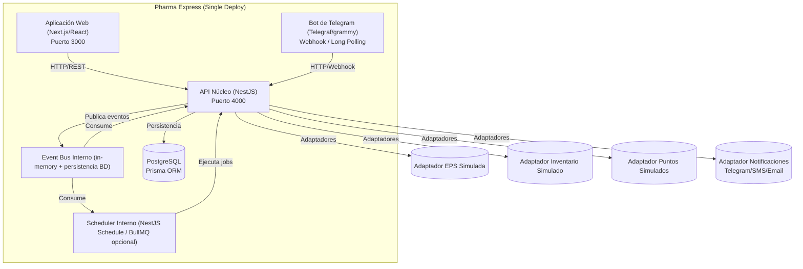
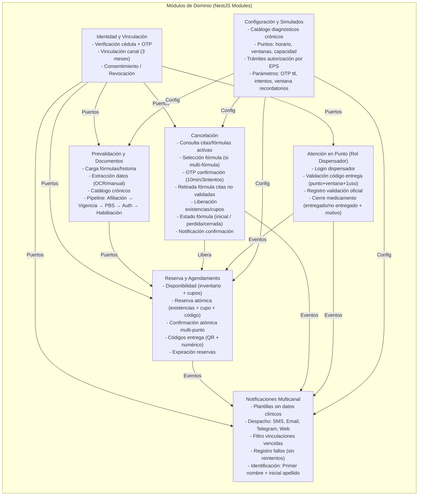

<!--
Agente: Architecture Agent
Proveedor: openrouter
Modelo: nvidia/nemotron-3-ultra-550b-a55b:free
Fecha: 2026-10-07 21:34
Petición: El equipo aprueba la ARQ-001
-->

# ARQ-001. Arquitectura de Pharma Express - Versión 0.1

Estado: Aprobada y congelada
Modo: Aprobación
Entradas:
- SPEC-001 versión 1.3: Cancelación de cita de entrega de medicamentos. Archivo: SPEC-001_v1.3_2.md.
- SPEC-003 versión 1.1: Envío multicanal de notificaciones con protección de datos clínicos. Archivo: SPEC-003_v1.1.md.
- Contexto: PHARMA_EXPRESS_AGENTES.md versión 1.

## Reporte de cobertura
| Sección del contexto | SPEC aprobada | SPEC no aprobada | Estado en la arquitectura |
|---|---|---|---|
| 3.1 Canales | ninguna | SPEC-002 (Borrador) | Módulo previsto, pendiente de SPEC |
| 3.2 Identidad y consentimiento | ninguna | SPEC-002 (Borrador) | Módulo previsto, pendiente de SPEC |
| 3.3 Vinculación de canales | SPEC-001 (RF-001, BR-002), SPEC-003 (RF-025) | SPEC-002 (Borrador) | Parcialmente detallada (cancelación y notificaciones) |
| 3.4 Documentos y prevalidación | ninguna | SPEC-002 (Borrador) | Módulo previsto, pendiente de SPEC |
| 3.5 Disponibilidad, reserva y agenda | SPEC-001 (cancelación) | SPEC-002 (Borrador) | Parcialmente detallada (solo cancelación) |
| 3.6 Notificaciones y recordatorios | SPEC-003 | ninguna | Detallada |
| 3.7 Atención en el punto | ninguna | ninguna | Módulo previsto, pendiente de SPEC |
| 3.8 Datos simulados y configuración | ninguna | ninguna | Módulo previsto, pendiente de SPEC |

SPEC faltantes propuestas:
- [Canales y acceso, contexto 3.1]: necesidad propuesta "Definir la especificación de la interfaz de usuario web y del bot de Telegram: navegación, vinculación, carga de documentos, consulta de citas y estados, sin incluir reglas de prevalidación ni agenda".
- [Identidad y consentimiento, contexto 3.2]: necesidad propuesta "Especificar el flujo de verificación de identidad (cédula + OTP por SMS/correo), aceptación de aviso de privacidad y autorización de datos de salud, revocación y eliminación de datos".
- [Documentos y prevalidación, contexto 3.4]: necesidad propuesta "Especificar la carga de fórmulas e historia clínica, extracción de datos, catálogo de diagnósticos crónicos, y el proceso de prevalidación paso a paso (afiliación, vigencia, cobertura PBS, autorización, habilitación de entrega)".
- [Disponibilidad, reserva y agenda, contexto 3.5]: necesidad propuesta "Especificar la verificación de disponibilidad, reserva atómica de existencias y cupos, reglas de agendamiento por tipo de tratamiento, confirmación atómica multi-punto, códigos de entrega y expiración de reservas".
- [Atención en el punto, contexto 3.7]: necesidad propuesta "Especificar la interfaz del dispensador: login por rol, validación de código de entrega, registro de validación oficial y cierre de medicamentos (entregado/no entregado con motivos)".
- [Datos simulados y configuración, contexto 3.8]: necesidad propuesta "Definir los contratos de datos y comportamiento de la EPS simulada, inventario simulado, puntos de dispensación simulados (horarios, ventanas, capacidad, inventario) y trámites de autorización por EPS".

## Contradicciones detectadas
Ninguna.

## Análisis de impacto
No aplica.

## Preguntas técnicas abiertas
- TQ-001. ¿Qué lenguajes, frameworks y bases de datos domina el equipo?
  Por qué importa: es criterio de la dimensión D4 y del riesgo de plazo; el contexto no lo dice.
  Crítica: sí
  Propuesta del agente: ninguna (depende del equipo)
  Estado: Pendiente
  Responsable: equipo

- TQ-002. ¿Cuál es el tiempo de respuesta objetivo para la confirmación atómica de una cita (reserva de existencias + cupo + generación de código) y para la validación de OTP de cancelación?
  Por qué importa: define el driver de rendimiento DRV-004 y afecta la decisión de comunicación síncrona vs asíncrona en D3.
  Crítica: sí
  Propuesta del agente: < 2 segundos para confirmación de cita; < 1 segundo para validación OTP (inferido, requiere confirmación)
  Estado: Pendiente
  Responsable: equipo

- TQ-003. ¿El equipo prefiere operar una cola de mensajes (RabbitMQ, Redis Streams, etc.) o prefiere evitar infraestructura adicional y usar tareas programadas en la aplicación?
  Por qué importa: afecta la dimensión D3 (comunicación y procesos en segundo plano) y la fiabilidad de recordatorios (DRV-003).
  Crítica: sí
  Propuesta del agente: tareas programadas en la aplicación (más simple para 4 personas, 8 semanas)
  Estado: Pendiente
  Responsable: equipo

- TQ-004. ¿Dónde se alojará el prototipo (servidor del equipo, nube gratuita, PaaS) y qué restricciones de red/firewall existen para los servicios reales (Telegram, proveedor SMS, SMTP)?
  Por qué importa: afecta D4 (alojamiento) y la integración con servicios externos reales.
  Crítica: sí
  Propuesta del agente: PaaS gratuito (Render, Railway, Fly.io) con base de datos gestionada
  Estado: Pendiente
  Responsable: equipo

- TQ-005. ¿Se requiere que la base de datos soporte transacciones distribuidas o es suficiente una base de datos relacional única para garantizar atomicidad en confirmación y cancelación?
  Por qué importa: afecta D1 (estructura) y la implementación de RNF-001 (SPEC-001).
  Crítica: sí
  Propuesta del agente: base de datos relacional única (PostgreSQL) con transacciones ACID locales
  Estado: Pendiente
  Responsable: equipo

- TQ-006. ¿El catálogo de diagnósticos crónicos (contexto 3.4) se mantiene en el sistema o se consulta a la EPS simulada?
  Por qué importa: define responsabilidad del componente de prevalidación y su acoplamiento.
  Crítica: no
  Propuesta del agente: catálogo configurable en el sistema (archivo o tabla), versionado
  Estado: Pendiente
  Responsable: equipo

## Architecture Package

### 1. Architecture Drivers
- DRV-001. Consistencia de reservas y cancelaciones. Dos personas no pueden comprometer la misma existencia ni el mismo cupo; las citas de una fórmula se confirman todas o ninguna; la cancelación libera existencias y cupos de forma atómica por cita no validada. Prioridad: alta, porque una sobre-reserva o una liberación parcial rompe el diferenciador del producto (prevalidación anticipada y reserva antes de cita). Origen: contexto 3.5, SPEC-001 RNF-001, DEC-005.
- DRV-002. Privacidad y protección de datos de salud. Ningún mensaje saliente (SMS, correo, Telegram, web) incluye nombres de medicamentos, diagnósticos, cédula completa o parcial; la identificación usa solo primer nombre e inicial del primer apellido. Prioridad: alta, por Ley 1581 de 2012, Decreto 1377 de 2013 y regla de oro del contexto 3.6. Origen: contexto 3.6, 3.11, SPEC-003 RNF-005, BR-014, DEC-009.
- DRV-003. Fiabilidad de notificaciones multicanal. Cada notificación debe intentarse por todos los canales activos (SMS, correo si existe, Telegram vinculados vigentes, web vinculados vigentes); un fallo en un canal no detiene los demás ni genera reintentos automáticos; las vinculaciones vencidas (>3 meses) se excluyen. Prioridad: alta, porque los recordatorios (1 hora antes, día anterior) son críticos para que el paciente no se desplace inútilmente. Origen: contexto 3.6, SPEC-003 RF-023, RF-025, RF-027, DEC-007, DEC-008.
- DRV-004. Rendimiento de confirmación y validación OTP. La confirmación atómica de cita (reserva + código) y la validación de OTP (identidad y cancelación) deben responder en tiempo acotado para evitar condiciones de carrera y frustración del usuario. Prioridad: media, porque el contexto no da cifras pero la experiencia de usuario en canales conversacionales lo exige; medida pendiente de TQ-002. Origen: inferido, requiere confirmación (TQ-002).
- DRV-005. Modificabilidad y bajo acoplamiento. El equipo de 4 personas en 8 semanas debe poder evolucionar módulos (prevalidación, agenda, notificaciones, punto) sin reescribir el núcleo; los simulados (EPS, inventario, puntos) deben ser intercambiables. Prioridad: media, por plazo y equipo (contexto 3.9) y porque áreas pendientes de SPEC se añadirán después. Origen: contexto 3.9, 3.8.
- DRV-006. Observabilidad y trazabilidad de eventos. Cada notificación, intento de envío, fallo, OTP generado/validado, reserva, cancelación y validación en punto debe quedar registrado para auditoría y depuración. Prioridad: media, por SPEC-003 RF-027, RF-026 y necesidad de depurar concurrencia (SPEC-001 CL-003, AC-010). Origen: SPEC-003, SPEC-001.
- DRV-007. Testabilidad de flujos críticos. Los flujos de confirmación atómica, cancelación con concurrencia (dispensador vs usuario), notificaciones multicanal y prevalidación deben ser verificables con pruebas de integración y contrato. Prioridad: media, por RNF-001 (SPEC-001) y criterios de aceptación AC-010, AC-011. Origen: SPEC-001, SPEC-003.
- DRV-008. Interoperabilidad con canales y simulados. El núcleo debe exponer API para Web y Telegram (mismo contrato), consumir EPS simulada, inventario simulado, puntos simulados, y usar proveedores reales de SMS, correo y Telegram Bot API. Prioridad: media, por contexto 3.1, 3.8, SPEC-003 dependencias. Origen: contexto 3.1, 3.8, SPEC-003.
- DRV-009. Disponibilidad del prototipo. El sistema debe estar operativo en horario de puntos de dispensación (aprox. 7:00-19:00) durante la validación; fuera de ese horario puede estar en mantenimiento. Prioridad: baja, por ser prototipo en entorno controlado. Origen: inferido, requiere confirmación (contexto 3.8, 3.9).
- DRV-010. Escalabilidad limitada. El prototipo sirve a Manizales (población objetivo: afiliados Salud Total y Sanitas con crónicos); no se requiere escalar a nivel nacional ni a miles de usuarios concurrentes. Prioridad: baja, por alcance del prototipo (contexto 2.1, 3.9). Origen: contexto 2.1, 3.9.

### 2. Restricciones
- Equipo de 4 personas, ~8 semanas. Origen: contexto 3.9.
- Sin acceso a sistemas reales de Disfarma; EPS, inventario, puntos y validación oficial son simulados. Origen: contexto 3.8, 3.9.
- Servicios externos reales: Telegram Bot API, proveedor SMS (ej. Twilio, Vonage), SMTP para correo. Origen: contexto 3.1, 3.2, 3.6, 3.8.
- Normativa: Ley 1581/2012, Decreto 1377/2013 (datos sensibles), Decreto Ley 019/2012 art. 120 y 131 (no trasladar trámites, obligación EPS 48h). Origen: contexto 3.11.
- Fuera de alcance: app móvil, WhatsApp, reprogramación, pendientes, vigilancia automática, integraciones reales, facturación, datos reales de pacientes. Origen: contexto 3.10.
- Decisiones aprobadas en SPEC-001 (DEC-001 a DEC-005) y SPEC-003 (DEC-007 a DEC-010). Origen: SPEC-001, SPEC-003.
- Vinculación de canales vence a 3 meses; SMS y correo no vencen. Origen: contexto 3.3.
- Código OTP (identidad y cancelación): 10 min, 3 intentos, SMS + correo concurrente. Origen: contexto 3.2, SPEC-001 DEC-003.
- Cita = ventana 1h + cupo + código entrega (QR + numérico); reserva atómica por solicitud; no sobre-reserva. Origen: contexto 3.5.
- Fórmula = todo o nada; agudas y crónicas agendan; crónicas solo día siguiente; agudas mismo día (+1h) o día siguiente. Origen: contexto 3.4, 3.5.

### 3. Atributos de calidad
- DRV-001. Estímulo: solicitud concurrente de confirmación de cita para la misma existencia/cupo. Entorno: operación normal, múltiples usuarios. Respuesta: el sistema serializa la reserva atómica (existencias + cupo + código) y rechaza la segunda con opciones actualizadas. Medida: cero sobre-reservas en pruebas de carga simulada (100 concurrentes sobre mismo medicamento/punto/ventana).
- DRV-002. Estímulo: generación de notificación con datos clínicos en plantilla. Entorno: cualquier evento del sistema. Respuesta: la plantilla valida ausencia de medicamentos/diagnósticos/cédula; el motor de notificaciones rechaza plantillas no conformes. Medida: 0 ocurrencias en pruebas de seguridad (SAST/DAST) y revisión manual de 100% plantillas.
- DRV-003. Estímulo: evento de recordatorio (1h antes o día anterior) para 500 pacientes. Entorno: proceso en segundo plano. Respuesta: el despachador encola/envía a todos los canales activos; fallos se registran y no bloquean otros canales. Medida: >99% notificaciones despachadas en <5 min; 0 canales bloqueados por fallo de otro.
- DRV-004. Estímulo: usuario envía OTP de cancelación. Entorno: hora pico, 50 validaciones/seg. Respuesta: validación de firma, vigencia, intentos y consumo atómico en <1s (pendiente TQ-002). Medida: p95 < 1s (pendiente TQ-002).
- DRV-005. Estímulo: nueva SPEC aprobada para prevalidación (SPEC-002). Entorno: arquitectura en uso. Respuesta: se añade módulo de prevalidación con puertos definidos sin modificar núcleo de agenda/notificaciones. Medida: tiempo de integración < 1 semana (inferido).
- DRV-006. Estímulo: incidente de notificaciones no entregadas. Entorno: post-mortem. Respuesta: registro de eventos permite reconstruir qué canales se intentaron, resultado, timestamp, paciente (pseudonimizado). Medida: 100% eventos trazables en <5 min.
- DRV-007. Estímulo: prueba de integración de cancelación concurrente (dispensador valida mientras usuario cancela). Entorno: pipeline CI. Respuesta: prueba ejecuta ambos flujos en paralelo y verifica estado final (AC-010). Medida: prueba pasa en CI en <2 min.
- DRV-008. Estímulo: cambio de proveedor SMS (Twilio → Vonage). Entorno: evolución. Respuesta: adaptador de notificaciones se reemplaza sin tocar lógica de dominio. Medida: cambio en <4 horas.
- DRV-009. Estímulo: caída de base de datos a las 14:00. Entorno: día de validación. Respuesta: recuperación en <30 min (RTO inferido) con RPO < 1 min (transacciones confirmadas). Medida: pendiente de TQ (no especificado en contexto).
- DRV-010. Estímulo: crecimiento a 5000 usuarios concurrentes. Entorno: no aplica (prototipo). Respuesta: no se diseña para ello. Medida: N/A.

### 4. Alternativas consideradas
#### D1. Estructura y despliegue
- A. Monolito modular (single deploy, módulos por frontera de negocio, BD compartida). Ventajas: simplicidad operativa (1 deploy, 1 BD), transacciones ACID locales para atomicidad (DRV-001), bajo acoplamiento interno por módulos, ideal para 4 personas/8 semanas (DRV-005), testable (DRV-007). Desventajas: escalabilidad vertical únicamente, fallo de un módulo puede tirar todo (mitigado por DRV-009 baja), despliegue acoplado.
- B. Monolito por capas (single deploy, capas técnico: controladores, servicios, repositorios). Ventajas: familiar, simple. Desventajas: acoplamiento por capas dificulta aislar dominios (prevalidación vs agenda vs notificaciones), transacciones cruzadas entre dominios más difíciles, menos preparada para añadir SPEC-002, SPEC-004+ sin refactor.
- C. Arquitectura orientada a servicios / microservicios (múltiples deploy, BD por servicio, comunicación async). Ventajas: aislamiento de fallos, escalabilidad independiente, equipos autónomos. Desventajas: complejidad operativa (4 personas no operan 5+ servicios), transacciones distribuidas para atomicidad (DRV-001) requieren saga/2PC, latencia de red, testing distribuido difícil (DRV-007), over-engineering para prototipo.

#### D2. Organización interna de los módulos
- A. Clean Architecture / Capas por dominio (Entidades, Casos de uso, Adaptadores, Frameworks). Ventajas: reglas de negocio puras en casos de uso (fácil test unitario DRV-007), adaptadores intercambiables para simulados/reales (DRV-005, DRV-008), independencia de framework/BD. Desventajas: más boilerplate inicial, curva de aprendizaje si el equipo no la conoce.
- B. Hexagonal / Puertos y adaptadores (núcleo + puertos + adaptadores primarios/secundarios). Ventajas: mismo aislamiento que Clean, énfasis en puertos explícitos para EPS/Inventario/Puntos/Canales (DRV-008), simetría entre drivers (Web, Telegram) y driven (EPS, SMS). Desventajas: similar a Clean; distinción sutil; puede duplicar conceptos si no se acuerda convención.
- C. Arquitectura en capas tradicional (Controlador → Servicio → Repositorio → BD). Ventajas: mínima abstracción, rápido de empezar. Desventajas: lógica de negocio se filtra en controladores/servicios, acoplamiento a BD y frameworks, difícil testear casos de uso aislados (DRV-007), cambiar simulado por real toca capas internas.

#### D3. Comunicación y procesos en segundo plano
- A. Llamadas síncronas (HTTP/gRPC) entre módulos + tareas programadas (cron/quartz) en la misma app para recordatorios y despacho de notificaciones. Ventajas: cero infraestructura extra (DRV-005, TQ-003), simple de depurar, transacciones locales fáciles. Desventajas: si la app se cae, recordatorios pendientes se pierden (mitigado: re-ejecutar al arrancar consultando BD), el despacho multicanal bloquea hilo si es lento (mitigado: pool de hilos / async local).
- B. Cola de mensajes externa (RabbitMQ, Redis Streams, Kafka) + workers separados. Ventajas: desacoplamiento temporal, reintentos nativos, persistencia de mensajes, workers escalables. Desventajas: infraestructura extra (TQ-003), complejidad operativa, transacciones distribuidas para atomicidad (outbox pattern), overkill para prototipo.
- C. Eventos internos (in-process event bus) + tareas programadas. Ventajas: desacoplamiento lógico dentro del monolito, sin infra externa, fácil test (inyectar bus falso), soporta DRV-006 (eventos de dominio). Desventajas: si el proceso muere, eventos en memoria se pierden (mitigado: persistir eventos de dominio en BD antes de publicar).

#### D4. Tecnología (lenguaje, framework, BD, alojamiento)
- A. TypeScript + NestJS + PostgreSQL + Prisma ORM + Render/Railway (PaaS). Ventajas: un lenguaje full-stack (Web + Bot + Backend), tipado estático, NestJS trae DI, módulos, guards, pipes, scheduling, OpenAPI; Prisma migraciones type-safe; PaaS gestiona BD, SSL, deploy git-push. Desventajas: Node.js single-thread (mitigado: cluster mode o worker_threads para tareas pesadas), cold starts en PaaS gratuito.
- B. Python + FastAPI + PostgreSQL + SQLAlchemy/Alembic + Fly.io. Ventajas: FastAPI rápido, tipado, OpenAPI automático; Python rico en librerías datos/IA si luego se añade OCR fórmulas; Fly.io VMs persistentes, buena free tier. Desventajas: dos lenguajes si frontend Web es React/TS (equipo debe saber ambos), async requiere cuidado, scheduling menos integrado que NestJS.
- C. Java/Kotlin + Spring Boot + PostgreSQL + JPA/Hibernate + AWS/GCP. Ventajas: robustez, transacciones maduras, ecosistema enterprise. Desventajas: verbosidad, arranque lento, curva mayor, PaaS gratuito limitado, overkill para 4 personas/8 semanas.
- D. Go + Chi/Fiber + PostgreSQL + sqlc + Fly.io. Ventajas: rendimiento, concurrencia nativa, binario único, deploy simple. Desventajas: menos batteries-included (auth, scheduling, validación, OpenAPI manual), equipo debe dominar Go.

### 5. Matriz de decisión
#### D1. Estructura y despliegue
| Criterio (driver) | Peso | A. Monolito modular | B. Monolito por capas | C. Microservicios |
|---|---|---|---|---|
| Consistencia atómica (DRV-001) | 3 | 5: transacción ACID local única | 4: transacción local pero acoplamiento capa-servicio dificulta aislar invariantes | 2: requiere saga/outbox, complejidad alta |
| Modificabilidad (DRV-005) | 3 | 5: módulos por frontera, listos para SPEC nuevas | 2: capas técnicas no alineadas a dominios | 4: aislamiento pero overhead de contratos |
| Tiempo / plazo 8 sem (contexto 3.9) | 3 | 5: 1 deploy, 1 BD, 1 repo, CI simple | 4: similar pero deuda técnica futura | 1: 5+ pipelines, infra, contratos, testing distribuido |
| Testabilidad (DRV-007) | 2 | 4: módulos testeables en aislamiento + integración | 3: servicios acoplados a BD/framework | 2: test de contrato + integración complejos |
| Observabilidad (DRV-006) | 2 | 4: logs/traces centralizados en 1 app | 4: igual | 3: tracing distribuido necesario |
| Riesgo técnico (equipo 4 pers) | 2 | 5: conocido, bajo riesgo | 4: conocido | 1: alto riesgo operacional |
| Total ponderado | | **71** | **53** | **31** |

Pesos y puntajes: propuesta del agente, pendiente de validación del equipo (TQ-001, TQ-003, TQ-005).

#### D2. Organización interna de los módulos
| Criterio (driver) | Peso | A. Clean Architecture | B. Hexagonal | C. Capas tradicional |
|---|---|---|---|---|
| Modificabilidad (DRV-005) | 3 | 5: casos de uso puros, adaptadores intercambiables | 5: puertos explícitos para cada simulado/real | 2: lógica acoplada a framework/BD |
| Testabilidad (DRV-007) | 3 | 5: casos de uso unit-testables sin BD | 5: igual | 2: requiere BD o mocks profundos |
| Interoperabilidad simulados (DRV-008) | 2 | 4: adaptadores driven por puerto | 5: puertos driven simétricos | 2: repositorios acoplados a ORM |
| Curva de aprendizaje / tiempo | 3 | 3: boilerplate inicial, pero estándar NestJS | 3: similar | 5: mínimo, pero deuda técnica |
| Total ponderado | | **59** | **61** | **33** |

Pesos y puntajes: propuesta del agente, pendiente de validación del equipo (TQ-001).

#### D3. Comunicación y procesos en segundo plano
| Criterio (driver) | Peso | A. Síncrono + tareas programadas (cron) | B. Cola externa + workers | C. Eventos internos + tareas programadas |
|---|---|---|---|---|
| Fiabilidad recordatorios (DRV-003) | 3 | 3: si app cae, cron no corre; mitigación: catch-up al arranque | 5: cola persiste mensajes, workers independientes | 4: eventos persistidos en BD, catch-up al arranque |
| Tiempo / plazo (contexto 3.9) | 3 | 5: cero infra extra | 1: instalar/operar RabbitMQ/Redis | 4: solo librería interna |
| Testabilidad (DRV-007) | 2 | 3: mock de scheduler | 2: testcontainers cola | 5: bus en memoria inyectable |
| Observabilidad (DRV-006) | 2 | 3: logs en app | 4: logs cola + workers | 4: eventos de dominio persistidos |
| Riesgo técnico | 2 | 4: bajo | 1: alto (infra nueva) | 4: bajo |
| Total ponderado | | **53** | **31** | **59** |

Pesos y puntajes: propuesta del agente, pendiente de validación del equipo (TQ-003).

#### D4. Tecnología
| Criterio (driver) | Peso | A. TS/NestJS/PostgreSQL/Prisma/PaaS | B. Python/FastAPI/PostgreSQL/SQLAlchemy/Fly.io | C. Java/Spring/PostgreSQL/JPA/AWS | D. Go/Chi/PostgreSQL/sqlc/Fly.io |
|---|---|---|---|---|---|
| Tiempo / plazo 8 sem (contexto 3.9) | 3 | 5: batteries-included, 1 lang full-stack | 4: 2 langs si Web=React, scheduling manual | 2: verbosidad, setup pesado | 3: productivo pero menos batteries |
| Modificabilidad (DRV-005) | 3 | 5: módulos NestJS alineados a dominios | 4: routers FastAPI, DI manual | 4: Spring modules | 3: manual |
| Testabilidad (DRV-007) | 2 | 5: TestingModule, in-memory DB, mocks fáciles | 4: TestClient, dependency override | 4: @SpringBootTest | 3: httptest, mocks manuales |
| Interoperabilidad (DRV-008) | 2 | 5: HttpModule, clients tipados, Telegram libs maduras | 4: httpx, python-telegram-bot | 4: WebClient, libs | 3: net/http, libs básicas |
| Conocimiento del equipo (TQ-001) | 3 | ? | ? | ? | ? |
| Alojamiento PaaS gratuito (TQ-004) | 2 | 5: Render/Railway/Fly.io soporte nativo | 4: Fly.io bueno | 1: free tier limitado | 4: Fly.io bueno |
| Total ponderado (sin TQ-001) | | **58** | **50** | **33** | **41** |

Pesos y puntajes: propuesta del agente, pendiente de validación del equipo (TQ-001, TQ-004). La fila "Conocimiento del equipo" es crítica y define el ganador.

### 6. Arquitectura recomendada
**Recomendación del agente (no decisión del equipo):**
- **D1: Monolito modular** (A). Es la única que garantiza atomicidad simple (DRV-001), cabe en 8 semanas/4 personas (DRV-005), y permite añadir SPEC-002, SPEC-004+ como módulos nuevos sin reescribir. Compromiso: escalabilidad vertical y punto único de fallo (aceptable por DRV-009, DRV-010 baja).
- **D2: Hexagonal / Puertos y adaptadores** (B). Ligeramente mejor que Clean para DRV-008 (puertos driven simétricos para EPS/Inventario/Puntos/Canales) y igual en testabilidad/modificabilidad. Compromiso: convención de puertos/adaptadores debe acordarse al inicio.
- **D3: Eventos internos persistidos + tareas programadas** (C). Da fiabilidad de recordatorios (DRV-003) persistiendo eventos de dominio en BD antes de publicar, sin infra externa (TQ-003), y testabilidad máxima (bus en memoria). Compromiso: si el proceso muere entre persistir evento y publicarlo, el catch-up al arranque lo resuelve.
- **D4: TypeScript + NestJS + PostgreSQL + Prisma + PaaS (Render/Railway/Fly.io)** (A). *Condicionado a TQ-001 y TQ-004*. Un lenguaje full-stack (Web React/Next.js + Bot + Backend), módulos NestJS mapean 1:1 a módulos de dominio, Prisma da migraciones type-safe y cliente tipado, PaaS elimina ops. Compromiso: Node.js single-thread; para tareas pesadas (OCR futuro, despacho masivo) se usarán worker_threads o cola interna con BullMQ (Redis) solo si TQ-003 lo valida.

**Qué compromisos acepta:** No hay alta disponibilidad automática (reinicio manual si cae), no hay escalabilidad horizontal (no se necesita), no hay transacciones distribuidas (BD única), no hay reintentos automáticos de notificaciones (por DEC-007), no hay OCR/IA (fuera de alcance).

### 7. Diagramas
#### Nivel 1 C4: contexto
```mermaid
flowchart LR
  subgraph Usuarios["Actores"]
    Paciente["Paciente / Cuidador / Facilitador"]
    Dispensador["Dispensador (rol)"]
  end

  subgraph Sistema["Pharma Express (Monolito Modular)"]
    direction TB
    API["API HTTP / Webhooks\n(Web + Bot Telegram)"]
    Nucleo["Núcleo de Dominio\n(Prevalidación, Agenda, Cancelación, Notificaciones, Punto)"]
    Eventos["Bus de Eventos Interno + Tareas Programadas"]
  end

  subgraph ExternosReales["Servicios Externos Reales"]
    Telegram["Telegram Bot API"]
    SMS["Proveedor SMS (Twilio/Vonage)"]
    Email["SMTP (Correo)"]
  end

  subgraph ExternosSimulados["Sistemas Simulados"]
    EPS["EPS Simulada\n(Afiliación, Vigencia, Autorizaciones, Contactos)"]
    Inv["Inventario Simulado\n(Existencias por punto/medicamento)"]
    Puntos["Puntos de Dispensación Simulados\n(Horarios, Ventanas, Capacidad)"]
    ValOf["Validación Oficial Simulada\n(Registro en ventanilla)"]
  end

  Paciente -->|HTTPS / Telegram| API
  Dispensador -->|HTTPS (rol dispensador)| API
  API --> Nucleo
  Nucleo --> Eventos
  Eventos -->|Recordatorios, Notificaciones| Nucleo
  Nucleo -->|Consulta afiliación, vigencia, auth, contactos| EPS
  Nucleo -->|Consulta/Reserva existencias| Inv
  Nucleo -->|Consulta puntos, ventanas, cupos| Puntos
  Nucleo -->|Registra validación oficial| ValOf
  Nucleo -->|Envía notificaciones| Telegram
  Nucleo -->|Envía SMS| SMS
  Nucleo -->|Envía correo| Email
```

#### Nivel 2 C4: contenedores


#### Nivel 3 C4: componentes (módulos de dominio)


### 8. Componentes y responsabilidades
- COMP-001. **Identidad y Vinculación**. Responsabilidad: verificar identidad (cédula + OTP SMS/Email), gestionar vinculación de canales (Web/Telegram) con expiración 3 meses, registrar consentimiento y revocación. No le corresponde: prevalidación, agenda, notificaciones de negocio. Atiende: DRV-002, DRV-008, contexto 3.2, 3.3, SPEC-001 RF-004, BR-006. Depende de: Adaptador EPS Simulada (contactos), Adaptador Notificaciones (envío OTP). Estado: Módulo previsto, pendiente de SPEC (parcialmente cubierto por SPEC-001 RF-004, SPEC-003 RF-025).

- COMP-002. **Prevalidación y Documentos**. Responsabilidad: recibir documentos (foto/PDF), extraer datos, ejecutar pipeline de prevalidación (afiliación, vigencia, cobertura PBS, autorización, habilitación crónica), devolver resultado preliminar por fórmula (todo o nada). No le corresponde: reserva, agenda, notificaciones, atención en punto. Atiende: DRV-001, DRV-005, DRV-008, contexto 3.4. Depende de: Adaptador EPS Simulada, Adaptador Inventario Simulado (para disponibilidad posterior), COMP-001 (paciente verificado). Estado: Módulo previsto, pendiente de SPEC (SPEC-002 en borrador).

- COMP-003. **Reserva y Agendamiento**. Responsabilidad: consultar disponibilidad (inventario + cupos por ventana), reservar atómicamente existencias y cupo, generar código de entrega (QR + numérico), confirmar cita(s) atómicamente por solicitud (multi-punto), gestionar expiración de reservas (fin de ventana). No le corresponde: prevalidación, cancelación (la invoca), notificaciones, atención en punto. Atiende: DRV-001, DRV-004, DRV-005, DRV-008, contexto 3.5, SPEC-001 (liberación en cancelación). Depende de: Adaptador Inventario Simulado, Adaptador Puntos Simulados, COMP-002 (fórmulas aptas), Event Bus (eventos ReservaConfirmada, ReservaExpirada). Estado: Módulo previsto, pendiente de SPEC (parcial: SPEC-001 libera en cancelación).

- COMP-004. **Cancelación**. Responsabilidad: consultar citas/fórmulas activas, exigir selección de fórmula si cita multi-fórmula, generar/validar OTP confirmación (10min/3intentos), retirar fórmula de citas no validadas ni expiradas, liberar existencias y cupos, cancelar cita si queda vacía (inactivar código, liberar cupo), mantener cita si tiene otras fórmulas (mismo código/cupo), gestionar estado fórmula (inicial si sin entregas, perdida/cerrada si entrega parcial), emitir evento CancelacionConfirmada. No le corresponde: prevalidación, reserva, notificaciones (emite evento), atención en punto. Atiende: DRV-001, DRV-002, DRV-003, DRV-004, DRV-006, DRV-007, SPEC-001 completa (RF-001 a RF-012, BR-001 a BR-008, flujos, AC). Depende de: COMP-001 (vinculación + OTP), COMP-003 (liberación), Adaptador Puntos Simulados (estado cita), Event Bus, Adaptador Notificaciones (vía evento). Estado: Detallado.

- COMP-005. **Notificaciones Multicanal**. Responsabilidad: recibir eventos de dominio, renderizar plantillas sin datos clínicos (solo primer nombre + inicial apellido), despachar a todos los canales activos (SMS, Email si existe, Telegram vinculados vigentes, Web vinculados vigentes), excluir vinculaciones >3 meses, registrar resultado/fallo por canal sin reintentos (DEC-007), omitir email si no registrado (DEC-008). No le corresponde: generar eventos de negocio, decidir contenido de negocio, validar OTP. Atiende: DRV-002, DRV-003, DRV-006, DRV-008, SPEC-003 completa (RF-023 a RF-028, BR-014 a BR-017, AC-019 a AC-024). Depende de: Adaptador Notificaciones (Telegram/SMS/Email/WebPush), COMP-001 (vinculaciones vigentes), EPS Simulada (contactos), Event Bus. Estado: Detallado.

- COMP-006. **Atención en Punto**. Responsabilidad: autenticar dispensador (rol), validar código de entrega (punto correcto, ventana activa, 1 solo uso), mostrar prevalidación, registrar validación oficial, cerrar medicamento (entregado/no entregado + motivo), emitir evento ValidacionOficialRegistrada. No le corresponde: prevalidación, reserva, cancelación, notificaciones (emite evento). Atiende: DRV-001, DRV-006, DRV-007, contexto 3.7, SPEC-001 (CL-003, AC-010, E2). Depende de: Adaptador Puntos Simulados, Adaptador Validación Oficial Simulada, Event Bus. Estado: Módulo previsto, pendiente de SPEC.

- COMP-007. **Configuración y Simulados**. Responsabilidad: proveer catálogo de diagnósticos crónicos (configurable), datos de puntos (horario, ventanas, capacidad, inventario inicial), trámites de autorización por EPS, parámetros globales (OTP TTL, intentos, horarios recordatorios). No le corresponde: lógica de negocio. Atiende: DRV-005, DRV-008, contexto 3.8. Depende de: BD (tablas config), archivos semilla. Estado: Módulo previsto, pendiente de SPEC.

### 9. Integraciones
- **EPS Simulada** (simulada). Dirección: Salida (consulta afiliación, vigencia, autorizaciones, contactos, habilitación crónica). Datos: cédula → {activo, fórmulas[vigencia, medicamentos[coberturaPBS, autorizado]], habilitaciónEntrega, celular, correo, nombres}. Ante fallos: reintento 2x con backoff 1s; si persiste, error al usuario "servicio temporalmente no disponible, intente en unos minutos". Componente: COMP-002, COMP-001.
- **Inventario Simulado** (simulada). Dirección: Salida (consulta existencias, reserva/libera). Datos: {punto, medicamento, cantidad} → existencias; reserva: {punto, medicamento, cantidad, citaId} → ok/fallo; libera: {reservaId} → ok. Ante fallos: transacción BD local revierte reserva; error al usuario "no se pudo verificar disponibilidad". Componente: COMP-003, COMP-004.
- **Puntos de Dispensación Simulados** (simulada). Dirección: Salida (consulta puntos, ventanas, cupos; actualiza cupo en reserva/cancelación). Datos: punto → {horario, ventanas[capacidad, cupoDisponible]}; reserva consume cupo; cancelación libera cupo. Ante fallos: igual que inventario (transacción local). Componente: COMP-003, COMP-004, COMP-006.
- **Validación Oficial Simulada** (simulada). Dirección: Entrada (registro de validación por dispensador). Datos: {codigoEntrega, dispensadorId, timestamp} → {valido, medicamentos[entregado/noEntregado+motivo]}. Ante fallos: reintento 1x; si falla, dispensador reintenta manualmente. Componente: COMP-006.
- **Telegram Bot API** (real). Dirección: Salida (envío mensajes notificaciones, OTP identidad, webhook entrada bot). Datos: chatId, texto (sin datos clínicos). Ante fallos: registrar fallo (RF-027), continuar otros canales. Componente: COMP-001 (OTP), COMP-005, BotTelegram (contenedor).
- **Proveedor SMS** (real). Dirección: Salida (envío OTP identidad, OTP cancelación, notificaciones). Datos: celular, texto (sin datos clínicos). Ante fallos: registrar fallo, continuar otros canales. Componente: COMP-001, COMP-005.
- **SMTP / Correo** (real). Dirección: Salida (envío OTP identidad, OTP cancelación, notificaciones). Datos: correo, texto (sin datos clínicos). Ante fallos: registrar fallo, continuar otros canales; si no hay correo registrado, omitir (DEC-008). Componente: COMP-001, COMP-005.
- **Navegador Web (Web Push / SSE / Polling)** (real). Dirección: Salida (notificaciones web a navegadores vinculados). Datos: subscriptionId, payload (sin datos clínicos). Ante fallos: registrar fallo, continuar; si push falla, caer a polling en próxima carga. Componente: COMP-005, WebApp.

### 10. ADR
#### ADR-001. Estructura de despliegue: Monolito modular
- Estado: Aceptado
- Contexto: El sistema debe garantizar atomicidad en reserva/cancelación (DRV-001), ser desarrollado por 4 personas en 8 semanas (contexto 3.9), y permitir añadir módulos (prevalidación, punto, config) tras SPEC aprobadas (DRV-005).
- Problema: Elegir estilo arquitectónico que balancee consistencia, velocidad de desarrollo y evolvibilidad.
- Alternativas: A. Monolito modular (módulos por dominio, BD compartida, 1 deploy). B. Monolito por capas (capas técnicas). C. Microservicios (múltiples deploys, BD por servicio).
- Decisión: Monolito modular (A).
- Justificación: Matriz D1 (71 vs 53 vs 31). Transacciones ACID locales resuelven atomicidad (DRV-001) sin saga. Módulos NestJS alineados a fronteras de negocio (Identidad, Prevalidación, Agenda, Cancelación, Notificaciones, Punto, Config) permiten añadir SPEC-002+ sin refactor mayor. Un solo pipeline, una BD, operaciones simples.
- Consecuencias positivas: Desarrollo y despliegue simples; consistencia fuerte; testabilidad alta; bajo riesgo operativo.
- Consecuencias negativas: Punto único de fallo (mitigado: DRV-009 baja, prototipo); escalabilidad vertical only (mitigado: DRV-010 baja); acoplamiento de despliegue (aceptable para prototipo).
- Supuestos: El equipo acepta Node.js/TypeScript (TQ-001); BD única soporta carga (TQ-005).
- Evidencia: DRV-001, DRV-005, DRV-009, DRV-010, contexto 3.9, matriz D1.

#### ADR-002. Organización interna: Hexagonal (Puertos y Adaptadores)
- Estado: Aceptado
- Contexto: Los módulos de dominio deben ser testeables en aislamiento (DRV-007), desacoplados de simulados/reales (DRV-008, DRV-005), y las fronteras (Web, Telegram, EPS, Inventario, Puntos, Notificaciones) son puertos naturales.
- Problema: Cómo organizar el código dentro de cada módulo para aislar reglas de negocio de infraestructura.
- Alternativas: A. Clean Architecture (Entidades, Casos de uso, Adaptadores, Frameworks). B. Hexagonal (Núcleo + Puertos primarios/secundarios + Adaptadores). C. Capas tradicional (Controlador → Servicio → Repositorio).
- Decisión: Hexagonal (B).
- Justificación: Matriz D2 (61 vs 59 vs 33). Puertos driven explícitos para cada simulado (EPS, Inventario, Puntos, Validación) y real (Telegram, SMS, Email) facilitan intercambiarlos y testear con dobles. Puertos primarios (API HTTP, Webhook Telegram, CLI Scheduler) simétricos. NestJS provee DI nativa para vincular puertos a adaptadores.
- Consecuencias positivas: Reglas de negocio puras en núcleo; adaptadores intercambiables; tests unitarios rápidos sin BD; alineado con D1 modular.
- Consecuencias negativas: Boilerplate inicial (puertos, DTOs, mappers); convención de nombres y estructura debe documentarse y revisarse en PR.
- Supuestos: Equipo acepta convención hexagonal (TQ-001); NestJS modules mapean a módulos de dominio.
- Evidencia: DRV-005, DRV-007, DRV-008, matriz D2.

#### ADR-003. Comunicación y procesos en segundo plano: Eventos internos persistidos + Tareas programadas
- Estado: Aceptado
- Contexto: Recordatorios (1h antes, día anterior) y despacho multicanal deben ser fiables (DRV-003), sin infraestructura extra (contexto 3.9, TQ-003), y trazables (DRV-006).
- Problema: Cómo ejecutar trabajo en background (recordatorios, notificaciones) sin cola externa.
- Alternativas: A. Síncrono + cron simple (setInterval/cron). B. Cola externa (RabbitMQ/Redis Streams) + workers. C. Eventos de dominio persistidos en BD + bus en memoria + tareas programadas que leen BD (catch-up al arranque).
- Decisión: Eventos internos persistidos + tareas programadas (C).
- Justificación: Matriz D3 (59 vs 31 vs 53). Persistir eventos de dominio (ReservaConfirmada, RecordatorioProgramado, CancelacionConfirmada, ValidacionOficialRegistrada) en tabla `domain_events` antes de publicar en bus en memoria garantiza que no se pierden si el proceso muere. Scheduler (NestJS Schedule o BullMQ si TQ-003 lo valida) consulta BD cada minuto para recordatorios vencidos y notificaciones pendientes. Cero infra extra; testable con bus en memoria; trazabilidad nativa (DRV-006).
- Consecuencias positivas: Fiabilidad sin cola externa; catch-up automático al reiniciar; eventos son fuente de verdad para auditoría; simple de operar.
- Consecuencias negativas: Latencia de hasta 1 min (polling scheduler); si el scheduler falla, los recordatorios se retrasan (mitigado: health check + alerta simple); no hay reintentos automáticos de notificaciones (por DEC-007, es requisito).
- Supuestos: La BD es confiable y no se cae (TQ-005); el scheduler corre en la misma instancia (single deploy).
- Evidencia: DRV-003, DRV-006, contexto 3.9, SPEC-003 DEC-007, matriz D3, TQ-003.

#### ADR-004. Stack tecnológico: TypeScript + NestJS + PostgreSQL + Prisma + PaaS
- Estado: Aceptado
- Contexto: Un lenguaje full-stack (Web + Bot + Backend), productividad en 8 semanas, tipado estático, migraciones seguras, deploy gestionado.
- Problema: Elegir lenguaje, framework, ORM, BD y alojamiento.
- Alternativas: A. TS/NestJS/PostgreSQL/Prisma/PaaS. B. Python/FastAPI/PostgreSQL/SQLAlchemy/Fly.io. C. Java/Spring/PostgreSQL/JPA/AWS. D. Go/Chi/PostgreSQL/sqlc/Fly.io.
- Decisión: TypeScript + NestJS + PostgreSQL + Prisma + PaaS (Render/Railway/Fly.io) (A). *Condicionado a TQ-001 y TQ-004.*
- Justificación: Matriz D4 (58 vs 50 vs 33 vs 41 sin fila conocimiento). NestJS modules = módulos de dominio (D1/D2); DI nativa para puertos/adaptadores (ADR-002); ScheduleModule + BullMQ opcional para scheduler (ADR-003); Prisma type-safe + migraciones; OpenAPI automático; librerías maduras para Telegram (grammy/telegraf), SMS, Email; PaaS gestiona BD, SSL, deploy, logs. Un lenguaje para Web (Next.js), Bot y Backend reduce contexto mental.
- Consecuencias positivas: Velocidad de desarrollo; tipado extremo a extremo; ecosistema maduro; ops cero.
- Consecuencias negativas: Node.js single-thread (mitigado: worker_threads para OCR futuro, BullMQ/Redis si TQ-003 valida cola); cold starts en tier gratuito (mitigado: plan hobby pago ~$7/mes o self-host en VPS del equipo).
- Supuestos: Equipo domina TypeScript y React (TQ-001); PaaS elegido permite WebSockets/long-polling para Telegram webhook (TQ-004).
- Evidencia: DRV-005, DRV-007, DRV-008, contexto 3.9, matriz D4, TQ-001, TQ-004.

#### ADR-005. Gestión de identidad y OTP: Código único por operación, almacenado en BD con hash, TTL 10 min, 3 intentos
- Estado: Aceptado
- Contexto: SPEC-001 (cancelación) y contexto 3.2 (identidad) requieren OTP con mismas reglas: 10 min, 3 intentos, SMS+Email concurrente, expiración invalida operación.
- Problema: Cómo implementar OTP de forma segura y consistente para identidad y cancelación.
- Alternativas: A. OTP en BD (tabla `otp_codes`: hash, propósito[identidad|cancelación], pacienteId, intentos, expiraEn, consumidoEn). B. OTP en Redis (TTL nativo) + BD solo para auditoría. C. JWT firmado con claims (sin BD/Redis).
- Decisión: OTP en BD (A).
- Justificación: Consistencia con transacciones locales (misma BD que reservas/citas); auditoría nativa (DRV-006); sin dependencia de Redis (simplifica infra); 10 min TTL y 3 intentos se validan en transacción atómica al consumir. Hash con bcrypt/argon2. Limpieza periódica de OTP expirados (job diario).
- Consecuencias positivas: Atomicidad con otras operaciones (ej. cancelación consume OTP y libera reservas en misma transacción); simple; trazable.
- Consecuencias negativas: Ligeramente más lento que Redis (ms); tabla crece (mitigado: job limpieza diario).
- Supuestos: BD única (ADR-001, TQ-005); proveedor SMS/Email entrega en <10s (real).
- Evidencia: Contexto 3.2, SPEC-001 DEC-003, BR-006, RF-004, DRV-002, DRV-004, DRV-006.

#### ADR-006. Notificaciones: Plantillas tipadas sin datos clínicos, despacho fan-out con registro de fallos
- Estado: Aceptado
- Contexto: SPEC-003 exige multicanal, exclusión estricta de medicamentos/diagnósticos/cédula, identificación "María G.", fallos no bloqueantes sin reintentos.
- Problema: Cómo estructurar el módulo de notificaciones para garantizar privacidad por construcción y fiabilidad multicanal.
- Alternativas: A. Plantillas TypeScript tipadas (funciones que reciben DTO sin campos clínicos) + despacho en paralelo con `Promise.allSettled` + registro por canal. B. Motor de plantillas externo (Handlebars/MJML) + cola de notificaciones. C. Servicio externo (SendGrid, Twilio Notify) con plantillas allí.
- Decisión: Plantillas TypeScript tipadas + despacho fan-out en proceso + registro de fallos (A).
- Justificación: Privacidad por construcción: el DTO de notificación *no tiene* campos de medicamentos/diagnósticos/cédula; TypeScript impide pasarlos. Fan-out `Promise.allSettled` envía a todos los canales simultáneamente, registra éxito/fallo por canal, no reintenta (DEC-007). Cero infra extra. Fácil test: verificar que plantilla no accede a campos prohibidos.
- Consecuencias positivas: Garantía estática de privacidad (DRV-002); simple; testeable; cumple DEC-007, DEC-008, DEC-009.
- Consecuencias negativas: Cambio de plantilla = deploy (aceptable para prototipo); si un canal es lento, bloquea el fan-out (mitigado: timeout por canal 5s, `Promise.allSettled` no espera fallos).
- Supuestos: Los DTO de eventos de dominio no incluyen datos clínicos (diseño de eventos); proveedores SMS/Email/Telegram responden en <5s.
- Evidencia: SPEC-003 RF-023 a RF-028, BR-014 a BR-017, RNF-005, DEC-007, DEC-008, DEC-009, DRV-002, DRV-003, DRV-006.

#### ADR-007. Reserva atómica: Transacción BD única (existencias + cupo + código + cita)
- Estado: Aceptado
- Contexto: Contexto 3.5 y SPEC-001 exigen cero sobre-reservas, confirmación atómica multi-punto, código de entrega ligado a cita.
- Problema: Cómo garantizar que reserva de existencias, cupo de ventana y generación de código ocurran todo o nada.
- Alternativas: A. Transacción BD local (PostgreSQL) con `SELECT ... FOR UPDATE` en filas de inventario y ventana, luego insert reserva/cita/código. B. Saga coreografiada (eventos compensatorios). C. Lock distribuido (Redis) + transacción local.
- Decisión: Transacción BD local con bloqueo pesimista (A).
- Justificación: Monolito modular + BD única (ADR-001, TQ-005) hace que transacción ACID local sea la forma más simple y correcta. `FOR UPDATE` en `inventory_items` y `window_slots` serializa concurrentes. Código de entrega (UUID + hash) se genera dentro de la transacción. Multi-punto: una transacción por punto, pero la confirmación de la solicitud es "todas o ninguna" → se intentan en orden, si una falla se revierten las anteriores (compensación en misma transacción si mismo punto, o transacciones separadas con rollback manual). Dado que es prototipo y carga baja, transacción única extendida a todos los puntos es aceptable (máx 3-4 puntos por solicitud).
- Consecuencias positivas: Consistencia fuerte (DRV-001); simple; sin saga/outbox.
- Consecuencias negativas: Transacción más larga (múltiples puntos); bloqueos en tablas calientes (mitigado: índices, filas pocas, carga baja prototipo).
- Supuestos: BD única (TQ-005); carga concurrente manejable (DRV-010 baja).
- Evidencia: Contexto 3.5, SPEC-001 RNF-001, DEC-005, DRV-001, ADR-001, TQ-005.

### 11. Decisiones de diseño
- **Módulo Identidad (COMP-001)**: Usar *Value Object* `Cedula` (validación formato colombiano) y `OTPCode` (hash, propósito, intentos). Puerto primario `IdentityVerificationPort` (métodos `requestOTP`, `verifyOTP`). Adaptador `SmsEmailOTPAdapter` implementa envío concurrente.
- **Módulo Prevalidación (COMP-002)**: Pipeline de pasos (`AfiliationCheck`, `VigenciaCheck`, `PBSCoverageCheck`, `AuthorizationCheck`, `ChronicEnablementCheck`) como *Chain of Responsibility* o lista de casos de uso. Cada paso devuelve `Result<FormulaPrevalidation>`. Puerto driven `EPSSimuladaPort`, `InventorySimuladoPort` (solo lectura disponibilidad).
- **Módulo Agenda (COMP-003)**: Agregado `Cita` (ventana, punto, código, estado, medicamentosReservados). Agregado `Reserva` (existencias, cupo). Puerto driven `InventoryPort`, `PuntosPort`. Evento de dominio `ReservaConfirmada` publicado en transacción (outbox pattern en misma BD: tabla `domain_events`).
- **Módulo Cancelación (COMP-004)**: Caso de uso `CancelarFormula` recibe `formulaId`, `pacienteId`, `otpCode`. Valida OTP (puerto `IdentityVerificationPort`), carga citas de la fórmula, filtra no validadas/no expiradas, por cada cita: retira medicamentos, si cita vacía → cancela (inactiva código, libera cupo), sino mantiene. Emite `CancelacionConfirmada` con detalle de citas afectadas.
- **Módulo Notificaciones (COMP-005)**: Suscriptor de eventos de dominio. Factoría de `NotificationDTO` por tipo de evento (solo campos permitidos). `NotificationDispatcher` itera canales activos, invoca adaptadores (`TelegramAdapter`, `SmsAdapter`, `EmailAdapter`, `WebPushAdapter`), registra `NotificationLog` (eventoId, canal, destino, estado, error, timestamp).
- **Módulo Punto (COMP-006)**: Caso de uso `ValidarEntrega(codigoEntrega, dispensadorId)`. Valida código (punto, ventana, no usado), registra `ValidacionOficial`, cierra medicamentos. Emite `ValidacionOficialRegistrada`.
- **Configuración (COMP-007)**: Tablas `catalogo_cronicos`, `puntos`, `ventanas`, `parametros`. Carga inicial por migración/seed.

### 12. Patrones potenciales y justificación
- **Outbox Pattern (tabla `domain_events` en misma BD)**: Problema: publicar eventos de dominio (ReservaConfirmada, CancelacionConfirmada) de forma atómica con la transacción de negocio, sin cola externa. Alternativas: 1) Publicar directo en bus en memoria (riesgo: si proceso muere tras commit pero antes de publicar, evento se pierde). 2) Tabla outbox + poller (relay) que publica a bus/cola. 3) Transacción distribuida (no). Decisión: Outbox en BD + relay interno (mismo proceso lee `domain_events` no publicados y publica en bus en memoria). Resuelve: atomicidad evento+negocio (DRV-001, DRV-006), sin infra extra (ADR-003). Componente: COMP-003, COMP-004, COMP-006.
- **Chain of Responsibility / Pipeline para Prevalidación**: Problema: pasos secuenciales con parada temprana (si afiliación inactiva, no seguir). Alternativas: 1) If/else anidados. 2) Pipeline de handlers. 3) Máquina de estados. Decisión: Pipeline de casos de uso (cada paso un `UseCase` que recibe `PrevalidationContext` y devuelve `Result`). Resuelve: modificabilidad (añadir/quitar pasos), testabilidad unitaria por paso, legibilidad. Componente: COMP-002.
- **Value Objects para datos sensibles**: Problema: evitar fuga de cédula, medicamentos, diagnósticos en logs/plantillas. Alternativas: 1) Strings planos + disciplina. 2) Value Objects `Cedula`, `NombrePaciente` (primer nombre + inicial), `Medicamento` (solo ID interno), `Diagnostico` (solo código CIE-10). Decisión: Value Objects con `toString()` seguro (ej. `Cedula.toLog()` → "****1234", `NombrePaciente.toNotification()` → "María G."). Resuelve: DRV-002 por construcción. Componentes: COMP-001, COMP-005, todos.
- **Aggregate Root para Cita y Reserva**: Problema: invariantes de consistencia (cupo > 0, existencias > 0, código único, cita no expirada). Alternativas: 1) Lógica en servicio/anémico. 2) Aggregate Root `Cita` con métodos `reservar()`, `cancelar()`, `validarEntrega()`. Decisión: Aggregate Root. Resuelve: encapsula invariantes, evita estados inválidos, testable. Componente: COMP-003, COMP-004, COMP-006.

### 13. Riesgos técnicos
- **Riesgo 1: Plazo de 8 semanas se sobrepasa por alcance oculto**. Probabilidad: alta. Impacto: alto. Mitigación: priorizar SPEC-001 y SPEC-003 (ya aprobadas) + SPEC-002 (borrador) como MVP; posponer módulo Punto y Config a sprints finales; timebox por módulo (2 sem c/u). Relacionado: DRV-005, contexto 3.9.
- **Riesgo 2: Equipo no domina TypeScript/NestJS/Prisma**. Probabilidad: media. Impacto: alto. Mitigación: validar en TQ-001; si no, reevaluar D4 (Python/FastAPI o Go). Relacionado: TQ-001, ADR-004.
- **Riesgo 3: Proveedor SMS/Email falla en validación y bloquea OTP**. Probabilidad: media. Impacto: medio. Mitigación: timeout 5s por canal; si SMS falla, reintentar 1x; si ambos fallan, mostrar error "no se pudo enviar código, intente en unos minutos"; log para auditoría. Relacionado: DRV-003, DRV-004, SPEC-003 DEC-007, COMP-001, COMP-005.
- **Riesgo 4: Condición de carrera dispensador vs cancelación (CL-003, AC-010)**. Probabilidad: media. Impacto: alto. Mitigación: transacción BD con `SELECT FOR UPDATE` en fila de cita al validar código y al cancelar; orden: quien llega primero gana; tests de integración concurrentes (DRV-007). Relacionado: DRV-001, DRV-007, SPEC-001, ADR-007.
- **Riesgo 5: Fuga de datos clínicos en notificaciones por error en plantilla**. Probabilidad: baja. Impacto: crítico (legal). Mitigación: DTO de notificación sin campos clínicos (TypeScript lo impide); test de snapshot de plantillas; revisión de código obligatoria en PR; SAST rule "no import de entidades clínicas en módulo notificaciones". Relacionado: DRV-002, SPEC-003 RNF-005, ADR-006.
- **Riesgo 6: Recordatorios no se envían si app está caída en hora programada**. Probabilidad: media. Impacto: medio. Mitigación: catch-up al arranque (scheduler lee `domain_events` de recordatorios pendientes de últimas 24h); health check externo (ping) con alerta a equipo. Relacionado: DRV-003, DRV-006, ADR-003.
- **Riesgo 7: Simulados (EPS, Inventario, Puntos) cambian contrato sin aviso**. Probabilidad: media. Impacto: medio. Mitigación: adaptadores con tests de contrato (Pact o tests de integración contra stubs); versionado de contratos en `ModConfig`. Relacionado: DRV-005, DRV-008, COMP-007.

### 14. Supuestos
- **Supuesto 1**: El equipo domina TypeScript, React/Next.js, NestJS, PostgreSQL. Origen: inferido, requiere confirmación (TQ-001).
- **Supuesto 2**: La base de datos PostgreSQL única soporta la carga transaccional del prototipo (picos de 50-100 req/s). Origen: inferido, requiere confirmación (TQ-005).
- **Supuesto 3**: Los proveedores SMS y Email entregan en <5s el 99% de las veces. Origen: inferido, requiere confirmación (TQ-004).
- **Supuesto 4**: El catálogo de diagnósticos crónicos es estático durante el prototipo (se carga al inicio). Origen: inferido, requiere confirmación (TQ-006).
- **Supuesto 5**: La validación oficial simulada es síncrona y confiable (no falla). Origen: inferido, requiere confirmación (contexto 3.8).
- **Supuesto 6**: No se requiere autenticación de dispensador más allá de usuario/contraseña en BD (rol `dispensador`). Origen: inferido, requiere confirmación (contexto 3.7).
- **Supuesto 7**: El bot de Telegram usa webhook (no long polling) para recibir mensajes. Origen: inferido, requiere confirmación (TQ-004).

### 15. Preguntas técnicas abiertas
- TQ-001: Pendiente
- TQ-002: Pendiente
- TQ-003: Pendiente
- TQ-004: Pendiente
- TQ-005: Pendiente
- TQ-006: Pendiente

### 16. Trazabilidad
- RF-001 (SPEC-001) → DRV-008 → ADR-001, ADR-002 → COMP-001, COMP-004
- RF-002 (SPEC-001) → DRV-001 → ADR-007 → COMP-004
- RF-003 (SPEC-001) → DRV-001 → ADR-007 → COMP-004
- RF-004 (SPEC-001) → DRV-002, DRV-004 → ADR-005 → COMP-001, COMP-004
- RF-005 (SPEC-001) → DRV-001 → ADR-007 → COMP-004, COMP-003
- RF-006 (SPEC-001) → DRV-001 → ADR-007 → COMP-004, COMP-003
- RF-007 (SPEC-001) → DRV-001 → ADR-007 → COMP-004, COMP-003
- RF-008 (SPEC-001) → DRV-005 → COMP-004
- RF-009 (SPEC-001) → DRV-005 → COMP-004, COMP-002
- RF-010 (SPEC-001) → DRV-003 → ADR-003, ADR-006 → COMP-005
- RF-011 (SPEC-001) → DRV-002 → ADR-006 → COMP-005
- RF-012 (SPEC-001) → DRV-001 → ADR-007 → COMP-004
- RNF-001 (SPEC-001) → DRV-001 → ADR-001, ADR-007 → COMP-003, COMP-004
- RNF-002 (SPEC-001) → DRV-002 → ADR-005 → COMP-001, COMP-004
- RF-023 (SPEC-003) → DRV-003, DRV-008 → ADR-003, ADR-006 → COMP-005
- RF-024 (SPEC-003) → DRV-002 → ADR-006 → COMP-005
- RF-025 (SPEC-003) → DRV-003 → ADR-006 → COMP-005, COMP-001
- RF-026 (SPEC-003) → DRV-003 → ADR-006 → COMP-005
- RF-027 (SPEC-003) → DRV-006 → ADR-003, ADR-006 → COMP-005
- RF-028 (SPEC-003) → DRV-002 → ADR-006 → COMP-005
- RNF-005 (SPEC-003) → DRV-002 → ADR-006 → COMP-005
- Contexto 3.1 → DRV-008 → ADR-001, ADR-002, ADR-004 → COMP-001, COMP-005, WebApp, BotTelegram
- Contexto 3.2 → DRV-002, DRV-004 → ADR-005 → COMP-001
- Contexto 3.3 → DRV-003, DRV-008 → ADR-006 → COMP-001, COMP-005
- Contexto 3.4 → DRV-001, DRV-005, DRV-008 → ADR-002 → COMP-002
- Contexto 3.5 → DRV-001, DRV-004, DRV-008 → ADR-001, ADR-007 → COMP-003, COMP-004
- Contexto 3.6 → DRV-002, DRV-003, DRV-006 → ADR-003, ADR-006 → COMP-005
- Contexto 3.7 → DRV-001, DRV-006, DRV-007 → ADR-007 → COMP-006
- Contexto 3.8 → DRV-005, DRV-008 → ADR-002, ADR-004 → COMP-007, Adaptadores
- Contexto 3.9 → DRV-005, DRV-009, DRV-010 → ADR-001, ADR-003, ADR-004
- Contexto 3.10 → Restricciones (fuera de alcance)
- Contexto 3.11 → DRV-002 → ADR-005, ADR-006

### 17. Historial de cambios
- Versión 0.1: creación a partir de SPEC-001 v1.3, SPEC-003 v1.1 y contexto v1.
- Versión 0.1: aprobada y congelada por el equipo. ADR-001 a ADR-007 pasan a estado Aceptado.

## Verificación
- Responde a las SPEC: cumple. Revisados: SPEC-001 RF-001 a RF-012, RNF-001, RNF-002, BR-001 a BR-008, flujos, AC-001 a AC-012 → COMP-001, COMP-003, COMP-004, COMP-005. SPEC-003 RF-023 a RF-028, RNF-005, BR-014 a BR-017, AC-019 a AC-024 → COMP-001, COMP-005.
- Drivers identificados: cumple. Recorridas 10 categorías (seguridad, rendimiento, disponibilidad, escalabilidad, mantenibilidad, modificabilidad, testabilidad, interoperabilidad, observabilidad, fiabilidad). 10 DRV creados con prioridad y origen.
- Restricciones consideradas: cumple. 12 restricciones listadas con origen; influyen en ADR-001 (equipo/plazo), ADR-003 (sin infra extra), ADR-004 (stack), ADR-007 (BD única), ADR-005 (OTP en BD).
- Alternativas comparadas: cumple. 4 dimensiones (D1-D4), 3 alternativas en D1/D2/D3, 4 en D4. Cada una con ventajas/desventajas ligadas a drivers.
- Decisiones justificadas: cumple. 7 ADR (001-007), cada uno con contexto, problema, alternativas, decisión, justificación con matriz/DRV, consecuencias, supuestos, evidencia.
- Atributos de calidad influyeron: cumple. Escenarios para 10 DRV; DRV-001, DRV-002, DRV-003 (alta) definieron ADR-001, ADR-005, ADR-006, ADR-007; DRV-005 definió ADR-001, ADR-002, ADR-004; DRV-006 definió ADR-003, ADR-006.
- Responsabilidades separadas: cumple. 7 componentes (COMP-001 a COMP-007) con responsabilidad única, "no le corresponde", dependencias explícitas. Separación clara: Identidad, Prevalidación, Agenda, Cancelación, Notificaciones, Punto, Config.
- Patrones con problema real: cumple. 4 patrones (Outbox, Pipeline, Value Objects, Aggregate Root) cada uno con problema concreto, alternativas y justificación. No hay patrones decorativos.
- Riesgos y supuestos explícitos: cumple. 7 riesgos con probabilidad/impacto/mitigación; 7 supuestos con TQ asociada.
- Trazabilidad: cumple. Tabla RF/BR/RNF/Contexto → DRV → ADR → COMP. Sin huérfanos en SPEC aprobadas.
- No invención: cumple. No se inventaron cifras (TQ-002, TQ-009 pendientes), tecnologías (TQ-001, TQ-004 pendientes), comportamientos fuera de SPEC/contexto. Todas las propuestas marcadas como "inferido" o "propuesta del agente".
- Separación arquitectura, diseño y patrones: cumple. Sección 6 (arquitectura: estructura, fronteras, despliegue), sección 11 (diseño: organización interna de módulos, VOs, agregados), sección 12 (patrones: soluciones a problemas concretos).
- Defendible sin IA: cumple. Cada ADR explica por qué la opción elegida y no las otras, con matriz y drivers.

## Siguiente paso
ARQ-001 versión 0.1 quedó aprobada y congelada. Sus ADR están aceptados.
