# Pharma Express - Flujos del producto

Versión: 1
Estado: Aprobado
Documento complementario de PHARMA_EXPRESS_SPEC.md. Si hay diferencias, prevalece la especificación.

## Resumen

Pharma Express permite que el paciente, o quien lo apoya, verifique antes de ir al punto si sus fórmulas cumplen los requisitos y si los medicamentos están disponibles. Solo entrega una cita cuando los medicamentos quedan reservados.

- Canales: aplicación web y bot de Telegram, ambos con el flujo completo. La atención presencial sigue disponible.
- Identidad: cédula y código enviado por SMS al celular registrado en la EPS y, si existe, al correo. No hay cuentas de pacientes.
- Canal asistido: un cuidador, tutor o facilitador usa la web o Telegram con el código del paciente.
- Prevalidación: por fórmula, en este orden: afiliación, vigencia, PBS, autorización y, si es crónica, habilitación de entrega. Cada fórmula es todo o nada.
- Agenda: ventanas de 1 hora. Agudo: hoy o mañana. Crónico: solo mañana.
- Recordatorios: la noche anterior (19:00 a 21:00) y una hora antes, con una nueva prevalidación.
- En el punto: el dispensador valida el código y cierra cada medicamento. Las novedades se gestionan con Disfarma.
- Fuera de alcance: cita de continuidad, pendientes, entrega parcial, reprogramación, reporte de concordancia, SUS y domicilio.

## 1. Flujo general

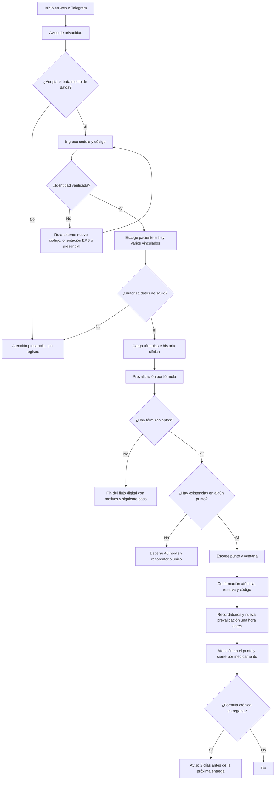

## 2. Consentimiento e identidad

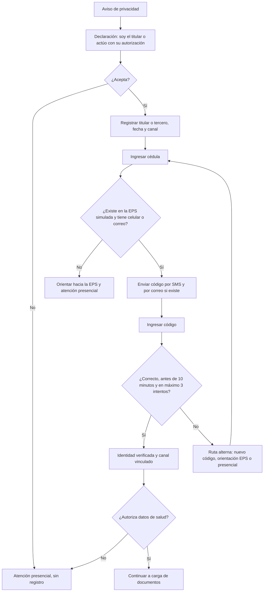

## 3. Prevalidación por fórmula

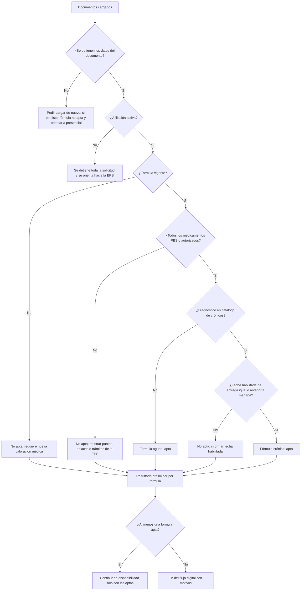

## 4. Disponibilidad, reserva y agenda

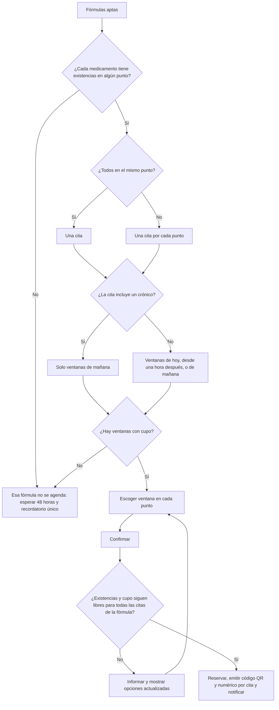

Cancelación y expiración:

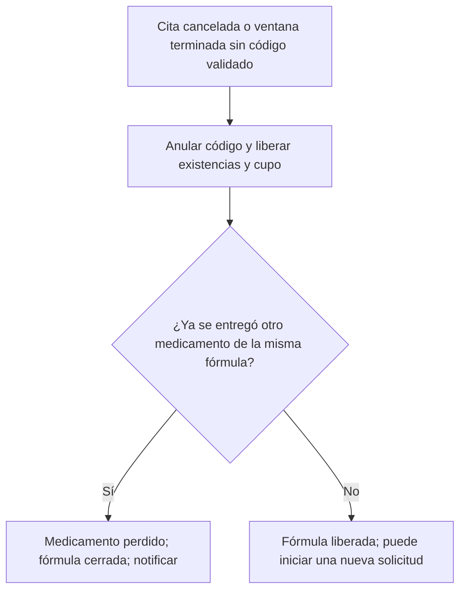

## 5. Recordatorios y notificaciones

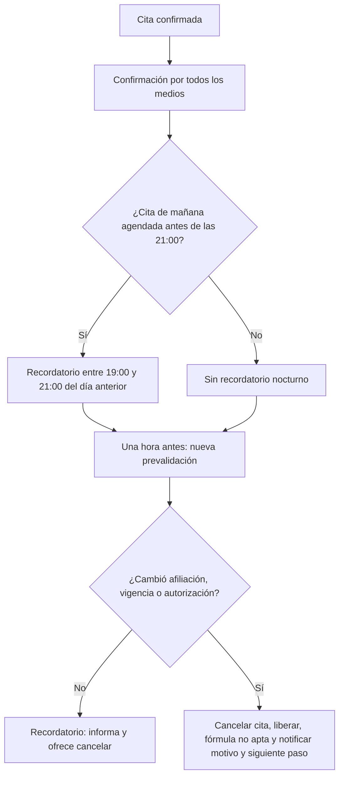

Medios de notificación: notificación de la web si hay navegador vinculado, Telegram si hay chat vinculado, SMS al celular registrado y correo si existe. Ninguna notificación incluye medicamentos ni diagnósticos.

Otros avisos:

- Sin disponibilidad: un recordatorio único a las 48 horas para volver a validar.
- Crónico entregado: aviso 2 días antes de la siguiente fecha habilitada.
- El sistema no avisa cuando llega un medicamento ni cuando la EPS autoriza.

## 6. Atención en el punto

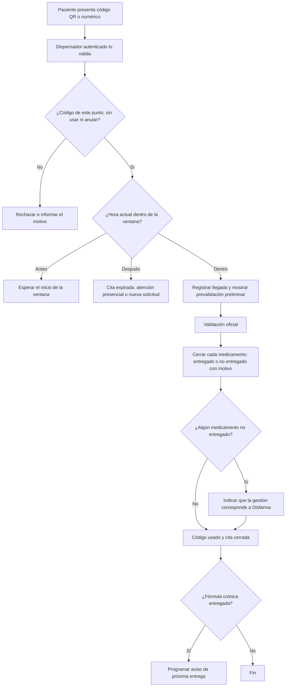

Motivos de no entrega: afiliación inactiva; fórmula vencida o inválida; autorización no vigente; medicamento no cubierto; datos del paciente no coinciden; sin existencias pese a reserva; otro, con descripción.

## 7. Canal asistido y vinculación de canales

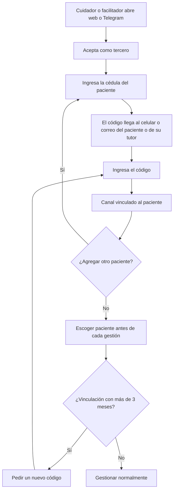

## 8. Estados

Fórmula:

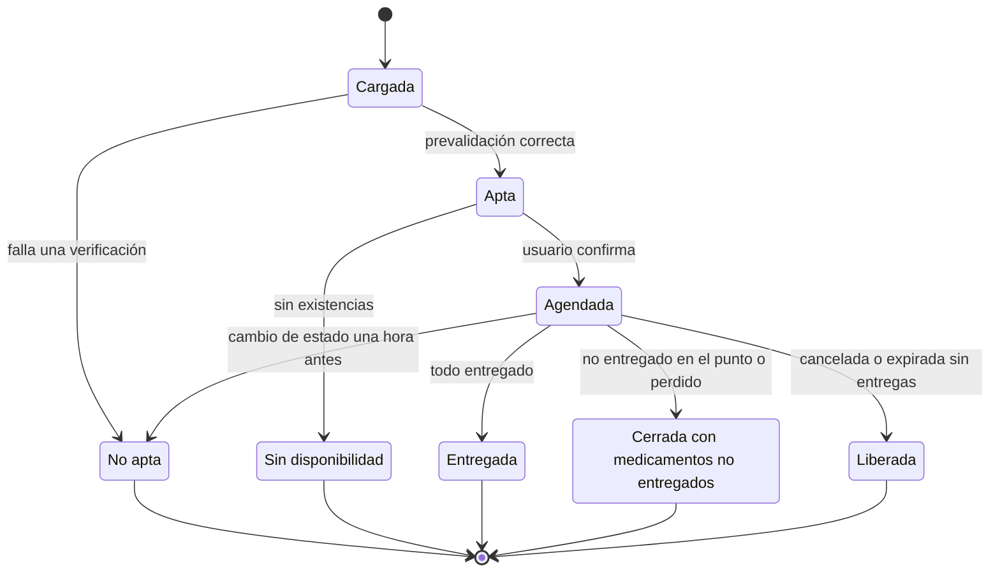

Cita:

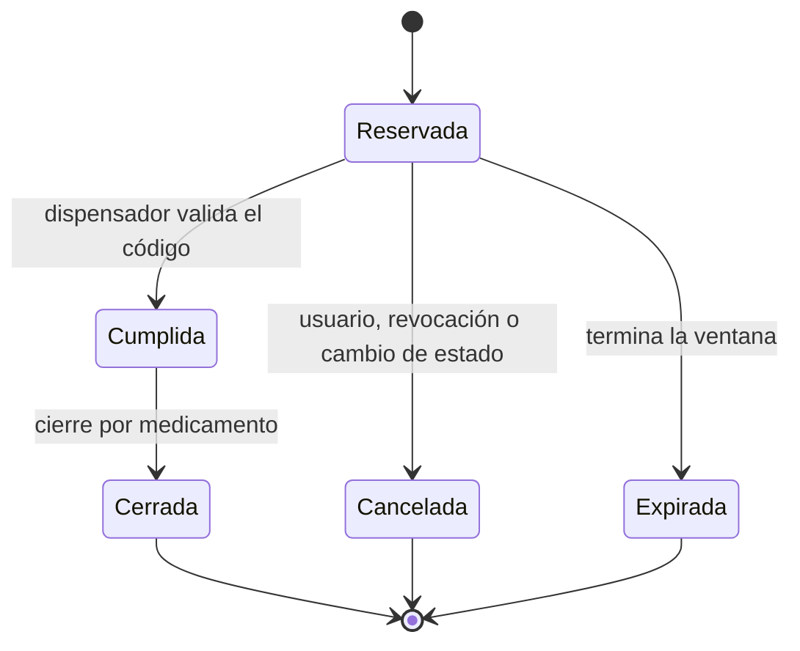

Vinculación de canal:

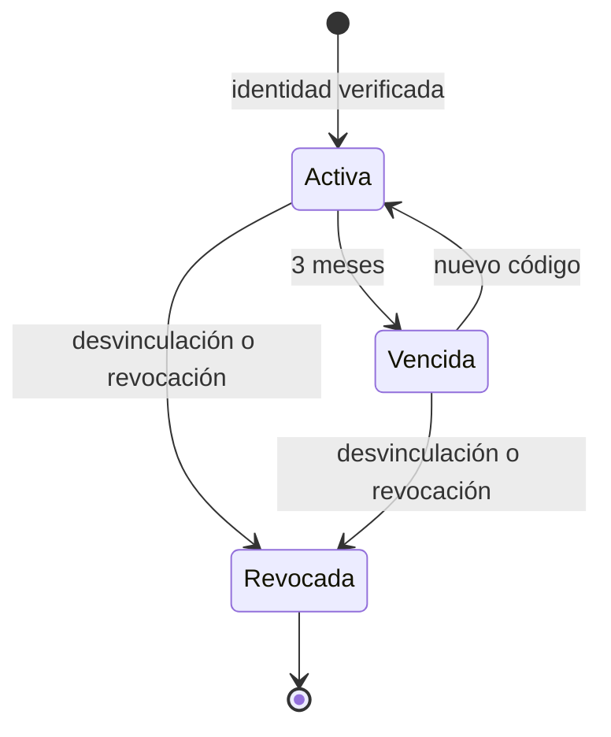

## 9. Reglas derivadas aprobadas

El equipo las aprobó. En la especificación son DEC-37 a DEC-47.

1. DEC-37. Agudo el mismo día: solo ventanas que inicien al menos una hora después de agendar, para que haya recordatorio de una hora antes.
2. DEC-38. Sin recordatorio nocturno si la cita se agenda después de las 21:00 del día anterior.
3. DEC-39. Un cambio de estado detectado una hora antes cancela la cita y deja la fórmula no apta.
4. DEC-40. Un medicamento no PBS continúa solo si está autorizado.
5. DEC-41. Agudo o crónico según un catálogo configurable de diagnósticos crónicos.
6. DEC-42. Documento ilegible o sin coincidencia: cargar de nuevo; si persiste, no apta y atención presencial.
7. DEC-43. Una cita por punto; si incluye un crónico, solo mañana; las citas de una fórmula se confirman todas o ninguna.
8. DEC-44. La pérdida solo aplica si ya se entregó parte de la fórmula; una nueva cita requiere una nueva solicitud.
9. DEC-45. Cierre por medicamento y remisión a Disfarma cuando hay no entregados.
10. DEC-46. Una vinculación vencida no recibe notificaciones por ese canal; SMS y correo continúan.
11. DEC-47. Sin ventanas con cupo en los días permitidos se trata como sin disponibilidad.
