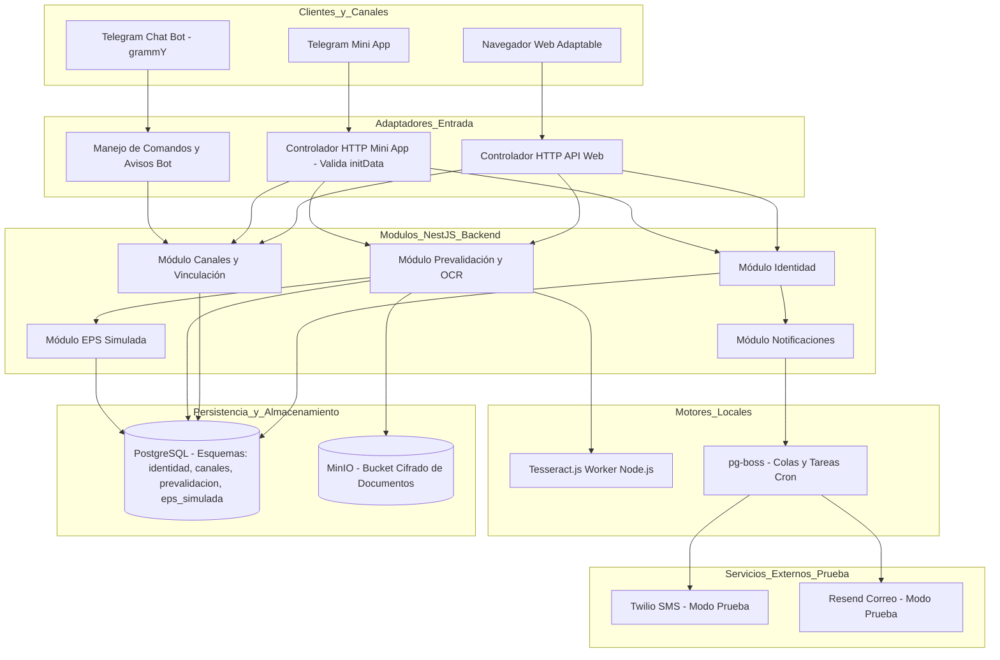

<!--
Agente: Architecture Agent
Proveedor: gemini
Modelo: gemini-3.5-flash
Fecha: 2026-11-01 14:43
Petición: Analiza la arquitectura de la prevalidación en web y Telegram (Mini App) para el MVP DEC-P01, usando el stack aprobado y sus enmiendas. Debe decidir con ADR: dónde corre el OCR y cómo se procesa un documento; almacenamiento y cifrado de fotos y PDF (T-010, T-041); EPS simulada y mecanismo para cambiar sus datos en pruebas (DEC-P36); validación de initData de la Mini App y vinculación del chat (T-040: el identificador del chat se guarda como destino, no como identidad; DEC-P37, DEC-P52); límite de frecuencia de códigos sin contradecir DEC-01 de SPEC-001 (T-023); módulos y sus fronteras (T-042). Propón el valor de la tolerancia de DEC-P49, según el OCR elegido, como propuesta para que la apruebe el equipo (DEC-P56). ARQ-003 y ARQ-004 quedan obsoletas (T-039). La retención de documentos sigue sin decidir (PREG-015, SPEC-003/OPEN-Q-011): deja el diseño preparado para las opciones de esa pregunta y regístrala como ARCH-Q, sin decidirla. Respeta DEC-P01 a DEC-P58 de docs/decisiones.md; donde contradigan la propuesta tecnológica, manda la decisión más reciente y señálalo. No escribas estado de aprobación: esta ARQ es una propuesta para revisión humana. Solo datos sintéticos.
-->

# ARQ-005. Prevalidación multicanal en Web y Telegram Mini App - Versión 0.1

Estado: Borrador
Modo: Propuesta
SPECs de origen: SPEC-001 v1.1, SPEC-002 v1.11, SPEC-003 v1.12, SPEC-008 v1.9

## Resumen de la decisión
Se define la arquitectura técnica para la prevalidación multicanal (Web y Telegram Mini App) correspondiente al MVP DEC-P01. La solución se estructura como un Monolito Modular en NestJS con esquemas de base de datos aislados en PostgreSQL, almacenamiento de documentos cifrados en MinIO, extracción OCR con Tesseract.js local y confirmación humana sin edición, validación criptográfica de `initData` para la Mini App (usando el `chat_id` como destino de mensajes y no como identidad) y un módulo configurable de EPS simulada para la ejecución de pruebas. Esta arquitectura reemplaza formalmente a las propuestas ARQ-003 y ARQ-004, las cuales quedan obsoletas (T-039).

## Architecture Drivers
- Driver: Seguridad de datos sensibles y cumplimiento normativo. Pregunta: ¿Cómo garantizar la confidencialidad de la información médica y PII cumpliendo la Ley 1581 de 2012 y la norma antitrámites? Origen: SPEC-001/RF-003, SPEC-001/RNF-002, SPEC-003/RF-021, contexto 3.11, Ley 1581 de 2012.
- Driver: Paridad multicanal sin dependencia de identidad en canales externos. Pregunta: ¿Cómo ofrecer paridad funcional entre la Web y Telegram Mini App asegurando que los identificadores de Telegram no constituyan prueba de identidad? Origen: SPEC-002/RF-011, SPEC-002/RNF-009, DEC-P10, DEC-P22, DEC-P29, DEC-P37, DEC-P52.
- Driver: Prevalidación estricta y procesamiento de documentos de salud. Pregunta: ¿Cómo procesar fotos/PDFs de fórmulas e historias clínicas, extraer medicamentos/diagnósticos con OCR local y ejecutar las reglas de negocio en el orden estricto establecido? Origen: SPEC-003/RF-021, RF-022, RF-024, DEC-P04, DEC-P10, DEC-P11, DEC-P13, DEC-P49.
- Driver: Flexibilidad de pruebas sin alteración del producto. Pregunta: ¿Cómo simular la EPS y provocar cambios de estado (afiliación, vigencia, autorizaciones) de forma segura durante las pruebas sin crear roles ni interfaces adicionales de producción? Origen: SPEC-008/RF-075, RF-076, RF-082, DEC-P36.

## Restricciones arquitectónicas
- Stack tecnológico aprobado: NestJS (TypeScript), PostgreSQL + Prisma, MinIO (almacenamiento de objetos cifrado), pg-boss (cola de tareas en PostgreSQL), grammY (bot de Telegram), React + Vite (web adaptable sin instalación). Origen: propuesta-tecnologica.md §2.
- Restricción de canales y OCR (DEC-P10): Aplicación web adaptable al celular sin instalación (se excluye PWA instalable nativa), usable directamente o como Mini App de Telegram. El chat del bot solo transmite avisos de plantilla fija con botones que abren la Mini App. El OCR no procesa archivos enviados al chat de Telegram y requiere vista previa de confirmación humana sin edición manual (DEC-P04). Origen: DEC-P10, DEC-P04, DEC-P44.
- Restricción de identidad de Telegram (DEC-P29, DEC-P37, DEC-P52): La identidad siempre requiere verificación con cédula y código OTP. El `chat_id` de Telegram se utiliza exclusivamente como dirección de destino para notificaciones y no como prueba de identidad. El bot solo opera en chats privados (DEC-P52).
- Restricción de simulación para pruebas (DEC-P36): La modificación de datos en la EPS simulada se realiza mediante datos o configuración de entorno sin construir una interfaz de producto ni agregar roles de usuario.
- Restricción de recursos y tiempo: Equipo de 4 personas y desarrollo en 8 semanas (contexto 3.9).
- Obsolescencia técnica (T-039): Las propuestas ARQ-003 y ARQ-004 quedan formalmente obsoletas por trazabilidad desacoplada y contradicciones con el contexto (T-040).

## Atributos de calidad
- Atributo: Seguridad y Privacidad (Confidencialidad y Eliminación Segura). Condición: Los archivos de salud deben cifrarse en reposo en MinIO; ante una revocación de consentimiento, los datos personales/salud y archivos se eliminan totalmente, disociando los eventos de auditoría (conservando solo tipo y fecha) (origen: SPEC-001/RNF-002, SPEC-002/RNF-009, SPEC-008/RF-083, DEC-P51).
- Atributo: Usabilidad e Integridad de Datos (Confirmación Human-in-the-Loop). Condición: La extracción OCR por Tesseract.js debe presentarse en una vista previa donde el usuario valida o rechaza lo leído sin edición de texto, evitando inyecciones o correcciones inconsistentes con la imagen (origen: SPEC-003/RF-030, DEC-P04, DEC-P55).
- Atributo: Mantenibilidad y Modularidad (Isolation por Esquemas). Condición: Cada módulo arquitectónico debe poseer la propiedad exclusiva de su esquema en PostgreSQL (`identidad`, `canales`, `prevalidacion`, `eps_simulada`), interactuando únicamente mediante servicios e interfaces declaradas (origen: propuesta-tecnologica.md §3, T-042).
- Atributo: Disponibilidad e Interoperabilidad (Resiliencia en Servicios Externos). Condición: Las fallas en los envíos de SMS (Twilio) o correo (Resend) deben notificarse al usuario permitiendo el reintento o la derivación a atención presencial, sin bloquear el estado del sistema (origen: SPEC-001/RF-011, RNF-001).

## Preguntas de aclaración
- ARCH-Q-001. Política de retención de archivos de salud (fotos/PDFs de fórmulas e historias clínicas) en almacenamiento de objetos (PREG-015, SPEC-003/OPEN-Q-011, T-010).
  Por qué importa: Define el ciclo de vida de los archivos en MinIO (borrado inmediato post-OCR, retención por tiempo o retención hasta revocación).
  Crítica: no
  Estado: Pendiente
  Responsable: equipo
- ARCH-Q-002. Propuesta de tolerancia para la coincidencia de texto leídos por OCR frente al catálogo de la EPS simulada (DEC-P49, DEC-P56).
  Por qué importa: Define el algoritmo técnico de comparación (distancia Levenshtein / similitud Jaro-Winkler) para validar la coincidencia de nombres de medicamentos. (Inferido, requiere confirmación).
  Crítica: no
  Estado: Pendiente
  Responsable: equipo
- ARCH-Q-003. Estrategia de control de frecuencia (rate limiting) para la generación de códigos de verificación por SMS/correo (T-023).
  Por qué importa: Evita abusos de envío de SMS/correo manteniendo cumplimiento con DEC-01 (sin bloqueos globales de generación). (Inferido, requiere confirmación).
  Crítica: no
  Estado: Pendiente
  Responsable: equipo

## Alternativas consideradas
- Alternativa 1: Arquitectura de Microservicios desacoplados con OCR en microservicio Python (FastAPI/EasyOCR) y almacenamiento S3 público.
  Descripción: Servidores independientes para identidad, canal Telegram, prevalidación y motor OCR en Python.
  Ventajas: Aislamiento total de procesos y librerías OCR especializadas en Python.
  Desventajas: Alta complejidad operativa, sobrecosto de infraestructura, latencia por llamadas HTTP entre servicios y riesgo de incumplimiento de Ley 1581 por transferencia de datos si se usan servicios Cloud externos.
- Alternativa 2: Monolito Modular en NestJS con esquemas aislados en PostgreSQL, OCR local con Tesseract.js en proceso Node.js/Worker y almacenamiento privado cifrado en MinIO.
  Descripción: Aplicación única desplegada en contenedor con módulos aislados por código y base de datos, ejecutando Tesseract.js localmente en el servidor backend para evitar la fuga de datos de salud y mantener el stack unificado en TypeScript.
  Ventajas: Unificación de lenguaje (TypeScript de punta a punta), cumplimiento directo de restricciones del proyecto (4 personas, 8 semanas), despliegue sencillo con Docker Compose, frontera estricta de datos entre esquemas y cero transferencia internacional de datos de salud.
  Desventajas: El procesamiento OCR consume CPU en el servidor de aplicación durante ráfagas de carga.

## Matriz de decisión

| Alternativa | Mantenibilidad (0.25) | Seguridad / Privacidad (0.30) | Complejidad de despliegue (0.20) | Tiempo de desarrollo (0.25) | Total |
|---|---|---|---|---|---|
| Alternativa 1: Microservicios + OCR Python | 3 | 3 | 1 | 2 | 2.35 |
| Alternativa 2: Monolito Modular NestJS + Tesseract.js local | 5 | 5 | 5 | 4 | 4.75 |

Justificación de pesos:
- Seguridad / Privacidad (0.30): Ley 1581 de 2012 y protección estricta de datos de salud (contexto 3.11).
- Mantenibilidad (0.25) y Tiempo de desarrollo (0.25): Restricción de equipo pequeño (4 personas) y marco temporal corto (8 semanas, contexto 3.9).
- Complejidad de despliegue (0.20): Necesidad de un entorno controlado en Docker Compose para prototipado funcional.

## Arquitectura seleccionada
- Decisión: Monolito Modular en NestJS con arquitectura de Puertos y Adaptadores (Ports and Adapters), esquemas de PostgreSQL aislados por módulo (`identidad`, `canales`, `prevalidacion`, `eps_simulada`), procesamiento OCR local mediante Tesseract.js (Node.js worker), almacenamiento de archivos cifrados en MinIO y cola de tareas `pg-boss`.
- Por qué: Satisface íntegramente las restricciones del proyecto (propuesta-tecnologica.md §3), garantiza el aislamiento de datos exige la Ley 1581, elimina dependencias de servicios externos no autorizados para OCR y permite una alta mantenibilidad en un equipo de 4 personas.
- ADR: ADR-001 (Monolito Modular NestJS y Fronteras de Datos), ADR-002 (Motor y Flujo de OCR con Confirmación Humana), ADR-003 (Almacenamiento y Cifrado de Documentos de Salud en MinIO), ADR-004 (Validación de initData en Telegram Mini App y Manejo de Destino vs Identidad), ADR-005 (Arquitectura de la EPS Simulada y Provocación de Estados en Pruebas), ADR-006 (Control de Frecuencia de Emisión de Códigos OTP).

## Diagrama conceptual

## Componentes y responsabilidades

- COMP-001. Módulo de Identidad (`identidad`): Gestiona el registro de aceptación del aviso de privacidad (titular/tercero), la emisión y validación de códigos OTP (SMS/correo) con caducidad de 10 minutos y máximo 3 intentos, la autorización separada para datos de salud, y la ejecución del flujo de revocación de consentimiento con disociación de auditoría. Traza a: SPEC-001/RF-001, RF-002, RF-004, RF-005, RF-007, RF-009, ADR-001, ADR-006.
- COMP-002. Módulo de Canales y Vinculación (`canales`): Administra la vinculación independiente entre un canal (`chat_id` de Telegram o cookie de navegador) y uno o varios pacientes, el ciclo de vida de 3 meses calendario, la reactivación con código nuevo, la desvinculación voluntaria, la validación de firmas de Telegram Mini App (`initData`), y el formateo de enmascaramiento (`CC ***1234`). Garantiza que los identificadores de Telegram no sirvan como prueba de identidad y que el bot solo opere en chats privados. Traza a: SPEC-002/RF-011, RF-013, RF-014, RF-016, RF-085, RF-086, RF-087, RNF-009, ADR-004.
- COMP-003. Módulo de Prevalidación y OCR (`prevalidacion`): Ejecuta la ingesta de fotos/PDFs, invoca el procesamiento OCR local con Tesseract.js, genera los datos para la vista previa de confirmación humana (sin edición), clasifica fórmulas en agudas/crónicas (mediante catálogo CIE-10), calcula la fecha de cita posible (días hábiles colombianos con el sábado como hábil) y ejecuta las reglas de prevalidación secuencial (afiliación, vigencia, PBS y autorización). Traza a: SPEC-003/RF-021, RF-022, RF-023, RF-024, RF-029, RF-030, ADR-002.
- COMP-004. Módulo EPS Simulada (`eps_simulada`): Provee los endpoints y la persistencia interna simulada para la consulta de afiliados (cédula, celular, correo, estado), fórmulas médicas MIPRES (20 dígitos), catálogo simulado de cobertura PBS, vigencias y autorizaciones. Incluye mecanismos de configuración para provocar cambios de estado en pruebas. Traza a: SPEC-008/RF-075, RF-076, RF-077, RF-080, RF-082, ADR-005.
- COMP-005. Servicio de Almacenamiento Cifrado (`documentos`): Encargado del guardado, cifrado transparente en reposo y eliminación física de los archivos de fórmulas e historias clínicas cargadas en MinIO, proveyendo abstracción para las políticas de retención. Traza a: SPEC-001/RNF-002, SPEC-003/RF-021, ADR-003.
- COMP-006. Servicio de Notificaciones y Tareador (`tareas_notificaciones`): Administra la cola de tareas asíncronas mediante `pg-boss`, orquestando los envíos reales a los planes de prueba de Twilio (SMS) y Resend (correo), asegurando la estricta omisión de diagnósticos, medicamentos y PII en las plantillas de mensaje. Traza a: SPEC-001/RNF-001, SPEC-002/BR-008, propuesta-tecnologica.md §5.

## Integraciones y flujos técnicos

- Flujo 1: Autenticación y Vinculación en Telegram Mini App.
  1. El cliente abre la Mini App desde un chat privado de Telegram.
  2. La Mini App envía en los encabezados HTTP el string `initData` provisto por Telegram.
  3. COMP-002 valida criptográficamente `initData` utilizando HMAC-SHA256 con el token del Bot de Telegram. Si falla o es un chat grupal, rechaza la solicitud (DEC-P52).
  4. COMP-002 extrae el `chat_id` únicamente como dirección de respuesta para avisos.
  5. COMP-002 evalúa si existe una vinculación activa o vencida para ese `chat_id` y el paciente. Si no existe vinculación activa, exige el flujo de cédula + código OTP de COMP-001 (DEC-P22, DEC-P39).
- Flujo 2: Carga de Documentos, OCR y Prevalidación Técnica.
  1. El usuario autoriza el tratamiento de datos de salud en el canal (COMP-001).
  2. El cliente sube la foto/PDF mediante multipart a COMP-003.
  3. COMP-005 encripta el archivo y lo almacena temporalmente en MinIO.
  4. COMP-003 procesa la imagen con el worker de Tesseract.js extrayendo el número MIPRES de 20 dígitos, medicamentos y diagnósticos.
  5. COMP-003 devuelve un JSON estructurado con los textos leídos hacia la interfaz (Web o Mini App) para la vista previa de confirmación humana.
  6. El usuario presiona "Confirmar datos" (sin poder editar texto). Si rechaza, consume 1 intento de carga (DEC-P04, DEC-P07).
  7. COMP-003 ejecuta en orden estricto la prevalidación contra COMP-004 (EPS Simulada):
     a) Afiliación activa (una vez por solicitud).
     b) Vigencia de la fórmula (fecha vigencia >= fecha actual).
     c) Cobertura PBS (prevalece catálogo simulado; si no está en catálogo se trata como no PBS - DEC-P32).
     d) Estado de autorización (decisivo solo para medicamentos no PBS).
     e) Cita posible para crónicas (primer día hábil omitiendo domingos/festivos, considerando el sábado como hábil; valida fecha habilitada antes de festivos - DEC-P50).
  8. COMP-003 retorna el resultado preliminar (Apta / No Apta con motivo y siguiente paso) y registra el evento de auditoría.
- Flujo 3: Provocación de Cambios de Estado en Pruebas.
  1. El equipo modifica registros en el esquema `eps_simulada` (p. ej. pasa afiliación a inactiva o anula autorización) mediante scripts de prueba o seeds de base de datos (DEC-P36).
  2. En la siguiente consulta de prevalidación, COMP-003 lee en tiempo real el estado actualizado en COMP-004 y emite el nuevo resultado sin requerir reiniciar la aplicación.

## ADR

- ADR-001. Monolito Modular en NestJS con aislación de esquemas PostgreSQL
  Estado: Propuesta
  Contexto: Se requiere construir un backend robusto, mantenible por 4 personas en 8 semanas, con separación de dominios por SPEC.
  Problema: Evitar el acoplamiento descontrolado de datos entre módulos manteniendo un despliegue simple.
  Alternativas: a) Monolito tradicional en esquema `public`; b) Microservicios independientes; c) Monolito Modular con esquemas de PostgreSQL aislados.
  Decisión: Adoptar Monolito Modular en NestJS donde cada módulo (`identidad`, `canales`, `prevalidacion`, `eps_simulada`) posee su propio esquema en PostgreSQL gestionado vía Prisma.
  Justificación: Garantiza límites claros de dominio, evita consultas cruzadas no autorizadas y mantiene la simplicidad de infraestructura.
  Consecuencias positivas: Alto aislamiento de datos, facilidad de prueba, migración futura simplificada.
  Consecuencias negativas: Exige disciplina de diseño para evitar imports circulares entre módulos NestJS.
  Supuestos: PostgreSQL soporta múltiples esquemas dentro de una misma base de datos.
  Evidencia: propuesta-tecnologica.md §3, T-042.

- ADR-002. Procesamiento OCR local con Tesseract.js y confirmación humana de lectura
  Estado: Propuesta
  Contexto: SPEC-003 exige extraer datos de documentos cargados (fórmulas e historias clínicas) preservando la privacidad de datos de salud (Ley 1581).
  Problema: Decidir dónde y cómo ejecutar el reconocimiento de caracteres sin transferir datos de salud a servicios externos no verificados.
  Alternativas: a) Cloud Vision / Amazon Textract (SaaS); b) Servidor OCR desacoplado en Python (EasyOCR); c) Tesseract.js ejecutado en proceso worker Node.js local.
  Decisión: Usar Tesseract.js en el entorno Node.js del backend para procesar imágenes y PDF, presentando una vista previa de confirmación humana donde el usuario solo valida o rechaza (sin edición manual).
  Justificación: Cumple estrictamente con la Ley 1581 (los datos no salen del servidor del prototipo), no genera costos adicionales y se adhiere a DEC-P04 y DEC-P10.
  Consecuencias positivas: Cero transferencia internacional de datos, unificación en TypeScript, cumplimiento legal.
  Consecuencias negativas: El consumo de CPU por OCR debe aislarse mediante colas o hilos secundarios (workers).
  Supuestos: Las imágenes de prueba proporcionadas por el equipo son fotos legibles de fórmulas impresas.
  Evidencia: propuesta-tecnologica.md §7, DEC-P04, DEC-P10, DEC-P55.

- ADR-003. Almacenamiento y Cifrado de Documentos de Salud en MinIO
  Estado: Propuesta
  Contexto: Las fotos y PDFs cargados contienen datos de salud sensibles. SPEC-001/RNF-002 exige eliminación segura y almacenamiento protegido.
  Problema: Almacenar archivos de forma cifrada y preparar el sistema para la política de retención definitiva (PREG-015 / ARCH-Q-001).
  Alternativas: a) Sistema de archivos local sin cifrar; b) Base de datos PostgreSQL en campos BLOB; c) Almacenamiento de objetos privado MinIO con cifrado transparente en reposo (Server-Side Encryption) y bucket aislado.
  Decisión: Implementar MinIO como almacén de objetos privado, aplicando cifrado de archivos en reposo y exponiendo interfaces para borrado programado (pg-boss) o borrado inmediato ante revocación.
  Justificación: Separa la persistencia estructurada de los archivos binarios pesados, brinda cifrado de nivel industrial y facilidades de purga segura.
  Consecuencias positivas: Alta escalabilidad, cumplimiento de RNF-002 de SPEC-001 y facilidades de auditoría.
  Consecuencias negativas: Requiere un contenedor adicional de MinIO en la orquestación Docker.
  Supuestos: MinIO se ejecuta localmente dentro del mismo entorno Docker Compose que la aplicación.
  Evidencia: propuesta-tecnologica.md §2, SPEC-001/RNF-002, PREG-015.

- ADR-004. Validación criptográfica de initData en Telegram Mini App y desacoplamiento de Identidad
  Estado: Propuesta
  Contexto: SPEC-002 exige paridad multicanal con Telegram Mini App. DEC-P29, DEC-P37 y DEC-P52 establecen que los datos de Telegram no prueban la identidad del paciente.
  Problema: Autenticar la procedencia de la petición desde la Mini App sin asumir la identidad del usuario de Telegram.
  Alternativas: a) Usar `telegram_user_id` como identidad automática del paciente; b) Validar la firma criptográfica HMAC-SHA256 del `initData` de Telegram y utilizar el `chat_id` únicamente como canal de entrega de notificaciones.
  Decisión: Implementar la verificación estricta del HMAC-SHA256 del `initData` en el backend NestJS. Si es válido, el `chat_id` se registra como dirección de envío (canal), exigiendo siempre la verificación de cédula + OTP si no existe una vinculación previa activa. Rechazar peticiones provenientes de chats grupales (DEC-P52).
  Justificación: Garantiza la autenticidad de la interfaz de Telegram sin violar la regla fundamental de que Telegram no valida la identidad legal del afiliado.
  Consecuencias positivas: Cumplimiento directo de RNF-009 de SPEC-002, protección contra falsificación de solicitudes webview.
  Consecuencias negativas: Requiere la gestión segura de la clave secreta del bot en las variables de entorno.
  Supuestos: Telegram envía el parámetro `initData` firmado en cada apertura de la Mini App.
  Evidencia: SPEC-002/RNF-009, DEC-P22, DEC-P29, DEC-P37, DEC-P52.

- ADR-005. Arquitectura del Módulo EPS Simulada y Provocación de Estados para Pruebas
  Estado: Propuesta
  Contexto: SPEC-008 exige simular la EPS (afiliación, fórmulas MIPRES de 20 dígitos, autorizaciones) y permitir provocar cambios de estado durante las pruebas.
  Problema: Proveer datos simulados interactivos sin alterar la lógica de producción ni crear roles de usuario no autorizados (DEC-P36).
  Alternativas: a) Crear una interfaz administrativa con login y roles de prueba; b) Exponer endpoints internos de simulación protegidos por token de entorno o modificar la base de datos de la EPS simulada mediante scripts/seeds de configuración.
  Decisión: Implementar el módulo `eps_simulada` con persistencia en el esquema `eps_simulada` de PostgreSQL, permitiendo actualizar registros mediante un script de semillas/fixture o llamadas internas de configuración habilitadas únicamente en entorno de desarrollo/pruebas.
  Justificación: Cumple con DEC-P36 (sin roles ni pantallas de producción adicionales) y satisface SPEC-008/RF-082.
  Consecuencias positivas: Simplicidad de implementación, aislamiento total del simulador.
  Consecuencias negativas: Los cambios de estado de prueba requieren ejecutar comandos de prueba o utilizar variables de entorno.
  Supuestos: Las pruebas son ejecutadas por el equipo de desarrollo/QA en un entorno controlado.
  Evidencia: SPEC-008/RF-075, RF-076, RF-082, DEC-P36.

- ADR-006. Control de Frecuencia (Rate Limiting) para Emisión de OTP
  Estado: Propuesta
  Contexto: SPEC-001/RF-005 exige que los códigos OTP duren 10 minutos y admitan 3 intentos. T-023 señala el riesgo de saturación/spam de SMS/correo.
  Problema: Proteger las fuentes de envío real (Twilio/Resend) contra solicitudes desmedidas sin imponer bloqueos globales permanentes prohibidos por DEC-01.
  Alternativas: a) Permitir solicitudes ilimitadas; b) Bloquear la cédula por 24 horas tras 3 intentos; c) Aplicar una ventana deslizante de enfriamiento (cooldown) de 60 segundos entre solicitudes consecutivas de emisión de código para una misma cédula o canal.
  Decisión: Implementar un control de frecuencia por enfriamiento (cooldown) de 60 segundos. Si se solicita un nuevo código antes de 60 segundos, el sistema rechaza la petición indicando el tiempo de espera restante. Si transcurren los 60 segundos, anula el código anterior y emite uno nuevo (DEC-01, SPEC-001/BR-003). (Inferido, asocia ARCH-Q-003).
  Justificación: Protege los costos de mensajería sin imponer bloqueos definitivos, respetando DEC-01 y BR-003 de SPEC-001.
  Consecuencias positivas: Prevención de abuso de API y control de costos de mensajería.
  Consecuencias negativas: Un usuario debe esperar 60 segundos para pedir el reenvío de un código.
  Supuestos: Un lapso de 60 segundos es el estándar aceptable para la llegada de un SMS/correo.
  Evidencia: SPEC-001/DEC-01, BR-003, T-023.

## Decisiones de diseño y patrones
- Patrón Strategy para Evaluación de Cobertura y Autorización: Se implementa la interfaz `ReglaPrevalidacionStrategy` para aislar la lógica de evaluación de medicamentos PBS (que no requieren autorización) y medicamentos No PBS (que requieren estado "Autorizado" en la EPS simulada, o catálogo prevalente según DEC-P11, DEC-P17, DEC-P32). Traza a: SPEC-003/RF-024, BR-011.
- Patrón Ports and Adapters (Arquitectura Hexagonal): Los adaptadores de entrada (Controlador Web HTTP, Controlador Mini App Telegram, Manejador de Chat Bot grammY) convierten los mensajes del canal a comandos de dominio unificados, desacoplando la lógica de negocio de la infraestructura del canal. Traza a: SPEC-002/RF-011, RNF-009.
- Patrón Outbox / Asynchronous Queue con `pg-boss`: Los eventos de envío de notificaciones y la purga programada de datos se insertan en colas transaccionales de PostgreSQL, garantizando entrega confiable y desacoplamiento del flujo HTTP principal. Traza a: propuesta-tecnologica.md §3.

## Riesgos técnicos
- Riesgo: Imprecisión en la extracción OCR de Tesseract.js ante fotografías de baja resolución o iluminación deficiente.
  Impacto: Alto.
  Probabilidad: Media.
  Mitigación: Se implementa el flujo Human-in-the-Loop de confirmación de vista previa (DEC-P04). Si el usuario rechaza la lectura, el sistema presenta recomendaciones de captura (iluminación, enmarque) y concede un segundo intento antes de derivar a atención presencial (SPEC-003/RF-029).
- Riesgo: Bloqueo de hilos en Node.js por ejecución intensiva de OCR en el servidor.
  Impacto: Medio.
  Probabilidad: Media.
  Mitigación: Delegar la ejecución de Tesseract.js a hilos secundarios (`worker_threads`) dentro de Node.js o procesar via trabajos asíncronos en `pg-boss`.

## Supuestos
- Supuesto: Los celulares y correos electrónicos utilizados en los entornos de prueba pertenecen exclusivamente a los integrantes del equipo con su consentimiento explícito (RNF-017 de SPEC-008). Requiere validación: Verificación por QA en la auditoría de datos de prueba.
- Supuesto: Las fórmulas simuladas poseen un número de prescripción de 20 dígitos (tipo MIPRES) que actúa como llave única de coincidencia en la EPS simulada (DEC-P05, DEC-P12). Requiere validación: Semillas de datos provistas en `eps_simulada`.

## Preguntas técnicas abiertas
- Algoritmo definitivo de tolerancia de lectura OCR (DEC-P49, DEC-P56): Se plantea como propuesta una similitud Jaro-Winkler >= 0.85 o distancia Levenshtein <= 2 sobre el nombre del medicamento para absorber errores menores de OCR. Pendiente de confirmación por el equipo (ARCH-Q-002).
- Definición de la política de retención física de archivos de salud en MinIO: Se deja el diseño preparado para borrado inmediato, expiración por tiempo o borrado al revocar (PREG-015). Pendiente de decisión del equipo (ARCH-Q-001).

## Trazabilidad
- SPEC-001/RF-003 → Driver Seguridad → ADR-001 → COMP-001 → Implementación/TEST (pendiente de Planning/QA).
- SPEC-001/RF-009 → Driver Seguridad → ADR-001, ADR-003 → COMP-001, COMP-005 → Implementación/TEST (pendiente de Planning/QA).
- SPEC-002/RF-011 → Driver Paridad Multicanal → ADR-004 → COMP-002 → Implementación/TEST (pendiente de Planning/QA).
- SPEC-002/RNF-009 → Driver Seguridad/Paridad → ADR-004 → COMP-002 → Implementación/TEST (pendiente de Planning/QA).
- SPEC-003/RF-022 → Driver Prevalidación/OCR → ADR-002 → COMP-003 → Implementación/TEST (pendiente de Planning/QA).
- SPEC-003/RF-024 → Driver Prevalidación → ADR-001 → COMP-003, COMP-004 → Implementación/TEST (pendiente de Planning/QA).
- SPEC-008/RF-076 → Driver EPS Simulada → ADR-005 → COMP-004 → Implementación/TEST (pendiente de Planning/QA).
- SPEC-008/RF-082 → Driver Pruebas → ADR-005 → COMP-004 → Implementación/TEST (pendiente de Planning/QA).
- ARCH-Q-001 (pendiente) → ADR-003 → COMP-005.
- ARCH-Q-002 (pendiente) → ADR-002 → COMP-003.
- ARCH-Q-003 (pendiente) → ADR-006 → COMP-001.

## Verificación
- Completitud: cumple. Se cubrieron todas las decisiones requeridas (OCR, almacenamiento/cifrado, EPS simulada y provocación de estados en pruebas, validación de initData de la Mini App, desacoplamiento de identidad en Telegram, límite de frecuencia OTP, fronteras de módulos, sustitución de ARQ-003/004 y preparación para retención PREG-015).
- Consistencia con las SPECs: cumple. Reviso y compruebo la estricta alineación con SPEC-001 v1.1, SPEC-002 v1.11, SPEC-003 v1.12, SPEC-008 v1.9, propuesta-tecnologica.md y las decisiones DEC-P01 a DEC-P58.
- No invención: cumple. No se inventaron requisitos de negocio. Se identificó el control de frecuencia y la propuesta de tolerancia OCR como inferencias marcadas con sus respectivas preguntas ARCH-Q.
- Justificación: cumple. Se presentaron alternativas y matriz de decisión justificada para la arquitectura base.
- Defensa: cumple. Las decisiones (Monolito Modular, NestJS, Tesseract.js local, MinIO) responden exactamente al tamaño del equipo (4 personas), tiempo (8 semanas) y marco normativo (Ley 1581).

## Historial de cambios
- Versión 0.1: propuesta arquitectónica inicial completa como Borrador para la prevalidación multicanal del MVP DEC-P01, reemplazando ARQ-003 y ARQ-004.

## Siguiente paso
Esta propuesta ARQ-005 versión 0.1 se encuentra en estado Borrador debido a que las preguntas de aclaración ARCH-Q-001, ARCH-Q-002 y ARCH-Q-003 continúan en estado Pendiente. Respondan las preguntas pendientes y ejecuten con `--continuar ARQ-005` para avanzar a la versión Candidata.
