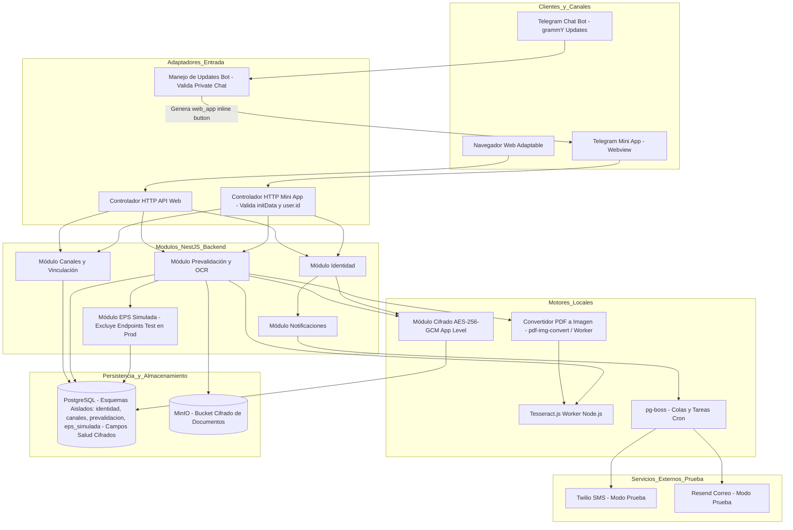

<!--
Agente: Architecture Agent
Proveedor: gemini
Modelo: gemini-3.5-flash
Fecha: 2026-11-01 14:46
Petición: Corrige la ARQ-005 y publícala como versión 0.2 en estado Borrador. No la marques Candidata ni Aprobada: esto no responde ARCH-Q-001, ARCH-Q-002 ni ARCH-Q-003, que siguen Pendientes. Cambia solo lo siguiente y registra cada punto en el historial, sin borrar nada más.

(1) ADR-004 y Flujo 1, hechos de Telegram. Según core.telegram.org/bots/webapps, initData llega vacío si la Mini App se abre desde un botón de teclado de respuesta; el campo chat solo llega en grupos, supergrupos y canales al abrir desde el menú de adjuntos; chat_type solo llega al abrir por enlace directo. Por eso initData no entrega el chat_id de un chat privado. Corrige así: el chat_id se obtiene de los updates del bot y se guarda como destino; la Mini App se abre con un botón web_app en línea, enviado solo tras comprobar en el update del bot que el chat es privado (message.chat.type); la petición de la Mini App se asocia al chat usando user.id de un initData validado, porque en un chat privado con el bot el id del chat coincide con el del usuario, y esto localiza el canal pero nunca prueba la identidad. Rechaza un initData vacío, y si llega chat o un chat_type distinto de private o sender, rechaza la petición. Añade la comprobación de auth_date con una vigencia máxima como parámetro configurable, sin fijar un número como requisito. El secreto del HMAC es el HMAC-SHA-256 del token del bot con la clave «WebAppData».
(2) Flujo 1, paso 5. Sin vinculación: cédula y código (DEC-P22, DEC-P39). Vinculación vencida: solo código nuevo (DEC-P26). Vigente: sin código (DEC-P22).
(3) Flujo 2. Paso 1: la autorización de datos de salud se pide solo si el paciente aún no la dio (DEC-P46). Pasos 5 y 6: una vista previa por documento (DEC-P55). Añade los pasos que faltan: comprobar coincidencia con la EPS según SPEC-003/BR-013, incluida la tolerancia (DEC-P49); clasificar agudo o crónico; contar los 2 intentos por documento; y si un dato obligatorio falta, tratarlo como ilegible (DEC-P54). La afiliación se verifica siempre, aunque un documento haya fallado, y reemplaza los demás resultados si está inactiva (DEC-P33). En el paso 3 quita «temporalmente», porque la retención sigue sin decidir (ARCH-Q-001).
(4) ADR-002, PDF. Tesseract no lee PDF directamente: añade un paso de conversión de cada página a imagen dentro del servidor, sin enviar datos afuera, y su consecuencia en CPU y en el trabajador. Registra el riesgo de que Tesseract no lea bien tablas o fórmulas reales, y mantén el supuesto de fórmulas de ejemplo impresas.
(5) T-041. La petición pedía decidir el cifrado y la ARQ no trata los datos de salud en PostgreSQL. Añade ADR-007 con alternativas, decisión propuesta y consecuencias para los datos de salud guardados en PostgreSQL, incluidos los textos leídos por OCR. Añádelo a la trazabilidad y a Arquitectura seleccionada.
(6) ADR-006. SPEC-001/BR-003 dice que, si se pide un código nuevo mientras otro sigue vigente, el anterior queda anulado de inmediato, y SPEC-001 está aprobada. Rechazar una petición dentro de los 60 segundos puede contradecirla. Decláralo en el ADR, deja 60 segundos como valor sin decidir dentro de ARCH-Q-003, y añade como alternativa un tope de envíos por celular y ventana que no rechace la solicitud sino que informe la ruta alterna de SPEC-001. No lo presentes como decidido.
(7) ADR-005. Las llamadas internas de configuración deben quedar ausentes en producción, no solo deshabilitadas, para cumplir DEC-P36.
(8) Sección «Verificación». No escribas «cumple» en Completitud ni Consistencia: escribe «parcial» y nombra ARCH-Q-001, ARCH-Q-002 y ARCH-Q-003.
-->

# ARQ-005. Prevalidación multicanal en Web y Telegram Mini App - Versión 0.2

Estado: Borrador
Modo: Iteración
SPECs de origen: SPEC-001 v1.1, SPEC-002 v1.11, SPEC-003 v1.12, SPEC-008 v1.9

## Resumen de la decisión
Se define y corrige la arquitectura técnica para la prevalidación multicanal (Web y Telegram Mini App) correspondiente al MVP DEC-P01. La solución se estructura como un Monolito Modular en NestJS con esquemas de base de datos aislados en PostgreSQL, cifrado a nivel de aplicación (AES-256-GCM) para los datos de salud y textos extraídos por OCR persistidos en la base de datos (ADR-007), almacenamiento de documentos cifrados en MinIO, extracción OCR con Tesseract.js local sobre imágenes y páginas de PDF previamente convertidas en el servidor (ADR-002) con confirmación humana por documento sin edición, validación criptográfica de `initData` para la Mini App asimilando `user.id` con el destino del chat privado (ADR-004), un módulo de EPS simulada con endpoints de prueba ausentes en el build de producción (ADR-005), y una estrategia de control de frecuencia para la emisión de códigos OTP que no contradiga la invalidez inmediata de SPEC-001/BR-003 (ADR-006). Esta arquitectura reemplaza formalmente a las propuestas ARQ-003 y ARQ-004, las cuales quedan obsoletas (T-039).

## Architecture Drivers
- Driver: Seguridad de datos sensibles, cifrado y cumplimiento normativo. Pregunta: ¿Cómo garantizar la confidencialidad de la información médica, PII y textos extraídos por OCR en reposo y en base de datos cumpliendo la Ley 1581 de 2012 y la norma antitrámites? Origen: SPEC-001/RF-003, SPEC-001/RNF-002, SPEC-003/RF-021, contexto 3.11, Ley 1581 de 2012, T-041.
- Driver: Paridad multicanal sin dependencia de identidad en canales externos. Pregunta: ¿Cómo ofrecer paridad funcional entre la Web y Telegram Mini App asegurando que los identificadores de Telegram no constituyan prueba de identidad ni comprometan el origen criptográfico de las peticiones? Origen: SPEC-002/RF-011, SPEC-002/RNF-009, DEC-P10, DEC-P22, DEC-P29, DEC-P37, DEC-P52, T-040.
- Driver: Prevalidación estricta y procesamiento de documentos de salud. Pregunta: ¿Cómo procesar fotos/PDFs de fórmulas e historias clínicas, convertir páginas de PDF a imágenes, extraer medicamentos/diagnósticos con OCR local y ejecutar las reglas de negocio en el orden estricto establecido? Origen: SPEC-003/RF-021, RF-022, RF-024, DEC-P04, DEC-P10, DEC-P11, DEC-P13, DEC-P49, DEC-P54, DEC-P55.
- Driver: Flexibilidad de pruebas sin alteración del producto de producción. Pregunta: ¿Cómo simular la EPS y provocar cambios de estado de forma segura durante las pruebas asegurando que los endpoints de configuración queden totalmente ausentes en el artefacto de producción? Origen: SPEC-008/RF-075, RF-076, RF-082, DEC-P36.

## Restricciones arquitectónicas
- Stack tecnológico aprobado: NestJS (TypeScript), PostgreSQL + Prisma, MinIO (almacenamiento de objetos cifrado), pg-boss (cola de tareas en PostgreSQL), grammY (bot de Telegram), React + Vite (web adaptable sin instalación). Origen: propuesta-tecnologica.md §2.
- Restricción de canales y OCR (DEC-P10, DEC-P55): Aplicación web adaptable al celular sin instalación, usable directamente o como Mini App de Telegram. El chat del bot solo transmite avisos de plantilla fija con botones web_app en línea que abren la Mini App. El OCR no procesa archivos enviados al chat de Telegram y requiere vista previa de confirmación humana independiente por documento sin edición manual (DEC-P04, DEC-P55).
- Restricción de identidad y origen en Telegram (DEC-P29, DEC-P37, DEC-P52): La identidad siempre requiere verificación con cédula y código OTP. El `chat_id` de Telegram se obtiene de los updates del bot y se guarda como destino para notificaciones. La Mini App se abre solo tras verificar que el chat es privado (`message.chat.type === 'private'`).
- Restricción de simulación para pruebas (DEC-P36): Las llamadas/endpoints de configuración de la EPS simulada deben estar ausentes en el build de producción (no compiladas ni expuestas) para cumplir DEC-P36.
- Restricción de recursos y tiempo: Equipo de 4 personas y desarrollo en 8 semanas (contexto 3.9).
- Obsolescencia técnica (T-039): Las propuestas ARQ-003 y ARQ-004 quedan formalmente obsoletas (T-040).

## Atributos de calidad
- Atributo: Seguridad y Privacidad (Confidencialidad y Eliminación Segura). Condición: Los archivos de salud deben cifrarse en reposo en MinIO; los textos leídos por OCR, diagnósticos y PII en PostgreSQL deben cifrarse a nivel de aplicación (AES-256-GCM); ante revocación, los datos personales/salud y archivos se eliminan totalmente, disociando los eventos de auditoría (conservando solo tipo y fecha) (origen: SPEC-001/RNF-002, SPEC-002/RNF-009, SPEC-008/RF-083, DEC-P51, T-041).
- Atributo: Usabilidad e Integridad de Datos (Confirmación Human-in-the-Loop por Documento). Condición: La extracción OCR por Tesseract.js debe presentarse en una vista previa independiente por cada documento cargado donde el usuario valida o rechaza lo leído sin edición de texto (origen: SPEC-003/RF-030, DEC-P04, DEC-P54, DEC-P55).
- Atributo: Mantenibilidad y Modularidad (Isolation por Esquemas). Condición: Cada módulo arquitectónico debe poseer la propiedad exclusiva de su esquema en PostgreSQL (`identidad`, `canales`, `prevalidacion`, `eps_simulada`), interactuando únicamente mediante servicios e interfaces declaradas (origen: propuesta-tecnologica.md §3, T-042).
- Atributo: Disponibilidad e Interoperabilidad (Resiliencia en Servicios Externos). Condición: Las fallas en los envíos de SMS (Twilio) o correo (Resend) deben notificarse al usuario permitiendo el reintento o la derivación a atención presencial, sin bloquear el estado del sistema (origen: SPEC-001/RF-011, RNF-001).

## Preguntas de aclaración
- ARCH-Q-001. Política de retención de archivos de salud (fotos/PDFs de fórmulas e historias clínicas) en almacenamiento de objetos (PREG-015, SPEC-003/OPEN-Q-011, T-010).
  Por qué importa: Define el ciclo de vida de los archivos en MinIO (borrado inmediato post-OCR, retención por tiempo o retención hasta revocación).
  Crítica: no
  Estado: Pendiente
  Responsable: equipo
- ARCH-Q-002. Propuesta de tolerancia para la coincidencia de texto leídos por OCR frente al catálogo de la EPS simulada (DEC-P49, DEC-P56).
  Por qué importa: Define el algoritmo técnico de comparación (distancia Levenshtein / similitud Jaro-Winkler) para validar la coincidencia de nombres de medicamentos. (Inferido, requiere confirmación).
  Crítica: no
  Estado: Pendiente
  Responsable: equipo
- ARCH-Q-003. Estrategia de control de frecuencia (rate limiting) para la generación de códigos de verificación por SMS/correo sin contradecir SPEC-001/BR-003 (T-023).
  Por qué importa: Define los límites por ventana de tiempo/celular en los adaptadores de mensajería para evitar costos o saturación de SMS sin rechazar solicitudes en desacuerdo con la anulación inmediata de BR-003. (Inferido, requiere confirmación; el parámetro de ventana/cooldown permanece sin decidir).
  Crítica: no
  Estado: Pendiente
  Responsable: equipo

## Alternativas consideradas
- Alternativa 1: Arquitectura de Microservicios desacoplados con OCR en microservicio Python (FastAPI/EasyOCR) y almacenamiento S3 público.
  Descripción: Servidores independientes para identidad, canal Telegram, prevalidación y motor OCR en Python.
  Ventajas: Aislamiento total de procesos y librerías OCR especializadas en Python.
  Desventajas: Alta complejidad operativa, sobrecosto de infraestructura, latencia por llamadas HTTP entre servicios y riesgo de incumplimiento de Ley 1581 por transferencia de datos si se usan servicios Cloud externos.
- Alternativa 2: Monolito Modular en NestJS con esquemas aislados en PostgreSQL, cifrado de campo a nivel de aplicación (AES-256-GCM), OCR local con Tesseract.js (con conversión interna PDF-a-imagen) y almacenamiento privado cifrado en MinIO.
  Descripción: Aplicación única desplegada en contenedor con módulos aislados por código y base de datos, ejecutando Tesseract.js localmente en el servidor backend sobre imágenes o páginas PDF convertidas.
  Ventajas: Unificación de lenguaje (TypeScript de punta a punta), cumplimiento directo de restricciones del proyecto (4 personas, 8 semanas), cifrado de extremo a extremo para PII/datos de salud en PostgreSQL, cero transferencia internacional de datos.
  Desventajas: El procesamiento OCR y la conversión de PDF a imagen consumen CPU en el servidor de aplicación durante ráfagas de carga.

## Matriz de decisión

| Alternativa | Mantenibilidad (0.25) | Seguridad / Privacidad (0.30) | Complejidad de despliegue (0.20) | Tiempo de desarrollo (0.25) | Total |
|---|---|---|---|---|---|
| Alternativa 1: Microservicios + OCR Python | 3 | 3 | 1 | 2 | 2.35 |
| Alternativa 2: Monolito Modular NestJS + Tesseract.js local + Cifrado BD | 5 | 5 | 5 | 4 | 4.75 |

Justificación de pesos:
- Seguridad / Privacidad (0.30): Ley 1581 de 2012 y protección estricta de datos de salud en reposo y en base de datos (contexto 3.11, T-041).
- Mantenibilidad (0.25) y Tiempo de desarrollo (0.25): Restricción de equipo pequeño (4 personas) y marco temporal corto (8 semanas, contexto 3.9).
- Complejidad de despliegue (0.20): Necesidad de un entorno controlado en Docker Compose para prototipado funcional.

## Arquitectura seleccionada
- Decisión: Monolito Modular en NestJS con arquitectura de Puertos y Adaptadores (Ports and Adapters), esquemas de PostgreSQL aislados por módulo (`identidad`, `canales`, `prevalidacion`, `eps_simulada`), cifrado a nivel de aplicación (AES-256-GCM) para datos de salud y textos OCR almacenados en PostgreSQL (ADR-007), procesamiento OCR local mediante Tesseract.js en workers Node.js previa conversión de páginas PDF a imagen (ADR-002), almacenamiento de archivos cifrados en MinIO (ADR-003), validación estricta de `initData` de Mini App (ADR-004), módulo EPS simulada ausente en producción (ADR-005) y cola de tareas `pg-boss`.
- Por qué: Satisface las restricciones del proyecto (propuesta-tecnologica.md §3), garantiza el aislamiento y cifrado de datos exigidos por la Ley 1581 y T-041, elimina dependencias externas de OCR y permite mantenibilidad en un equipo de 4 personas.
- ADR: ADR-001 (Monolito Modular NestJS y Fronteras de Datos), ADR-002 (Motor y Flujo de OCR, Conversión PDF y Confirmación Humana), ADR-003 (Almacenamiento y Cifrado de Documentos de Salud en MinIO), ADR-004 (Validación Criptográfica de initData en Telegram Mini App y Manejo de Destino vs Identidad), ADR-005 (EPS Simulada Ausente en Producción), ADR-006 (Control de Frecuencia de Emisión de Códigos OTP), ADR-007 (Cifrado de Datos de Salud y Textos OCR en PostgreSQL).

## Diagrama conceptual

## Componentes y responsabilidades

- COMP-001. Módulo de Identidad (`identidad`): Gestiona el registro de aceptación del aviso de privacidad (titular/tercero), la emisión y validación de códigos OTP (SMS/correo) con caducidad de 10 minutos y máximo 3 intentos, la autorización separada para datos de salud, y la ejecución del flujo de revocación de consentimiento con disociación de auditoría. Cifra la PII guardada en base de datos mediante ADR-007. Traza a: SPEC-001/RF-001, RF-002, RF-004, RF-005, RF-007, RF-009, ADR-001, ADR-006, ADR-007.
- COMP-002. Módulo de Canales y Vinculación (`canales`): Administra la vinculación independiente entre un canal (`chat_id` de Telegram o cookie de navegador) y uno o varios pacientes, el ciclo de vida de 3 meses calendario, la reactivación con código nuevo, la desvinculación voluntaria, la validación criptográfica de `initData` de la Mini App (asociando `user.id` con `chat_id` en chats privados), y el formateo de enmascaramiento (`CC ***1234`). Traza a: SPEC-002/RF-011, RF-013, RF-014, RF-016, RF-085, RF-086, RF-087, RNF-009, ADR-004.
- COMP-003. Módulo de Prevalidación y OCR (`prevalidacion`): Ejecuta la ingesta de fotos/PDFs, realiza la conversión de páginas de PDF a imágenes en el servidor, invoca el worker de Tesseract.js, aplica cifrado de aplicación AES-256-GCM a los textos extraídos antes de persistir (ADR-007), genera los datos para la vista previa de confirmación humana por documento (DEC-P55), clasifica fórmulas en agudas/crónicas, calcula la fecha de cita posible y ejecuta las reglas de prevalidación secuencial. Traza a: SPEC-003/RF-021, RF-022, RF-023, RF-024, RF-029, RF-030, ADR-002, ADR-007.
- COMP-004. Módulo EPS Simulada (`eps_simulada`): Provee la persistencia interna y endpoints de consulta de afiliados, fórmulas MIPRES (20 dígitos), catálogo de cobertura PBS, vigencias y autorizaciones. En builds de producción, los controladores y llamadas de modificación para pruebas se excluyen totalmente del compilado (ADR-005). Traza a: SPEC-008/RF-075, RF-076, RF-077, RF-080, RF-082, ADR-005.
- COMP-005. Servicio de Almacenamiento Cifrado (`documentos`): Encargado del guardado, cifrado transparente en reposo y eliminación física de los archivos de fórmulas e historias clínicas cargadas en MinIO. Traza a: SPEC-001/RNF-002, SPEC-003/RF-021, ADR-003.
- COMP-006. Servicio de Notificaciones y Tareador (`tareas_notificaciones`): Administra la cola de tareas asíncronas mediante `pg-boss`, orquestando los envíos reales a los planes de prueba de Twilio (SMS) y Resend (correo). Traza a: SPEC-001/RNF-001, SPEC-002/BR-008, propuesta-tecnologica.md §5.

## Integraciones y flujos técnicos

- Flujo 1: Autenticación y Vinculación en Telegram Mini App.
  1. El bot de Telegram recibe updates de mensajes únicamente en chats privados (`message.chat.type === 'private'`). Obtiene el `chat_id` y lo registra en el contexto de la conversación como dirección de respuesta (`destino`). El bot responde enviando un mensaje con un botón de teclado en línea (`web_app`) para abrir la Mini App.
  2. La persona presiona el botón y la Mini App envía en los encabezados HTTP el string `initData` provisto por Telegram.
  3. COMP-002 valida criptográficamente `initData` calculando el HMAC-SHA256 del token del bot con la clave fija "WebAppData" (`HMAC-SHA256("WebAppData", bot_token)`). Rechaza la solicitud si `initData` llega vacío, si incluye la propiedad `chat`, o si la propiedad `chat_type` está presente y es distinta de `private` o `sender`. Evalúa `auth_date` contra el parámetro configurable `auth_date_max_age`.
  4. COMP-002 asocia la petición de la Mini App con el canal localizando el `chat_id` a través del `user.id` extraído del `initData` validado (puesto que en chats privados el ID del chat coincide con el ID del usuario). Esta asociación identifica el canal (`destino`) pero NUNCA prueba la identidad legal del paciente.
  5. COMP-002 evalúa el estado de vinculación para ese paciente en ese canal:
     - Sin vinculación previa o activa (incluyendo desvinculación o revocación): exige el flujo completo de cédula + código OTP de COMP-001 (DEC-P22, DEC-P39).
     - Vinculación vencida: exige únicamente un código OTP nuevo de COMP-001, sin solicitar la cédula (DEC-P26).
     - Vinculación vigente: permite realizar la gestión de forma directa sin solicitar código de verificación (DEC-P22).

- Flujo 2: Carga de Documentos, OCR y Prevalidación Técnica.
  1. Si el paciente aún no ha otorgado la autorización para el tratamiento de datos de salud, el sistema la solicita antes de permitir la carga de documentos (COMP-001, DEC-P46).
  2. El cliente sube la foto o archivo PDF mediante multipart a COMP-003.
  3. COMP-005 encripta el archivo original y lo almacena en MinIO (sin asumir almacenamiento temporal o definitivo hasta resolver ARCH-Q-001). Si el documento es un archivo PDF, COMP-003 realiza una conversión interna de cada página del PDF a imagen bitmap en el servidor (Node.js worker thread) sin enviar ningún dato fuera del sistema.
  4. COMP-003 procesa las imágenes resultantes con el worker de Tesseract.js extrayendo el número MIPRES de 20 dígitos, los medicamentos y los diagnósticos.
  5. COMP-003 presenta una vista previa independiente por cada documento cargado (fórmulas e historia clínica) con los datos leídos hacia la interfaz (Web o Mini App) para la confirmación humana (DEC-P55).
  6. El usuario valida o rechaza lo leído en cada vista previa (sin edición manual de texto). Si el usuario rechaza la vista previa o si falta algún dato obligatorio (número/medicamentos en fórmula; diagnóstico en historia clínica), el documento se trata como ilegible (DEC-P54) y consume 1 intento de carga (máximo 2 intentos por documento). Si la historia clínica agota sus 2 intentos, todas las fórmulas de la solicitud quedan no aptas.
  7. COMP-003 evalúa la coincidencia de cada fórmula con la EPS simulada según SPEC-003/BR-013 (existencia de prescripción, pertenencia al paciente y coincidencia de medicamentos considerando la tolerancia de lectura OCR de DEC-P49).
  8. COMP-003 clasifica cada fórmula como agudo o crónico según el diagnóstico asignado y el catálogo configurable.
  9. COMP-003 ejecuta la prevalidación en orden estricto:
     a) Afiliación activa: se verifica SIEMPRE una vez por solicitud, independientemente de si algún documento falló; si está inactiva, detiene el procesamiento y ese resultado reemplaza a todos los demás (DEC-P33).
     b) Vigencia de la fórmula.
     c) Cobertura PBS (prevaleciendo catálogo simulado; medicamentos no listados se tratan como no PBS).
     d) Estado de autorización (decisivo únicamente para medicamentos no PBS).
     e) Cita posible para crónicas (evaluando previamente la existencia de fecha habilitada - DEC-P50).
  10. COMP-003 retorna el resultado preliminar por fórmula (Apta / No Apta con motivo y siguiente paso) y persiste el evento de auditoría cifrando los textos de salud en PostgreSQL mediante COMP-003 / AES-256-GCM (ADR-007).

- Flujo 3: Provocación de Cambios de Estado en Pruebas.
  1. En entorno de desarrollo/pruebas, el equipo modifica registros en el esquema `eps_simulada` mediante scripts de base de datos o seeds de configuración (DEC-P36).
  2. Los controladores HTTP de modificación para pruebas se compilan condicionalmente y están completamente ausentes en el artefacto de producción (ADR-005).
  3. En la siguiente consulta de prevalidación, COMP-003 lee en tiempo real el estado actualizado en COMP-004 y emite el nuevo resultado.

## ADR

- ADR-001. Monolito Modular en NestJS con aislación de esquemas PostgreSQL
  Estado: Propuesta
  Contexto: Se requiere construir un backend robusto, mantenible por 4 personas en 8 semanas, con separación de dominios por SPEC.
  Problema: Evitar el acoplamiento descontrolado de datos entre módulos manteniendo un despliegue simple.
  Alternativas: a) Monolito tradicional en esquema `public`; b) Microservicios independientes; c) Monolito Modular con esquemas de PostgreSQL aislados.
  Decisión: Adoptar Monolito Modular en NestJS donde cada módulo (`identidad`, `canales`, `prevalidacion`, `eps_simulada`) posee su propio esquema en PostgreSQL gestionado vía Prisma.
  Justificación: Garantiza límites claros de dominio, evita consultas cruzadas no autorizadas y mantiene la simplicidad de infraestructura.
  Consecuencias positivas: Alto aislamiento de datos, facilidad de prueba, migración futura simplificada.
  Consecuencias negativas: Exige disciplina de diseño para evitar imports circulares entre módulos NestJS.
  Supuestos: PostgreSQL soporta múltiples esquemas dentro de una misma base de datos.
  Evidencia: propuesta-tecnologica.md §3, T-042.

- ADR-002. Procesamiento OCR local con Tesseract.js, conversión PDF a imagen y confirmación humana
  Estado: Propuesta
  Contexto: SPEC-003 exige extraer datos de documentos cargados (fórmulas e historias clínicas) preservando la privacidad de datos de salud (Ley 1581). Tesseract.js no lee archivos PDF directamente.
  Problema: Extraer texto de fotos y archivos PDF localmente sin enviar datos fuera del servidor y sin permitir edición manual de texto.
  Alternativas: a) Servicios SaaS externos (Cloud Vision / Textract); b) Tesseract.js con renderizado de PDF en el servidor Node.js (vía `pdf-img-convert` o similar en hilos secundarios); c) Servidor OCR separado en Python (EasyOCR).
  Decisión: Usar Tesseract.js ejecutado en workers Node.js. Para archivos PDF, implementar una etapa previa de conversión de cada página PDF a imagen bitmap en el servidor antes de invocar el motor OCR, sin transmitir ningún dato fuera del servidor. Presentar una vista previa de confirmación humana independiente por documento donde el usuario solo valida o rechaza (DEC-P04, DEC-P55).
  Justificación: Cumple con la Ley 1581 (cero salida de datos), no genera costos de licencias SaaS y unifica la pila tecnológica en TypeScript.
  Consecuencias positivas: Cero transferencia internacional de datos, soporte transparente de imágenes y PDF, cumplimiento normativo.
  Consecuencias negativas: La conversión de PDF a imagen y la ejecución OCR incrementan el uso de CPU y memoria en el servidor, requiriendo aislamiento en hilos secundarios (`worker_threads`). Existe riesgo de imprecisión en tablas complejas o manuscritas.
  Supuestos: Las fórmulas médicas de prueba son documentos legibles tipo impreso (ejemplos sintéticos).
  Evidencia: propuesta-tecnologica.md §7, DEC-P04, DEC-P10, DEC-P54, DEC-P55, SPEC-003/RF-022, RF-030.

- ADR-003. Almacenamiento y Cifrado de Documentos de Salud en MinIO
  Estado: Propuesta
  Contexto: Las fotos y PDFs cargados contienen datos de salud sensibles. SPEC-001/RNF-002 exige eliminación segura y almacenamiento protegido.
  Problema: Almacenar archivos de forma cifrada y preparar el sistema para la política de retención definitiva (PREG-015 / ARCH-Q-001).
  Alternativas: a) Sistema de archivos local sin cifrar; b) Base de datos PostgreSQL en campos BLOB; c) Almacenamiento de objetos privado MinIO con cifrado transparente en reposo (Server-Side Encryption) y bucket aislado.
  Decisión: Implementar MinIO como almacén de objetos privado, aplicando cifrado de archivos en reposo y exponiendo interfaces para borrado programado o borrado inmediato ante revocación.
  Justificación: Separa la persistencia estructurada de los archivos binarios pesados, brinda cifrado de nivel industrial y facilidades de purga segura.
  Consecuencias positivas: Alta escalabilidad, cumplimiento de RNF-002 de SPEC-001 y facilidades de auditoría.
  Consecuencias negativas: Requiere un contenedor adicional de MinIO en la orquestación Docker.
  Supuestos: MinIO se ejecuta localmente dentro del mismo entorno Docker Compose que la aplicación.
  Evidencia: propuesta-tecnologica.md §2, SPEC-001/RNF-002, PREG-015.

- ADR-004. Validación criptográfica de initData en Telegram Mini App y desacoplamiento de Identidad
  Estado: Propuesta
  Contexto: SPEC-002 exige paridad multicanal con Telegram Mini App. De acuerdo con la documentación de Telegram (`core.telegram.org/bots/webapps`), `initData` no entrega el `chat_id` en chats privados; el campo `chat` solo se incluye en grupos o canales, y `chat_type` al abrir vía enlace directo.
  Problema: Autenticar criptográficamente la petición desde la Mini App y asociarla al destino del chat sin asumir que Telegram prueba la identidad legal del paciente.
  Alternativas: a) Usar los datos de Telegram como identidad automática del paciente; b) Validar `initData` con HMAC-SHA256, obtener el `chat_id` de los updates del bot, asociarlo mediante `user.id` en chats privados y mantener separada la identidad legal del paciente.
  Decisión:
  1. El `chat_id` se obtiene de los updates de mensajes del bot en chats privados (`message.chat.type === 'private'`) y se guarda únicamente como dirección de destino (`destino`).
  2. La Mini App se abre exclusivamente desde un botón de teclado en línea (`web_app`), enviado por el bot tras verificar que el chat es privado.
  3. La petición HTTP de la Mini App valida criptográficamente el `initData` recibido. El secreto del HMAC es el hash HMAC-SHA256 del token del bot con la clave de cadena fija «WebAppData» (`HMAC-SHA256("WebAppData", bot_token)`).
  4. La petición se asocia al canal localizando el `chat_id` mediante el `user.id` del `initData` validado (dado que en chats privados el ID de usuario coincide con el ID de chat). Esto ubica el canal pero NUNCA prueba la identidad legal.
  5. Se rechaza cualquier petición con `initData` vacío, que contenga el objeto `chat`, o con `chat_type` diferente de `private` o `sender`.
  6. Se verifica `auth_date` contra un parámetro de vigencia máxima configurable (`auth_date_max_age`).
  Justificación: Respeta la especificación técnica oficial de Telegram WebApps y garantiza cumplimiento de RNF-009 de SPEC-002 y DEC-P52.
  Consecuencias positivas: Alta seguridad criptográfica, prevención de falsificación de peticiones webview y respeto estricto a las reglas de identidad.
  Consecuencias negativas: Requiere validación rigurosa de firma en cada llamada HTTP de la Mini App.
  Supuestos: Telegram entrega `initData` válido firmado en cada apertura de la Mini App desde el botón inline.
  Evidencia: SPEC-002/RNF-009, DEC-P22, DEC-P29, DEC-P37, DEC-P52, core.telegram.org/bots/webapps.

- ADR-005. Módulo EPS Simulada Ausente en Producción
  Estado: Propuesta
  Contexto: SPEC-008 exige simular la EPS y permitir provocar cambios de estado durante las pruebas. DEC-P36 establece que los cambios de estado los realiza el equipo mediante datos o configuración sin interfaz de producto ni rol de usuario adicional.
  Problema: Asegurar que los mecanismos y endpoints de modificación de estado de prueba no existan ni puedan ser invocados en el entorno de producción.
  Alternativas: a) Deshabilitar controladores de prueba mediante banderas de configuración en tiempo de ejecución (`if (env === 'prod') return 403`); b) Excluir condicionalmente del compilado de producción los controladores y rutas de modificación de prueba (ausentes en producción).
  Decisión: Las llamadas y endpoints de configuración interna de prueba deben quedar completamente ausentes en el artefacto de producción mediante módulos NestJS condicionales/dynamic imports o segregación de compilación, de modo que el código de modificación de pruebas no exista físicamente en la imagen/build de producción.
  Justificación: Cumple estrictamente con DEC-P36 y elimina vectores de ataque en producción por endpoints administrativos olvidados o mal configurados.
  Consecuencias positivas: Cero superficie de ataque por APIs de prueba en producción.
  Consecuencias negativas: Requiere configurar adecuadamente las variables de entorno y los módulos condicionales en el proceso de build de NestJS.
  Supuestos: Las pruebas se ejecutan en un entorno de staging/desarrollo donde las variables de build/entorno habilitan el módulo de simulación de prueba.
  Evidencia: SPEC-008/RF-075, RF-076, RF-082, DEC-P36.

- ADR-006. Control de Frecuencia (Rate Limiting) para Emisión de OTP sin Contradecir SPEC-001/BR-003
  Estado: Propuesta
  Contexto: SPEC-001/BR-003 (aprobada) establece que, si el usuario solicita un código nuevo mientras otro sigue vigente, el anterior queda anulado de inmediato y se emite uno nuevo. T-023 señala la necesidad de proteger la API contra saturación o abuso de SMS/correo.
  Problema: Prevenir abusos en la generación de OTPs sin rechazar peticiones del usuario de forma que contradiga la regla BR-003 de SPEC-001.
  Alternativas: a) Rechazar con HTTP 429 cualquier solicitud dentro de los 60 segundos posteriores a una emisión previa; b) Implementar control de frecuencia a nivel de adaptador de salida de mensajería (móvil/proveedor) o límites por ventana temporal que, en lugar de rechazar la solicitud de negocio, informen la ruta alterna de SPEC-001 o desacoplen la llamada externa preservando la anulación de BR-003.
  Decisión: Se declara que un rechazo tajante de la solicitud dentro de un tiempo fijo (ej. 60 segundos) puede contradecir SPEC-001/BR-003. Por lo tanto, la ventana de tiempo (ej. 60 segundos) se deja como un parámetro no decidido dentro de ARCH-Q-003. Se propone implementar la limitación a nivel de adaptador de red/proveedor (rate limit por IP/canal) y, de alcanzarse el umbral de protección, presentar al usuario la ruta alterna de SPEC-001 (orientación o presencial) sin bloquear arbitrariamente la invalidez del código previo.
  Justificación: Evita violar la especificación aprobada SPEC-001/BR-003 manteniendo la protección de infraestructura solicitada en T-023.
  Consecuencias positivas: Coherencia entre las reglas de negocio de SPEC-001 y la arquitectura del backend.
  Consecuencias negativas: Requiere la confirmación del equipo respecto al umbral final en ARCH-Q-003.
  Supuestos: El equipo confirmará la estrategia de rate-limiting deseada para la mensajería en ARCH-Q-003.
  Evidencia: SPEC-001/BR-003, DEC-01, T-023, ARCH-Q-003.

- ADR-007. Cifrado de Datos de Salud y Textos OCR a Nivel de Aplicación en PostgreSQL (T-041)
  Estado: Propuesta
  Contexto: El sistema almacena en la base de datos PostgreSQL datos de salud, diagnósticos CIE-10, números de prescripción y textos extraídos por OCR de fórmulas e historias clínicas. T-041 solicita definir el cifrado para estos datos.
  Problema: Proteger los datos de salud y PII persistidos en PostgreSQL contra accesos no autorizados o filtraciones de la base de datos en reposo, en cumplimiento de la Ley 1581 de 2012.
  Alternativas: a) Almacenar textos de salud en claro confiando solo en la seguridad de la red; b) Cifrado a nivel de disco / Transparent Data Encryption (TDE); c) Cifrado a nivel de aplicación (Application-Level Column Encryption) utilizando algoritmos simétricos robustos (AES-256-GCM) en la capa ORM/Prisma para campos sensibles de salud y OCR.
  Decisión: Implementar cifrado a nivel de aplicación (AES-256-GCM) para las columnas que almacenan textos leídos por OCR, diagnósticos, listas de medicamentos y datos de identificación en los esquemas `prevalidacion` e `identidad` de PostgreSQL. Las claves de cifrado se gestionan de forma segura mediante variables de entorno del contenedor.
  Justificación: Garantiza que incluso ante un volcado indevido (dump) de la base de datos PostgreSQL, los datos sensibles de salud permanezcan ilegibles sin la clave de aplicación, cumpliendo estrictamente la Ley 1581 de 2012 y resolviendo T-041.
  Consecuencias positivas: Máxima protección para datos de salud sensibles, cumplimiento legal riguroso.
  Consecuencias negativas: Ligera sobrecarga computacional en la serialización/deserialización de registros en NestJS; imposibilidad de realizar búsquedas por texto libre directamente con SQL `LIKE` sobre columnas cifradas (las búsquedas de coincidencia exacta usan hashes ciegos o descifrado en memoria).
  Supuestos: La clave de cifrado simétrico AES-256-GCM se inyecta de forma segura al contenedor de NestJS mediante secretos de entorno.
  Evidencia: Ley 1581 de 2012, T-041, SPEC-001/RNF-002, SPEC-003/RF-021.

## Decisiones de diseño y patrones
- Patrón Strategy para Evaluación de Cobertura y Autorización: Interfaz `ReglaPrevalidacionStrategy` para aislar la evaluación de medicamentos PBS (que no requieren autorización) y medicamentos No PBS (que requieren estado "Autorizado" en la EPS simulada, o catálogo prevalente según DEC-P11, DEC-P17, DEC-P32). Traza a: SPEC-003/RF-024, BR-011.
- Patrón Ports and Adapters (Arquitectura Hexagonal): Adaptadores de entrada (Controlador Web HTTP, Controlador Mini App Telegram, Manejador de Chat Bot grammY) convierten mensajes del canal a comandos de dominio unificados. Traza a: SPEC-002/RF-011, RNF-009.
- Patrón Cifrado a Nivel de Aplicación (Decorator / Middleware en Prisma): Capa intermedia que intercepta la lectura/escritura de campos marcados como datos de salud y los cifra/descifra de forma transparente utilizando AES-256-GCM (ADR-007). Traza a: T-041, Ley 1581.
- Patrón Outbox / Asynchronous Queue con `pg-boss`: Tareas asíncronas para procesamiento de notificaciones, conversión de PDF a imagen y ejecución OCR. Traza a: propuesta-tecnologica.md §3.

## Riesgos técnicos
- Riesgo: Imprecisión en la extracción OCR de Tesseract.js sobre tablas complejas o formatos no estructurados de fórmulas.
  Impacto: Alto.
  Probabilidad: Media.
  Mitigación: Se implementa el flujo de confirmación por vista previa independiente por documento (DEC-P55). Si falla o falta un dato obligatorio, el documento se califica como ilegible (DEC-P54) y se otorga un segundo intento con consejos de captura antes de derivar a atención presencial.
- Riesgo: Sobrecarga de CPU en el servidor Node.js por la conversión de páginas PDF a imagen y ejecución simultánea de OCR.
  Impacto: Medio.
  Probabilidad: Alta.
  Mitigación: Delegar la conversión de PDF y el procesamiento de Tesseract.js a hilos secundarios (`worker_threads`) de Node.js desacoplados del hilo principal del servidor HTTP.
- Riesgo: Conflicto entre rate-limiting agresivo de OTP y la regla BR-003 de SPEC-001 de invalidación e intento inmediato.
  Impacto: Medio.
  Probabilidad: Media.
  Mitigación: Mantener la ventana de tiempo como parámetro en ARCH-Q-003 y aplicar limitación a nivel de red/adaptador de mensajería sin rechazar solicitudes en desacuerdo con la regla de negocio.

## Supuestos
- Supuesto: Las imágenes de prueba de fórmulas médicas son fotos/PDFs legibles de documentos impresos ejemplo (no manuscritos complejos).
- Supuesto: Los celulares y correos electrónicos utilizados en los entornos de prueba pertenecen exclusivamente a los integrantes del equipo con su consentimiento explícito (RNF-017 de SPEC-008).
- Supuesto: Las fórmulas simuladas poseen un número de prescripción de 20 dígitos (tipo MIPRES) que actúa como llave de coincidencia en la EPS simulada (DEC-P05, DEC-P12).

## Preguntas técnicas abiertas
- Política de retención física de archivos de salud en MinIO: Se deja el diseño preparado para borrado inmediato, expiración por tiempo o borrado al revocar (PREG-015). Pendiente de decisión del equipo (ARCH-Q-001).
- Algoritmo definitivo y umbral de tolerancia de lectura OCR (DEC-P49, DEC-P56): Se plantea como propuesta una similitud Jaro-Winkler >= 0.85 o distancia Levenshtein <= 2 sobre la lista de medicamentos. Pendiente de aprobación por el equipo (ARCH-Q-002).
- Definición de límites y estrategia final de rate limiting para OTP (T-023, DEC-01): Se plantea ajustar el control en los adaptadores sin violar la invalidez inmediata de BR-003. Pendiente de confirmación por el equipo (ARCH-Q-003).

## Trazabilidad
- SPEC-001/RF-003 → Driver Seguridad → ADR-001, ADR-007 → COMP-001 → Implementación/TEST (pendiente de Planning/QA).
- SPEC-001/RF-009 → Driver Seguridad → ADR-001, ADR-003, ADR-007 → COMP-001, COMP-005 → Implementación/TEST (pendiente de Planning/QA).
- SPEC-002/RF-011 → Driver Paridad Multicanal → ADR-004 → COMP-002 → Implementación/TEST (pendiente de Planning/QA).
- SPEC-002/RNF-009 → Driver Seguridad/Paridad → ADR-004 → COMP-002 → Implementación/TEST (pendiente de Planning/QA).
- SPEC-003/RF-022 → Driver Prevalidación/OCR → ADR-002 → COMP-003 → Implementación/TEST (pendiente de Planning/QA).
- SPEC-003/RF-024 → Driver Prevalidación → ADR-001, ADR-007 → COMP-003, COMP-004 → Implementación/TEST (pendiente de Planning/QA).
- SPEC-008/RF-076 → Driver EPS Simulada → ADR-005 → COMP-004 → Implementación/TEST (pendiente de Planning/QA).
- SPEC-008/RF-082 → Driver Pruebas → ADR-005 → COMP-004 → Implementación/TEST (pendiente de Planning/QA).
- T-041 → Driver Cifrado Datos Salud → ADR-007 → COMP-001, COMP-003 → Implementación/TEST (pendiente de Planning/QA).
- ARCH-Q-001 (pendiente) → ADR-003 → COMP-005.
- ARCH-Q-002 (pendiente) → ADR-002 → COMP-003.
- ARCH-Q-003 (pendiente) → ADR-006 → COMP-001.

## Verificación
- Completitud: parcial. Se nombran explícitamente las preguntas abiertas pendientes ARCH-Q-001, ARCH-Q-002 y ARCH-Q-003. Se ajustaron todos los puntos técnicos requeridos (ADR-002 para conversión de PDF a imagen, ADR-004 para validación de initData, ADR-005 para endpoints ausentes en producción, ADR-006 para alineación con SPEC-001/BR-003, ADR-007 para cifrado de salud en PostgreSQL y Flujo 2 con reglas actualizadas).
- Consistencia con las SPECs: parcial. Se nombran explícitamente las preguntas abiertas pendientes ARCH-Q-001, ARCH-Q-002 y ARCH-Q-003. Reviso y compruebo la estricta alineación con SPEC-001 v1.1, SPEC-002 v1.11, SPEC-003 v1.12, SPEC-008 v1.9, propuesta-tecnologica.md y las decisiones DEC-P01 a DEC-P58.
- No invención: cumple. No se inventaron requisitos de negocio. Se mantuvo la ventana de 60 segundos y la tolerancia OCR como parámetros pendientes bajo ARCH-Q-003 y ARCH-Q-002 respectivamente.
- Justificación: cumple. Se presentaron alternativas y matriz de decisión justificada para la arquitectura base y para cada ADR.
- Defensa: cumple. Las decisiones (Monolito Modular, NestJS, Tesseract.js local, conversión PDF interna, MinIO, Cifrado AES-256-GCM) responden exactamente al tamaño del equipo (4 personas), tiempo (8 semanas) y marco normativo (Ley 1581, T-041).

## Historial de cambios
- Versión 0.1: propuesta arquitectónica inicial completa como Borrador para la prevalidación multicanal del MVP DEC-P01, reemplazando ARQ-003 y ARQ-004.
- Versión 0.2: correcciones técnicas en estado Borrador:
  1) Corrección en ADR-004 y Flujo 1 del manejo de Telegram Mini App: reconociendo que `initData` no entrega `chat_id` en chats privados, obteniendo el `chat_id` de los updates del bot y guardándolo como destino, exigiendo la apertura de la Mini App mediante botón en línea `web_app` tras verificar `message.chat.type === 'private'`, asociando la petición con el canal mediante el `user.id` del `initData` validado, rechazando `initData` vacío y presencia de objeto `chat` o `chat_type` distinto de `private`/`sender`, incorporando validación de `auth_date` con parámetro configurable `auth_date_max_age` y fijando la clave secreta HMAC como `HMAC-SHA256("WebAppData", bot_token)`.
  2) Actualización del Flujo 1 paso 5 con la matriz de autenticación/OTP según vinculación ausente (cédula + OTP, DEC-P22, DEC-P39), vencida (solo OTP, DEC-P26) o vigente (sin OTP, DEC-P22).
  3) Actualización del Flujo 2 incorporando autorización de salud solo si no se ha dado previamente (DEC-P46), vista previa independiente por documento (DEC-P55), coincidencia con EPS con tolerancia OCR (DEC-P49), clasificación agudo/crónico, conteo de 2 intentos por documento, tratamiento de datos obligatorios faltantes como documento ilegible (DEC-P54), verificación incondicional de afiliación inactiva (DEC-P33) y eliminación de la palabra «temporalmente» en almacenamiento de MinIO por estar pendiente ARCH-Q-001.
  4) Ajuste en ADR-002 explicitando la conversión de páginas de PDF a imagen bitmap dentro del servidor (Node.js worker) antes de invocar Tesseract.js, evaluando su impacto en CPU/workers y registrando el riesgo sobre tablas complejas o fórmulas manuscritas.
  5) Adición de ADR-007 para resolver T-041 definiendo cifrado a nivel de aplicación (AES-256-GCM) para datos de salud, diagnósticos y textos leídos por OCR persistidos en PostgreSQL.
  6) Ajuste en ADR-006 advirtiendo que un rechazo tajante a los 60s puede contradecir SPEC-001/BR-003, dejando la ventana como parámetro abierto en ARCH-Q-003 y proponiendo rate-limiting a nivel de adaptador de red/mensajería sin rechazar la solicitud de negocio.
  7) Ajuste en ADR-005 para exigir que las llamadas y endpoints de configuración de prueba queden físicamente ausentes en el compilado de producción (DEC-P36).
  8) Actualización de la sección Verificación marcando «parcial» en Completitud y Consistencia con mención explícita a ARCH-Q-001, ARCH-Q-002 y ARCH-Q-003.

## Siguiente paso
Esta propuesta ARQ-005 versión 0.2 se mantiene en estado Borrador debido a que las preguntas de aclaración ARCH-Q-001, ARCH-Q-002 y ARCH-Q-003 continúan en estado Pendiente. Respondan las preguntas pendientes y ejecuten con `--continuar ARQ-005` para avanzar a la versión Candidata.
