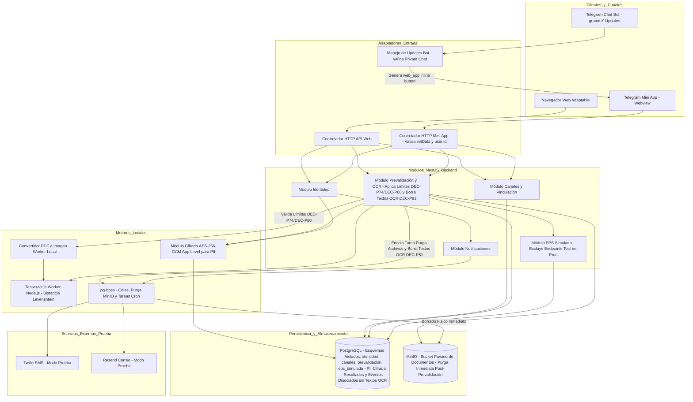

<!--
Agente: Architecture Agent
Proveedor: gemini
Modelo: gemini-3.5-flash-lite
Fecha: 2026-11-02 09:06
Petición: Modo cambio. Publica la ARQ-005 como versión 1.1 en estado Candidata, para alinearla con las decisiones posteriores a su aprobación. No la marques Aprobada: la aprueba una persona. Cambia solo lo siguiente, conserva todo lo demás y registra los cambios en el historial y en el análisis de impacto, sin borrar líneas de versiones anteriores. Escribe en español.

(1) SPEC de origen: SPEC-001 v1.5, SPEC-002 v1.11, SPEC-003 v1.14 y SPEC-008 v1.10.
(2) DEC-P81. Los textos leídos por OCR (medicamentos y diagnóstico) ya no se conservan cifrados: solo existen mientras se procesa la solicitud y se borran con las fotos y los PDF al terminar la prevalidación (SPEC-003/RF-032). Por cada fórmula solo se persisten el resultado (apta o no apta), el motivo, el siguiente paso y el número de fórmula. Aplica esto en COMP-003, COMP-005, el paso 11 del Flujo 2, ADR-003, ADR-007 y el atributo de calidad de seguridad. ADR-007 sigue cifrando lo que se persiste y aplica DEC-P51 tras revocar. El evento de prevalidación (SPEC-008/RF-083) no guarda medicamentos ni diagnósticos.
(3) DEC-P74 y DEC-P80. Fija como parámetros técnicos configurables, con un valor por defecto propuesto y su justificación según el OCR y los workers: tamaño máximo por archivo, páginas máximas por PDF y fórmulas máximas por solicitud. Lo que supere un límite se rechaza antes de leerlo, sin gastar intento. Ubícalo en ADR-002 o en un ADR nuevo, y en COMP-003.
(4) ADR-006: elimina la frase de que SPEC-001 no sufre modificaciones; ahora SPEC-001 v1.5 recoge el tope en RF-012, con DEC-P61, DEC-P68, DEC-P78 y DEC-P82: con el tope alcanzado el código vigente sigue valiendo, y un envío cuenta si el código llegó por al menos un canal. El conteo depende de que la cola de notificaciones informe si el código llegó.
(5) No fijes valores que decide el equipo: umbral de tolerancia, valor del tope y de la ventana, purga de solicitudes abandonadas.
(6) Actualiza Trazabilidad, Riesgos técnicos, Verificación y Siguiente paso a esta versión. No escribas «cumple» en Completitud si queda algo pendiente.
-->

# ARQ-005. Prevalidación multicanal en Web y Telegram Mini App - Versión 1.1

Estado: Candidata
Modo: Cambio
SPECs de origen: SPEC-001 v1.5, SPEC-002 v1.11, SPEC-003 v1.14, SPEC-008 v1.10

## Resumen de la decisión
Se define la arquitectura técnica para la prevalidación multicanal (Web y Telegram Mini App) correspondiente al MVP DEC-P01. La solución se estructura como un Monolito Modular en NestJS con esquemas de base de datos aislados en PostgreSQL, cifrado a nivel de aplicación (AES-256-GCM) para la PII en reposo sin persistir los textos leídos por OCR (ADR-007, DEC-P81), almacenamiento de documentos en MinIO con borrado físico inmediato tras finalizar la prevalidación de la solicitud (ADR-003, DEC-P59), extracción OCR con Tesseract.js local sobre imágenes y páginas de PDF previamente convertidas en el servidor en local, con límites técnicos configurables de tamaño por archivo, páginas por PDF y fórmulas por solicitud (ADR-002, DEC-P74, DEC-P80), comparación por distancia Levenshtein (DEC-P60) y confirmación humana por documento sin edición, validación criptográfica de `initData` para la Mini App asimilando `user.id` con el destino del chat privado (ADR-004), un módulo de EPS simulada con endpoints de prueba ausentes en el build de producción (ADR-005), control de frecuencia de emisión OTP mediante tope configurable por celular y ventana temporal sin rechazos por tiempo de espera (ADR-006, DEC-P61), y disociación estricta de auditoría tras revocación conservando únicamente tipo de evento y fecha sin datos ni textos de salud (DEC-P51). Esta ARQ consolida las respuestas del equipo a ARCH-Q-001, ARCH-Q-002 y ARCH-Q-003.

## Architecture Drivers
- Driver: Seguridad de datos sensibles, cifrado y cumplimiento normativo. Pregunta: ¿Cómo garantizar la confidencialidad de la información médica, PII y textos en reposo y en base de datos cumpliendo la Ley 1581 de 2012, DEC-P51 y la norma antitrámites? Origen: SPEC-001/RF-003, SPEC-001/RNF-002, SPEC-003/RF-021, SPEC-003/RF-032, contexto 3.11, Ley 1581 de 2012, T-041, DEC-P51, DEC-P59, DEC-P81.
- Driver: Paridad multicanal sin dependencia de identidad en canales externos. Pregunta: ¿Cómo ofrecer paridad funcional entre la Web y Telegram Mini App asegurando que los identificadores de Telegram no constituyan prueba de identidad ni comprometan el origen criptográfico de las peticiones? Origen: SPEC-002/RF-011, SPEC-002/RNF-009, DEC-P10, DEC-P22, DEC-P29, DEC-P37, DEC-P52, T-040.
- Driver: Prevalidación estricta y procesamiento de documentos de salud. Pregunta: ¿Cómo procesar fotos/PDFs de fórmulas e historias clínicas, aplicar límites técnicos de tamaño, páginas y fórmulas (DEC-P74, DEC-P80), convertir páginas de PDF a imágenes, extraer medicamentos/diagnósticos con OCR local y ejecutar las reglas de negocio en el orden estricto establecido? Origen: SPEC-003/RF-021, RF-022, RF-024, RF-032, DEC-P04, DEC-P10, DEC-P11, DEC-P13, DEC-P49, DEC-P54, DEC-P55, DEC-P60, DEC-P74, DEC-P80, DEC-P81.
- Driver: Flexibilidad de pruebas sin alteración del producto de producción. Pregunta: ¿Cómo simular la EPS y provocar cambios de estado de forma segura durante las pruebas asegurando que los endpoints de configuración queden totalmente ausentes en el artefacto de producción? Origen: SPEC-008/RF-075, RF-076, RF-082, DEC-P36.

## Restricciones arquitectónicas
- Stack tecnológico aprobado: NestJS (TypeScript), PostgreSQL + Prisma, MinIO (almacenamiento de objetos privado), pg-boss (cola de tareas en PostgreSQL), grammY (bot de Telegram), React + Vite (web adaptable sin instalación). Origen: propuesta-tecnologica.md §2.
- Restricción de canales y OCR (DEC-P10, DEC-P55): Aplicación web adaptable al celular sin instalación, usable directamente o como Mini App de Telegram. El chat del bot solo transmite avisos de plantilla fija con botones web_app en línea que abren la Mini App. El OCR no procesa archivos enviados al chat de Telegram y requiere vista previa de confirmación humana independiente por documento sin edición manual (DEC-P04, DEC-P55).
- Restricción de identidad y origen en Telegram (DEC-P29, DEC-P37, DEC-P52): La identidad siempre requiere verificación con cédula y código OTP. El `chat_id` de Telegram se obtiene de los updates del bot y se guarda como destino para notificaciones. La Mini App se abre solo tras verificar que el chat es privado (`message.chat.type === 'private'`).
- Restricción de simulación para pruebas (DEC-P36): Las llamadas/endpoints de configuración de la EPS simulada deben estar ausentes en el build de producción (no compiladas ni expuestas) para cumplir DEC-P36.
- Restricción de recursos y tiempo: Equipo de 4 personas y desarrollo en 8 semanas (contexto 3.9).
- Obsolescencia técnica (T-039): Las propuestas ARQ-003 y ARQ-004 quedan formalmente obsoletas (T-040).

## Atributos de calidad
- Atributo: Seguridad y Privacidad (Confidencialidad, Eliminación Física, No Persistencia de Textos OCR y Disociación). Condición: Los archivos de salud se almacenan cifrados en MinIO y se eliminan físicamente de forma inmediata al terminar la prevalidación de la solicitud (DEC-P59); los textos leídos por OCR (medicamentos y diagnóstico) ya no se conservan cifrados: solo existen mientras se procesa la solicitud y se borran con las fotos y los PDF al terminar la prevalidación (SPEC-003/RF-032, DEC-P81), conservándose únicamente el resultado (apta o no apta), el motivo, el siguiente paso y el número de fórmula; ADR-007 sigue cifrando lo que se persiste; ante revocación, los datos personales y resultados se eliminan totalmente sin depender de la destrucción de claves, y en los eventos de auditoría se conservan únicamente el tipo de evento y la fecha (DEC-P51) (origen: SPEC-001/RNF-002, SPEC-002/RNF-009, SPEC-003/RF-032, SPEC-008/RF-083, DEC-P51, DEC-P59, DEC-P81, T-041).
- Atributo: Usabilidad e Integridad de Datos (Confirmación Human-in-the-Loop por Documento). Condición: La extracción OCR por Tesseract.js debe presentarse en una vista previa independiente por cada documento cargado donde el usuario valida o rechaza lo leído sin edición de texto (origen: SPEC-003/RF-030, DEC-P04, DEC-P54, DEC-P55).
- Atributo: Mantenibilidad y Modularidad (Isolation por Esquemas). Condición: Cada módulo arquitectónico debe poseer la propiedad exclusiva de su esquema en PostgreSQL (`identidad`, `canales`, `prevalidacion`, `eps_simulada`), interactuando únicamente mediante servicios e interfaces declaradas (origen: propuesta-tecnologica.md §3, T-042).
- Atributo: Disponibilidad e Interoperabilidad (Resiliencia en Servicios Externos). Condición: Las fallas en los envíos de SMS (Twilio) o correo (Resend) deben notificarse al usuario permitiendo el reintento o la derivación a atención presencial, sin bloquear el estado del sistema (origen: SPEC-001/RF-011, RNF-001).

## Preguntas de aclaración
- ARCH-Q-001. Política de retención de archivos de salud (fotos/PDFs de fórmulas e historias clínicas) en almacenamiento de objetos (PREG-015, SPEC-003/OPEN-Q-011, T-010).
  Por qué importa: Define el ciclo de vida de los archivos en MinIO.
  Crítica: no
  Estado: Respondida (respuesta del equipo - DEC-P59)
  Responsable: equipo
  Respuesta: Los archivos se borran físicamente de MinIO al terminar la prevalidación de la solicitud y solo queda el resultado preliminar. El borrado se ejecuta mediante una tarea asíncrona de pg-boss y se registra sin datos de salud. SPEC-003 v1.14 ya recoge DEC-P59 en SPEC-003/RF-032, con la precisión de DEC-P81.

- ARCH-Q-002. Propuesta de tolerancia para la coincidencia de textos leídos por OCR frente al catálogo de la EPS simulada (DEC-P49, DEC-P56).
  Por qué importa: Define el algoritmo técnico de comparación para validar la coincidencia de medicamentos.
  Crítica: no
  Estado: Respondida (respuesta del equipo - DEC-P60)
  Responsable: equipo
  Respuesta: Se utiliza distancia Levenshtein. El umbral es un parámetro sin valor decidido que se fija tras medir el OCR con documentos sintéticos impresos y requiere aprobación del equipo.

- ARCH-Q-003. Estrategia de control de frecuencia (rate limiting) para la generación de códigos de verificación por SMS/correo sin contradecir SPEC-001/BR-003 (T-023).
  Por qué importa: Protege la infraestructura contra abusos de mensajería.
  Crítica: no
  Estado: Respondida (respuesta del equipo - DEC-P61)
  Responsable: equipo
  Respuesta: Se aplica un tope configurable de envíos por celular y ventana de tiempo. Al alcanzarlo, no se envían más códigos y se muestra la ruta alterna de SPEC-001. No se rechaza ninguna petición por tiempo de espera. SPEC-001 v1.5 recoge el tope en SPEC-001/RF-012 (DEC-P61, DEC-P68, DEC-P78, DEC-P82). El valor exacto lo fija el equipo.

No hay preguntas pendientes.

## Alternativas consideradas
- Alternativa 1: Arquitectura de Microservicios desacoplados con OCR en microservicio Python (FastAPI/EasyOCR) y almacenamiento S3 público.
  Descripción: Servidores independientes para identidad, canal Telegram, prevalidación y motor OCR en Python.
  Ventajas: Aislamiento total de procesos y librerías OCR especializadas en Python.
  Desventajas: Alta complejidad operativa, sobrecosto de infraestructura, latencia por llamadas HTTP entre servicios y riesgo de incumplimiento de Ley 1581 por transferencia de datos si se usan servicios Cloud externos.
- Alternativa 2: Monolito Modular en NestJS con esquemas aislados en PostgreSQL, cifrado a nivel de aplicación (AES-256-GCM), OCR local con Tesseract.js (con conversión interna de páginas PDF a imagen en el servidor) y almacenamiento privado cifrado en MinIO con purga inmediata post-prevalidación y borrado de textos OCR leídos (DEC-P81).
  Descripción: Aplicación única desplegada en contenedor con módulos aislados por código y base de datos, ejecutando Tesseract.js localmente en el servidor backend sobre imágenes o páginas PDF convertidas, aplicando límites configurables (DEC-P74, DEC-P80) y no persistiendo textos leídos (DEC-P81).
  Ventajas: Unificación de lenguaje (TypeScript de punta a punta), cumplimiento directo de restricciones del proyecto (4 personas, 8 semanas), cifrado a nivel de aplicación para PII en PostgreSQL, cero persistencia de datos de salud procesados (DEC-P81), cero transferencia internacional de datos.
  Desventajas: El procesamiento OCR y la conversión de PDF a imagen consumen CPU en el servidor de aplicación durante ráfagas de carga.

## Matriz de decisión

| Alternativa | Mantenibilidad (0.25) | Seguridad / Privacidad (0.30) | Complejidad de despliegue (0.20) | Tiempo de desarrollo (0.25) | Total |
|---|---|---|---|---|---|
| Alternativa 1: Microservicios + OCR Python | 3 | 3 | 1 | 2 | 2.35 |
| Alternativa 2: Monolito Modular NestJS + Tesseract.js local + Cifrado BD | 5 | 5 | 5 | 4 | 4.75 |

Justificación de pesos:
- Seguridad / Privacidad (0.30): Ley 1581 de 2012, DEC-P51, DEC-P59, DEC-P81 y protección estricta de datos de salud en reposo y en base de datos (contexto 3.11, T-041).
- Mantenibilidad (0.25) y Tiempo de desarrollo (0.25): Restricción de equipo pequeño (4 personas) y marco temporal corto (8 semanas, contexto 3.9).
- Complejidad de despliegue (0.20): Necesidad de un entorno controlado en Docker Compose para prototipado funcional.

## Arquitectura seleccionada
- Decisión: Monolito Modular en NestJS con arquitectura de Puertos y Adaptadores (Ports and Adapters), esquemas de PostgreSQL aislados por módulo (`identidad`, `canales`, `prevalidacion`, `eps_simulada`), cifrado a nivel de aplicación (AES-256-GCM) para PII almacenada en PostgreSQL (ADR-007), procesamiento OCR local mediante Tesseract.js en workers Node.js previa conversión local de páginas PDF a imagen (ADR-002), aplicación de límites técnicos configurables de tamaño por archivo, páginas por PDF y fórmulas por solicitud (DEC-P74, DEC-P80), almacenamiento de archivos en MinIO con borrado físico inmediato tras la prevalidación (ADR-003, DEC-P59) y eliminación de textos leídos por OCR (DEC-P81), validación estricta de `initData` de Mini App (ADR-004), módulo EPS simulada ausente en producción (ADR-005), control de frecuencia OTP por tope configurable por celular y ventana temporal (ADR-006, DEC-P61) y cola de tareas `pg-boss`.
- Por qué: Satisface las restricciones del proyecto (propuesta-tecnologica.md §3), garantiza el aislamiento, cifrado y purga física de archivos y textos de salud exigidos por la Ley 1581, DEC-P51, DEC-P59 y DEC-P81, elimina dependencias externas de OCR y permite mantenibilidad en un equipo de 4 personas.
- ADR: ADR-001 (Monolito Modular NestJS y Fronteras de Datos), ADR-002 (Motor y Flujo de OCR, Conversión PDF Local, Límites Técnicos DEC-P74/DEC-P80, Levenshtein y Confirmación Humana), ADR-003 (Almacenamiento y Purga Física Inmediata de Documentos de Salud en MinIO), ADR-004 (Validación Criptográfica de initData en Telegram Mini App y Manejo de Destino vs Identidad), ADR-005 (EPS Simulada Ausente en Producción), ADR-006 (Control de Frecuencia de Emisión de Códigos OTP mediante Tope Configurable), ADR-007 (Cifrado de PII a Nivel de Aplicación en PostgreSQL, No Persistencia de Textos OCR DEC-P81 y Disociación de Auditoría).

## Diagrama conceptual

## Componentes y responsabilidades

- COMP-001. Módulo de Identidad (`identidad`): Gestiona el registro de aceptación del aviso de privacidad (titular/tercero), la emisión y validación de códigos OTP (SMS/correo) con caducidad de 10 minutos y máximo 3 intentos, la verificación de topes configurables de emisión por celular y ventana temporal (ADR-006, DEC-P61), la autorización separada para datos de salud, y la ejecución del flujo de revocación de consentimiento con eliminación de datos y disociación de eventos de auditoría (DEC-P51). Cifra la PII guardada en base de datos mediante ADR-007. Traza a: SPEC-001/RF-001, RF-002, RF-004, RF-005, RF-007, RF-009, ADR-001, ADR-006, ADR-007, DEC-P51, DEC-P61.
- COMP-002. Módulo de Canales y Vinculación (`canales`): Administra la vinculación independiente entre un canal (`chat_id` de Telegram o cookie de navegador) y uno o varios pacientes, el ciclo de vida de 3 meses calendario, la reactivación con código nuevo, la desvinculación voluntaria, la validación criptográfica de `initData` de la Mini App (asociando `user.id` con `chat_id` en chats privados), y el formateo de enmascaramiento (`CC ***1234`). Traza a: SPEC-002/RF-011, RF-013, RF-014, RF-016, RF-085, RF-086, RF-087, RNF-009, ADR-004.
- COMP-003. Módulo de Prevalidación y OCR (`prevalidacion`): Ejecuta la ingesta de fotos/PDFs, valida límites configurables de tamaño de archivo, páginas de PDF y número de fórmulas por solicitud rechazando excedentes antes de leerlos y sin gastar intento (DEC-P74, DEC-P80), con los valores por defecto propuestos en ADR-002 (10 MB por archivo, 3 páginas por PDF y 5 fórmulas por solicitud; propuesta de Arquitectura, ajustable tras la medición del OCR), realiza la conversión local de páginas de PDF a imágenes en el servidor, invoca el worker de Tesseract.js, compara la coincidencia de medicamentos usando distancia Levenshtein (DEC-P60), aplica cifrado a nivel de aplicación AES-256-GCM exclusivamente a PII (ADR-007), **no persiste los textos leídos por OCR (medicamentos y diagnóstico) cumpliendo DEC-P81 y SPEC-003/RF-032**, generando únicamente el resultado (apta o no apta), el motivo, el siguiente paso y el número de fórmula, genera los datos para la vista previa de confirmación humana por documento (DEC-P55), clasifica fórmulas en agudas/crónicas, calcula la fecha de cita posible, ejecuta las reglas de prevalidación secuencial, ordena la purga física inmediata de archivos en MinIO al finalizar la solicitud (ADR-003, DEC-P59) y registra el evento de auditoría disociado (DEC-P51). Traza a: SPEC-003/RF-021, RF-022, RF-023, RF-024, RF-029, RF-030, RF-032, ADR-002, ADR-003, ADR-007, DEC-P51, DEC-P55, DEC-P59, DEC-P60, DEC-P74, DEC-P80, DEC-P81.
- COMP-004. Módulo EPS Simulada (`eps_simulada`): Provee la persistencia interna y endpoints de consulta de afiliados, fórmulas MIPRES (20 dígitos), catálogo de cobertura PBS, vigencias y autorizaciones. En builds de producción, los controladores y llamadas de modificación para pruebas se excluyen totalmente del compilado (ADR-005). Traza a: SPEC-008/RF-075, RF-076, RF-077, RF-080, RF-082, ADR-005.
- COMP-005. Servicio de Almacenamiento y Purga de Documentos (`documentos`): Encargado del guardado en MinIO y de la ejecución del borrado físico inmediato de los archivos de fórmulas e historias clínicas al concluir la prevalidación de la solicitud o ante una revocación (DEC-P59). Traza a: SPEC-001/RNF-002, SPEC-003/RF-021, ADR-003, DEC-P59.
- COMP-006. Servicio de Notificaciones y Tareador (`tareas_notificaciones`): Administra la cola de tareas asíncronas mediante `pg-boss`, orquestando la purga de archivos en MinIO y los envíos reales a los planes de prueba de Twilio (SMS) y Resend (correo). Traza a: SPEC-001/RNF-001, SPEC-002/BR-008, propuesta-tecnologica.md §5, ADR-003.

## Integraciones y flujos técnicos

- Flujo 1: Autenticación y Vinculación en Telegram Mini App.
  1. El bot de Telegram recibe updates de mensajes únicamente en chats privados (`message.chat.type === 'private'`). Obtiene el `chat_id` y lo registra en el contexto de la conversación como dirección de respuesta (`destino`). El bot responde enviando un mensaje con un botón de teclado en línea (`web_app`) para abrir la Mini App.
  2. La persona presiona el botón y la Mini App envía en los encabezados HTTP el string `initData` provisto por Telegram.
  3. COMP-002 valida criptográficamente `initData` calculando el HMAC-SHA256 del token del bot con la clave fija "WebAppData" (`HMAC-SHA256("WebAppData", bot_token)`). Rechaza la solicitud si `initData` llega vacío, si incluye la propiedad `chat`, o si la propiedad `chat_type` está presente y es distinta de `private` o `sender`. Evalúa `auth_date` contra el parámetro configurable `auth_date_max_age`.
  4. COMP-002 asocia la petición de la Mini App con el canal localizando el `chat_id` a través del `user.id` extraído del `initData` validado (puesto que en chats privados el ID del chat coincide con el ID del usuario). Esta asociación identifica el canal (`destino`) pero NUNCA prueba la identidad legal del paciente.
  5. COMP-002 evalúa el estado de vinculación para ese paciente en ese canal:
     - Sin vinculación previa o activa (incluyendo desvinculación o revocación): exige el flujo completo de cédula + código OTP de COMP-001 (DEC-P22, DEC-P39).
     - Vinculación vencida: exige únicamente un código OTP nuevo de COMP-001, sin solicitar la cédula (DEC-P26).
     - Vinculación vigente: permite realizar la gestión de forma directa sin solicitar código de verificación (DEC-P22).

- Flujo 2: Carga de Documentos, OCR y Prevalidación Técnica.
  1. Si el paciente aún no ha otorgado la autorización para el tratamiento de datos de salud, el sistema la solicita antes de permitir la carga de documentos (COMP-001, DEC-P46).
  2. El cliente sube la foto o archivo PDF mediante multipart a COMP-003.
  3. COMP-003 valida los límites configurables (DEC-P74, DEC-P80): tamaño máximo por archivo (por defecto 10 MB), páginas máximas por PDF (por defecto 3) y fórmulas máximas por solicitud (por defecto 5); valores propuestos por Arquitectura en ADR-002, ajustables tras la medición del OCR. Si un archivo supera el límite de tamaño/páginas, o la solicitud supera el límite de fórmulas, se rechaza antes de leerlo, sin gastar intento (DEC-P74, DEC-P80).
  4. COMP-005 almacena el archivo en MinIO. Si el documento es un archivo PDF, COMP-003 realiza una conversión local de cada página del PDF a imagen bitmap en el servidor (Node.js worker thread) sin enviar datos fuera del sistema.
  5. COMP-003 procesa las imágenes resultantes con el worker de Tesseract.js extrayendo el número MIPRES de 20 dígitos, los medicamentos y los diagnósticos.
  6. COMP-003 presenta una vista previa independiente por cada documento cargado (fórmulas e historia clínica) con los datos leídos hacia la interfaz (Web o Mini App) para la confirmación humana (DEC-P55).
  7. El usuario valida o rechaza lo leído en cada vista previa (sin edición manual de texto). Si el usuario rechaza la vista previa o si falta algún dato obligatorio (número/medicamentos en fórmula; diagnóstico en historia clínica), el documento se trata como ilegible (DEC-P54) y consume 1 intento de carga (máximo 2 intentos por documento). Si la historia clínica agota sus 2 intentos, todas las fórmulas de la solicitud quedan no aptas.
  8. COMP-003 evalúa la coincidencia de cada fórmula con la EPS simulada según SPEC-003/BR-013 (existencia de prescripción, pertenencia al paciente y coincidencia de lista de medicamentos evaluada mediante distancia Levenshtein con umbral configurable, DEC-P49, DEC-P60).
  9. COMP-003 clasifica cada fórmula como agudo o crónico según el diagnóstico asignado y el catálogo configurable.
  10. COMP-003 ejecuta la prevalidación en orden estricto:
      a) Afiliación activa: se verifica SIEMPRE una vez por solicitud, independientemente de si algún documento falló; si está inactiva, detiene el procesamiento y ese resultado reemplaza a todos los demás (DEC-P33).
      b) Vigencia de la fórmula.
      c) Cobertura PBS (prevaleciendo catálogo simulado; medicamentos no listados se tratan como no PBS).
      d) Estado de autorización (decisivo únicamente para medicamentos no PBS).
      e) Cita posible para crónicas (evaluando previamente la existencia de fecha habilitada - DEC-P50).
  11. COMP-003 genera el resultado preliminar por fórmula (Apta / No Apta con motivo y siguiente paso). Inmediatamente al finalizar el procesamiento de la solicitud, COMP-003/COMP-005 encola una tarea en `pg-boss` para el borrado físico inmediato de las fotos/PDFs en MinIO y **elimina los textos leídos por OCR (medicamentos y diagnóstico) según DEC-P81 y SPEC-003/RF-032**, conservando únicamente por cada fórmula el resultado (apta o no apta), el motivo, el siguiente paso y el número de fórmula como identificador en base de datos (ADR-003, ADR-007, DEC-P59, DEC-P81).
  12. COMP-003 cifra la PII mediante el módulo de cifrado a nivel de aplicación AES-256-GCM antes de persistir (ADR-007). COMP-003 registra el evento de auditoría. Ante una revocación del consentimiento, los resultados se eliminan directamente y en el registro de auditoría se conservan únicamente el tipo de evento y su fecha, sin textos de salud ni datos de identificación (DEC-P51).

- Flujo 3: Provocación de Cambios de Estado en Pruebas.
  1. En entorno de desarrollo/pruebas, el equipo modifica registros en el esquema `eps_simulada` mediante scripts de base de datos o seeds de configuración (DEC-P36).
  2. Los controladores HTTP de modificación para pruebas se compilan condicionalmente y están completamente ausentes en el artefacto de producción (ADR-005).
  3. En la siguiente consulta de prevalidación, COMP-003 lee en tiempo real el estado actualizado en COMP-004 y emite el nuevo resultado.

## ADR

- ADR-001. Monolito Modular en NestJS con aislación de esquemas PostgreSQL
  Estado: Propuesta
  Contexto: Se requiere construir un backend robusto, mantenible por 4 personas en 8 semanas, con separación de dominios por SPEC.
  Problema: Evitar el acoplamiento descontrolado de datos entre módulos manteniendo un despliegue simple.
  Alternativas: a) Monolito tradicional en esquema `public`; b) Microservicios independientes; c) Monolito Modular con esquemas de PostgreSQL aislados.
  Decisión: Adoptar Monolito Modular en NestJS donde cada módulo (`identidad`, `canales`, `prevalidacion`, `eps_simulada`) posee su propio esquema en PostgreSQL gestionado vía Prisma.
  Justificación: Garantiza límites claros de dominio, evita consultas cruzadas no autorizadas y mantiene la simplicidad de infraestructura.
  Consecuencias positivas: Alto aislamiento de datos, facilidad de prueba, migración futura simplificada.
  Consecuencias negativas: Exige disciplina de diseño para evitar imports circulares entre módulos NestJS.
  Supuestos: PostgreSQL soporta múltiples esquemas dentro de una misma base de datos.
  Evidencia: propuesta-tecnologica.md §3, T-042.

- ADR-002. Motor y Flujo de OCR, Conversión PDF Local, Límites Técnicos (DEC-P74, DEC-P80), Levenshtein y Confirmación Humana
  Estado: Propuesta
  Contexto: SPEC-003 exige extraer datos de documentos cargados (fórmulas e historias clínicas) preservando la privacidad de datos de salud (Ley 1581). Tesseract.js no lee archivos PDF directamente. Se requiere un criterio de comparación de medicamentos leídos por OCR frente al catálogo simulado (DEC-P49, DEC-P60) y límites técnicos configurables para rechazar archivos excedentes sin gastar intento (DEC-P74, DEC-P80).
  Problema: Extraer texto de fotos y archivos PDF localmente sin enviar datos fuera del servidor, comparar similitud de texto de forma tolerante a errores de OCR, no permitir edición manual y establecer parámetros técnicos configurables para límites de tamaño de archivo, páginas PDF y fórmulas por solicitud.
  Alternativas: a) Servicios SaaS externos (Cloud Vision / Textract); b) Tesseract.js local con conversión previa de PDF a imagen en el servidor en local, comparación por distancia Levenshtein y límites configurables (DEC-P74, DEC-P80); c) Servidor OCR separado en Python (EasyOCR) con Jaro-Winkler.
  Decisión: Usar Tesseract.js ejecutado en workers Node.js. Para archivos PDF, implementar una conversión local de cada página PDF a imagen bitmap en el servidor (tarea técnica que corre en local). Establecer como parámetros técnicos configurables (DEC-P74, DEC-P80) los siguientes valores por defecto, que son propuesta de Arquitectura y se ajustan tras la medición del OCR con documentos sintéticos impresos:
  - Tamaño máximo por archivo: 10 MB. Una foto de celular en JPG o PNG o un PDF de pocas páginas suele quedar por debajo de ese valor, y el límite acota la memoria que el worker de Tesseract.js necesita para decodificar la imagen a mapa de bits sin comprometer el resto del proceso de Node.js.
  - Páginas máximas por PDF: 3. Una fórmula o una historia clínica sintética ocupa normalmente 1 o 2 páginas; cada página se convierte localmente a imagen y pasa por el OCR, que es la operación de mayor consumo de CPU del prototipo, de modo que el límite acota el tiempo de procesamiento por documento.
  - Fórmulas máximas por solicitud: 5. Con 3 páginas por documento y hasta 2 intentos por documento (DEC-P07), el peor caso de una solicitud queda acotado en un número fijo de páginas para OCR, compatible con un servidor de prototipo con pocos workers en paralelo y sin bloquear al resto de usuarios.
  Lo que supere un límite se rechaza antes de leerlo, sin gastar intento (DEC-P74, DEC-P80). Evaluar la coincidencia de listas de medicamentos mediante el algoritmo de distancia Levenshtein (DEC-P60), cuyo umbral de tolerancia es un parámetro sin valor decidido que se fijará tras ejecutar una medición previa de OCR sobre documentos sintéticos impresos y requiere aprobación del equipo. Presentar una vista previa de confirmación humana independiente por documento donde el usuario solo valida o rechaza (DEC-P04, DEC-P55).
  Justificación: Cumple con la Ley 1581 (cero salida de datos), protege contra ataques de denegación por archivos gigantes (DEC-P74, DEC-P80), no genera costos de licencias SaaS, unifica la pila en TypeScript y provee tolerancia a errores tipográficos del OCR.
  Consecuencias positivas: Cero transferencia internacional de datos, soporte transparente de imágenes/PDF, control de recursos y rigurosidad técnica.
  Consecuencias negativas: La conversión de PDF y el OCR incrementan el uso de CPU/memoria. Existe el riesgo principal de que el OCR no alcance un nivel útil en documentos complejos.
  Supuestos: Se realizará una tarea técnica previa de medición del motor OCR con documentos sintéticos impresos para ajustar el umbral de Levenshtein.
  Evidencia: propuesta-tecnologica.md §7, DEC-P04, DEC-P10, DEC-P49, DEC-P54, DEC-P55, DEC-P60, DEC-P74, DEC-P80, SPEC-003/RF-022, RF-030.

- ADR-003. Almacenamiento y Purga Física Inmediata de Documentos de Salud en MinIO (DEC-P59)
  Estado: Propuesta
  Contexto: Las fotos y PDFs cargados contienen datos sensibles de salud. SPEC-001/RNF-002 y DEC-P59 exigen la eliminación de archivos tras el procesamiento. SPEC-003 v1.14 ya recoge esta decisión en SPEC-003/RF-032, con la precisión de DEC-P81.
  Problema: Definir la política de retención de archivos binarios en el almacenamiento de objetos de forma segura y normativamente conforme.
  Alternativas: a) Retención indefinida o hasta la revocación del consentimiento; b) Expiración por tiempo tras X días; c) Borrado físico inmediato de fotos y PDFs al terminar la prevalidación de la solicitud, conservando únicamente el resultado preliminar (DEC-P59).
  Decisión: Adoptar el borrado físico inmediato de los archivos cargados en MinIO en cuanto concluya el procesamiento de prevalidación de la solicitud (DEC-P59). El borrado se ejecuta mediante una tarea asíncrona orquestada por `pg-boss` y se registra en logs sin incluir PII ni datos de salud. Se eliminan las opciones de expiración por tiempo o retención hasta revocación. Una solicitud abandonada (sin concluir la prevalidación) se declara como riesgo técnico y como parámetro de purga sin valor decidido (se fijará por el equipo sin inventar plazos).
  Justificación: Minimiza radicalmente la superficie de exposición de datos sensibles de salud y cumple estrictamente con DEC-P59 y la Ley 1581.
  Consecuencias positivas: Cero acumulación de archivos médicos binarios sensibles en el servidor, máxima privacidad.
  Consecuencias negativas: Imposibilidad de re-inspeccionar visualmente el documento original tras finalizar el flujo digital; si el usuario reintenta en una nueva sesión, debe volver a cargar el archivo.
  Supuestos: MinIO se ejecuta localmente dentro del mismo entorno Docker Compose y `pg-boss` ejecuta la purga de forma confiable.
  Evidencia: SPEC-001/RNF-002, DEC-P59, PREG-015, ARCH-Q-001.

- ADR-004. Validación Criptográfica de initData en Telegram Mini App y Desacoplamiento de Identidad
  Estado: Propuesta
  Contexto: SPEC-002 exige paridad multicanal con Telegram Mini App. De acuerdo con la documentación de Telegram (`core.telegram.org/bots/webapps`), `initData` no entrega el `chat_id` en chats privados; el campo `chat` solo se incluye en grupos o canales, y `chat_type` al abrir vía enlace directo.
  Problema: Autenticar criptográficamente la petición desde la Mini App y asociarla al destino del chat sin asumir que Telegram prueba la identidad legal del paciente.
  Alternativas: a) Usar los datos de Telegram como identidad automática del paciente; b) Validar `initData` con HMAC-SHA256, obtener el `chat_id` de los updates del bot, asociarlo mediante `user.id` en chats privados y mantener separada la identidad legal del paciente.
  Decisión:
  1. El `chat_id` se obtiene de los updates de mensajes del bot en chats privados (`message.chat.type === 'private'`) y se guarda únicamente como dirección de destino (`destino`).
  2. La Mini App se abre exclusivamente desde un botón de teclado en línea (`web_app`), enviado por el bot tras verificar que el chat es privado.
  3. La petición HTTP de la Mini App valida criptográficamente el `initData` recibido. El secreto del HMAC es el hash HMAC-SHA256 del token del bot con la clave de cadena fija «WebAppData» (`HMAC-SHA256("WebAppData", bot_token)`).
  4. La petición se asocia al canal localizando el `chat_id` mediante el `user.id` del `initData` validado (dado que en chats privados el ID de usuario coincide con el ID de chat). Esto ubica el canal pero NUNCA prueba la identidad legal.
  5. Se rechaza cualquier petición con `initData` vacío, que contenga el objeto `chat`, o con `chat_type` diferente de `private` o `sender`.
  6. Se verifica `auth_date` contra un parámetro de vigencia máxima configurable (`auth_date_max_age`).
  Justificación: Respeta la especificación técnica oficial de Telegram WebApps y garantiza cumplimiento de RNF-009 de SPEC-002 y DEC-P52.
  Consecuencias positivas: Alta seguridad criptográfica, prevención de falsificación de peticiones webview y respeto estricto a las reglas de identidad.
  Consecuencias negativas: Requiere validación rigurosa de firma en cada llamada HTTP de la Mini App.
  Supuestos: Telegram entrega `initData` válido firmado en cada apertura de la Mini App desde el botón inline.
  Evidencia: SPEC-002/RNF-009, DEC-P22, DEC-P29, DEC-P37, DEC-P52, core.telegram.org/bots/webapps.

- ADR-005. Módulo EPS Simulada Ausente en Producción
  Estado: Propuesta
  Contexto: SPEC-008 exige simular la EPS y permitir provocar cambios de estado durante las pruebas. DEC-P36 establece que los cambios de estado los realiza el equipo mediante datos o configuración sin interfaz de producto ni rol de usuario adicional.
  Problema: Asegurar que los mecanismos y endpoints de modificación de estado de prueba no existan ni puedan ser invocados en el entorno de producción.
  Alternativas: a) Deshabilitar controladores de prueba mediante banderas de configuración en tiempo de ejecución (`if (env === 'prod') return 403`); b) Excluir condicionalmente del compilado de producción los controladores y rutas de modificación de prueba (ausentes en producción).
  Decisión: Las llamadas y endpoints de configuración interna de prueba deben quedar completamente ausentes en el artefacto de producción mediante módulos NestJS condicionales/dynamic imports o segregación de compilación, de modo que el código de modificación de pruebas no exista físicamente en la imagen/build de producción.
  Justificación: Cumple estrictamente con DEC-P36 y elimina vectores de ataque en producción por endpoints administrativos olvidados o mal configurados.
  Consecuencias positivas: Cero superficie de ataque por APIs de prueba en producción.
  Consecuencias negativas: Requiere configurar adecuadamente las variables de entorno y los módulos condicionales en el proceso de build de NestJS.
  Supuestos: Las pruebas se ejecutan en un entorno de staging/desarrollo donde las variables de build/entorno habilitan el módulo de simulación de prueba.
  Evidencia: SPEC-008/RF-075, RF-076, RF-082, DEC-P36.

- ADR-006. Control de Frecuencia (Rate Limiting) para Emisión de OTP mediante Tope Configurable (DEC-P61)
  Estado: Propuesta
  Contexto: SPEC-001/BR-003 establece que la solicitud de un código nuevo anula de inmediato el anterior. T-023 y DEC-P61 requieren proteger la emisión de SMS/correo contra abusos.
  Problema: Prevenir abusos de envío de SMS/correo sin rechazar solicitudes por tiempo de espera.
  Alternativas: a) Rechazar con HTTP 429 tras un tiempo de espera fijo (ej. 60s); b) Implementar un tope configurable de envíos por celular y ventana temporal (DEC-P61).
  Decisión: Establecer un tope configurable de envíos por número de celular y ventana de tiempo, que SPEC-001 v1.5 recoge en SPEC-001/RF-012 (DEC-P61, DEC-P68, DEC-P78, DEC-P82). Al alcanzar dicho tope, el sistema no envía más códigos y despliega la ruta alterna, que ofrece solo la orientación para actualizar datos en la EPS y la atención presencial (DEC-P68). Con el tope alcanzado, pedir otro código no anula el vigente, que sigue valiendo hasta vencer o agotar sus intentos (DEC-P78, SPEC-001/BR-003). Un envío cuenta para el tope si el código llegó por al menos un canal; solo es fallido, y no cuenta, si fallan todos los canales, y un código enviado por SMS y correo cuenta como un solo envío (DEC-P78, DEC-P82). Por eso el conteo depende de que la cola de notificaciones (COMP-006) informe a COMP-001 si el código llegó por cada canal. No se rechaza ninguna petición por tiempo de espera de intermedio. Se retiran la limitación por IP o canal como decisión y la regla de 60 segundos. El valor exacto del tope y de la ventana temporal lo fijará el equipo como parámetro de configuración.
  Justificación: Aplica la regla de negocio de SPEC-001/RF-012 y SPEC-001/BR-003, evita costos descontrolados de mensajería y cumple con DEC-P61, DEC-P68, DEC-P78 y DEC-P82.
  Consecuencias positivas: Coherencia plena con SPEC-001 y protección efectiva de la pasarela de mensajes.
  Consecuencias negativas: Si un usuario legítimo agota el tope, deberá recurrir a la ruta alterna hasta que venza la ventana temporal. El conteo exige que la cola de notificaciones reporte el resultado de entrega por canal.
  Supuestos: El equipo definirá los valores numéricos del tope y la ventana temporal antes de las pruebas de integración. Los planes de prueba de Twilio y Resend permiten a la cola de notificaciones saber si el envío por cada canal falló.
  Evidencia: SPEC-001/RF-012, SPEC-001/BR-003, DEC-01, DEC-P61, DEC-P68, DEC-P78, DEC-P82, T-023, ARCH-Q-003.

- ADR-007. Cifrado de PII a Nivel de Aplicación en PostgreSQL, No Persistencia de Textos OCR (DEC-P81) y Disociación de Auditoría (T-041, DEC-P51)
  Estado: Propuesta
  Contexto: El sistema almacena en PostgreSQL PII, diagnósticos y textos leídos por OCR. T-041, DEC-P51 y DEC-P81 exigen cifrado en reposo, disociación de auditoría tras revocación y borrado estricto de textos leídos por OCR al terminar la prevalidación (SPEC-003/RF-032).
  Problema: Proteger la PII en base de datos cumpliendo la Ley 1581, asegurar que la revocación elimine resultados sin depender exclusivamente de destruir claves, y cumplir DEC-P81 evitando persistir textos leídos por OCR.
  Alternativas: a) Cifrado en disco / TDE y persistencia cifrada de textos OCR; b) Cifrado a nivel de aplicación (AES-256-GCM) para PII en PostgreSQL, no persistencia de textos leídos por OCR (guardando únicamente resultado, motivo, siguiente paso y número de fórmula según DEC-P81), y borrado directo de registros al revocar, conservando únicamente tipo de evento y fecha en auditoría (DEC-P51).
  Decisión: Implementar cifrado a nivel de aplicación (AES-256-GCM) para las columnas de PII en los esquemas de PostgreSQL. Conforme a DEC-P81 y SPEC-003/RF-032, los textos leídos por OCR (medicamentos y diagnóstico) no se conservan cifrados ni en texto plano: solo existen mientras se procesa la solicitud y se borran con las fotos y los PDF al terminar la prevalidación, conservándose únicamente por cada fórmula el resultado (apta o no apta), el motivo, el siguiente paso y el número de fórmula como identificador. Ante una revocación del consentimiento, los datos personales y resultados se eliminan físicamente de la base de datos de forma directa (sin depender de la destrucción de una clave de cifrado). En los eventos de auditoría persistidos solo se conservan el tipo de evento y la fecha, sin incluir textos de salud, novedades ni datos de identificación (DEC-P51).
  Justificación: Ofrece la máxima protección normativamente requerida, cumple estrictamente con DEC-P81 y DEC-P51, y resuelve T-041.
  Consecuencias positivas: Imposibilidad de leer datos de salud o textos OCR en reposo, disociación irreversible en auditoría y cumplimiento normativo estricto.
  Consecuencias negativas: Incompatibilidad con búsquedas SQL `LIKE` sobre columnas cifradas. Adicionalmente, se declara que mantener la clave de cifrado en variables de entorno del contenedor es una solución aceptable únicamente para la etapa de prototipo.
  Supuestos: Las variables de entorno en el prototipo se inyectan mediante el archivo `.env` del contenedor Docker Compose.
  Evidencia: Ley 1581 de 2012, T-041, DEC-P51, DEC-P81, SPEC-001/RF-009, RNF-002, SPEC-003/RF-032, SPEC-008/RF-083.

## Decisiones de diseño y patrones
- Patrón Strategy para Evaluación de Cobertura y Autorización: Interfaz `ReglaPrevalidacionStrategy` para aislar la evaluación de medicamentos PBS (que no requieren autorización) y medicamentos No PBS (que requieren estado "Autorizado" en la EPS simulada, o catálogo prevalente según DEC-P11, DEC-P17, DEC-P32). Traza a: SPEC-003/RF-024, BR-011.
- Patrón Ports and Adapters (Arquitectura Hexagonal): Adaptadores de entrada (Controlador Web HTTP, Controlador Mini App Telegram, Manejador de Chat Bot grammY) convierten mensajes del canal a comandos de dominio unificados. Traza a: SPEC-002/RF-011, RNF-009.
- Patrón Cifrado a Nivel de Aplicación (Decorator / Middleware en Prisma): Capa intermedia que intercepta la lectura/escritura de campos marcados como PII y los cifra/descifra de forma transparente utilizando AES-256-GCM (ADR-007). Traza a: T-041, Ley 1581.
- Patrón Outbox / Asynchronous Queue con `pg-boss`: Tareas asíncronas para procesamiento de notificaciones, conversión local de PDF a imagen, ejecuciones OCR, borrado de textos OCR (DEC-P81) y purga física inmediata de archivos en MinIO (ADR-003, DEC-P59). Traza a: propuesta-tecnologica.md §3.

## Riesgos técnicos
- Riesgo principal: Que el motor OCR de Tesseract.js no alcance un nivel útil de precisión sobre fotos o formatos complejos de fórmulas impresas.
  Impacto: Alto.
  Probabilidad: Media-Alta.
  Mitigación: Se programa una tarea técnica previa de medición del OCR con documentos sintéticos impresos para calibrar el algoritmo de Levenshtein (DEC-P60). En producción/prototipo se aplica el flujo de confirmación humana por vista previa independiente por documento (DEC-P55), concediendo 2 intentos con recomendaciones antes de derivar a atención presencial.
- Riesgo: Acumulación de archivos huérfanos en MinIO por solicitudes de prevalidación abandonadas (sin concluir el flujo).
  Impacto: Medio.
  Probabilidad: Media.
  Mitigación: Declarar la purga de solicitudes abandonadas como un parámetro de purga por tiempo sin valor decidido (a definir por el equipo) ejecutado por un cron de `pg-boss`.
- Riesgo: Sobrecarga de CPU en el servidor Node.js por la conversión de páginas PDF a imagen y ejecución simultánea de OCR.
  Impacto: Medio.
  Probabilidad: Alta.
  Mitigación: Delegar la conversión de PDF y el procesamiento de Tesseract.js a hilos secundarios (`worker_threads`) de Node.js desacoplados del hilo principal del servidor HTTP.
- Riesgo: Vulnerabilidad en la gestión de claves de cifrado al almacenarlas en variables de entorno del contenedor.
  Impacto: Medio.
  Probabilidad: Baja.
  Mitigación: Se declara explícitamente que esta solución es aceptable únicamente para el prototipo del proyecto (ADR-007).
- Riesgo: Que el límite técnico de 5 fórmulas por solicitud (ADR-002) actúe en la práctica como un máximo de negocio, que DEC-P80 descartó.
  Impacto: Medio.
  Probabilidad: Media.
  Mitigación: Mantener el valor como parámetro técnico configurable y revisarlo con la medición del OCR con documentos sintéticos impresos, para que responda a la capacidad de procesamiento y no a una regla de negocio (DEC-P80, SPEC-003/RF-021, AC-058).

## Supuestos
- Supuesto: Se ejecutará una tarea técnica previa para medir la precisión del OCR utilizando un conjunto de documentos sintéticos impresos (ejemplos claros de prueba).
- Supuesto: Los celulares y correos electrónicos utilizados en los entornos de prueba pertenecen exclusivamente a los integrantes del equipo con su consentimiento explícito (RNF-017 de SPEC-008).
- Supuesto: Las fórmulas simuladas poseen un número de prescripción de 20 dígitos (tipo MIPRES) que actúa como llave de coincidencia en la EPS simulada (DEC-P05, DEC-P12).

## Preguntas técnicas abiertas
- Umbral de tolerancia de distancia Levenshtein para coincidencia de medicamentos OCR (DEC-P49, DEC-P60): Es un parámetro técnico sin valor decidido que se establecerá tras la medición previa con documentos sintéticos impresos y requiere aprobación del equipo.
- Valor del tope configurable de envíos OTP y ventana de tiempo (DEC-P61): Parámetro técnico de infraestructura a fijar por el equipo.
- Regla y plazo de purga para solicitudes abandonadas en MinIO (DEC-P59): Parámetro técnico de mantenimiento a definir por el equipo para limpiar solicitudes no concluidas.

## Trazabilidad
- SPEC-001/RF-003 → Driver Seguridad → ADR-001, ADR-007 → COMP-001 → Implementación/TEST (pendiente de Planning/QA).
- SPEC-001/RF-009 → Driver Seguridad → ADR-001, ADR-003, ADR-007, DEC-P51, DEC-P59 → COMP-001, COMP-005 → Implementación/TEST (pendiente de Planning/QA).
- SPEC-002/RF-011 → Driver Paridad Multicanal → ADR-004 → COMP-002 → Implementación/TEST (pendiente de Planning/QA).
- SPEC-002/RNF-009 → Driver Seguridad/Paridad → ADR-004 → COMP-002 → Implementación/TEST (pendiente de Planning/QA).
- SPEC-003/RF-022 → Driver Prevalidación/OCR → ADR-002 → COMP-003 → Implementación/TEST (pendiente de Planning/QA).
- SPEC-003/RF-024 → Driver Prevalidación → ADR-001, ADR-007 → COMP-003, COMP-004 → Implementación/TEST (pendiente de Planning/QA).
- SPEC-003/RF-032 → Driver Seguridad/No Persistencia OCR → ADR-002, ADR-003, ADR-007, DEC-P81 → COMP-003, COMP-005 → Implementación/TEST (pendiente de Planning/QA).
- SPEC-008/RF-076 → Driver EPS Simulada → ADR-005 → COMP-004 → Implementación/TEST (pendiente de Planning/QA).
- SPEC-008/RF-082 → Driver Pruebas → ADR-005 → COMP-004 → Implementación/TEST (pendiente de Planning/QA).
- T-041 → Driver Cifrado PII → ADR-007 → COMP-001, COMP-003 → Implementación/TEST (pendiente de Planning/QA).
- ARCH-Q-001 (DEC-P59) → ADR-003 → COMP-003, COMP-005 → Implementación/TEST (pendiente de Planning/QA).
- ARCH-Q-002 (DEC-P60) → ADR-002 → COMP-003 → Implementación/TEST (pendiente de Planning/QA).
- ARCH-Q-003 (DEC-P61) → ADR-006 → COMP-001 → Implementación/TEST (pendiente de Planning/QA).

## Verificación
- Completitud: parcial. Se cubren los componentes, flujos, restricciones y decisiones vigentes (incluyendo DEC-P74, DEC-P80 y DEC-P81), pero siguen sin valor y los decide el equipo: el umbral de tolerancia de distancia Levenshtein (DEC-P60), el valor del tope de envíos OTP y de su ventana temporal (DEC-P61), el plazo de purga de solicitudes abandonadas en MinIO y la vigencia máxima de `auth_date` (`auth_date_max_age`, ADR-004). Los límites técnicos de ADR-002 tienen valor por defecto propuesto por Arquitectura, ajustable tras la medición del OCR.
- Consistencia con las SPECs: cumple. Se compararon exhaustivamente las decisiones registradas en `docs/decisiones.md` (DEC-P01 a DEC-P82) frente a SPEC-001 v1.5, SPEC-002 v1.11, SPEC-003 v1.14 y SPEC-008 v1.10, asegurando la trazabilidad de cada regla de negocio y restricción técnica.
- No invención: cumple. Se revisó que la arquitectura no agregue requisitos ni comportamientos no solicitados. El borrado inmediato en MinIO responde a DEC-P59, Levenshtein a DEC-P60, el tope de OTP a DEC-P61, la disociación en auditoría a DEC-P51, los límites a DEC-P74 y DEC-P80, y la no persistencia de textos OCR a DEC-P81.
- Justificación: cumple. Cada ADR cuenta con alternativas comparadas mediante criterios y matriz de decisión con pesos fundamentados en las restricciones del proyecto.
- Defensa: cumple. La arquitectura seleccionada (Monolito Modular NestJS, Tesseract.js local con límites DEC-P74/DEC-P80, conversión PDF local, MinIO con purga inmediata, no persistencia de textos OCR DEC-P81, cifrado AES-256-GCM para PII y rate-limiting por tope) puede ser explicada y defendida directamente por el equipo técnico sin dependencia de la IA.

## Historial de cambios
- Versión 0.1: propuesta arquitectónica inicial como Borrador para la prevalidación multicanal del MVP DEC-P01, reemplazando ARQ-003 y ARQ-004.
- Versión 0.2: correcciones técnicas en estado Borrador:
  1) Corrección en ADR-004 y Flujo 1 del manejo de Telegram Mini App en chats privados.
  2) Actualización de la matriz de autenticación OTP según vinculación.
  3) Incorporación de vista previa OCR por documento y reglas de prevalidación.
  4) Ajuste en ADR-002 para conversión de PDF a imagen en el servidor.
  5) Adición de ADR-007 para cifrado a nivel de aplicación en PostgreSQL (T-041).
  6) Ajuste en ADR-006 para alineación de rate limiting con SPEC-001/BR-003.
  7) Ajuste en ADR-005 para exclusión de endpoints de prueba en compilado de producción.
- Versión 1.0: propuesta aprobada y congelada por el equipo tras incorporar las respuestas a ARCH-Q-001 (DEC-P59), ARCH-Q-002 (DEC-P60) y ARCH-Q-003 (DEC-P61):
  1) ADR-003 y Flujo 2 actualizados para borrado físico inmediato de archivos en MinIO tras concluir la prevalidación de la solicitud (DEC-P59), eliminando opciones de retención/expiración por tiempo y la nota de almacenamiento indefinido. Se registra la tarea técnica de purga en `pg-boss` sin PII y se señala que SPEC-003 está congelada y recogerá DEC-P59. Se declara la solicitud abandonada como riesgo y parámetro de purga sin valor decidido.
  2) ADR-002 y Preguntas abiertas actualizados fijando la distancia Levenshtein como algoritmo de tolerancia OCR (DEC-P60), eliminando Jaro-Winkler y los valores 0.85/2. Se añade la medición OCR con documentos sintéticos impresos como tarea técnica previa y se registra como riesgo principal que el OCR no alcance un nivel útil.
  3) ADR-006 actualizado adoptando un tope configurable de envíos OTP por celular y ventana temporal (DEC-P61), eliminando la regla de 60s e IP/canal. Se redirecciona a la ruta alterna de SPEC-001 al alcanzar el tope sin rechazar solicitudes por tiempo de espera.
  4) ADR-007 y Flujo 2 (paso 10) actualizados con DEC-P51: borrado directo de resultados/textos cifrados al revocar, conservando en auditoría solo el tipo de evento y fecha sin textos de salud ni PII.
  5) Retiro del nombre `pdf-img-convert` del diagrama conceptual, manteniéndose como tarea técnica local.
  6) Cambio en Alternativa 2 de «cifrado de extremo a extremo» a «cifrado a nivel de aplicación».
  7) Declaración en ADR-007 de la consecuencia negativa de mantener claves de cifrado en variables de entorno solo como aceptable para el prototipo.
  8) Actualización de Verificación marcando Completitud como 'parcial' con mención explícita al umbral de tolerancia, valor del tope, purga de solicitudes abandonadas y actualización de SPEC-003.
- Versión 1.1: actualización en modo cambio (Estado: Candidata) para alinear la arquitectura con SPEC-001 v1.5, SPEC-002 v1.11, SPEC-003 v1.14 y SPEC-008 v1.10:
  1) Incorporación de DEC-P81 y SPEC-003/RF-032: los textos leídos por OCR (medicamentos y diagnóstico) ya no se persisten cifrados ni en texto plano. Solo existen durante el procesamiento y se borran con las fotos y PDF al finalizar la prevalidación. Se actualizan COMP-003, COMP-005, el paso 11 del Flujo 2, ADR-003, ADR-007 (ajustado para cifrar PII y no persistir textos OCR) y el atributo de calidad de seguridad.
  2) Incorporación de DEC-P74 y DEC-P80: fijación de parámetros técnicos configurables para límites de tamaño de archivo, páginas máximas por PDF y fórmulas máximas por solicitud. Lo que supere un límite se rechaza antes de leerlo sin gastar intento. Se actualizan ADR-002, COMP-003 y el paso 3 del Flujo 2.
  3) Actualización de ADR-006 con DEC-P61, DEC-P68, DEC-P78 y DEC-P82 en relación con el tope de códigos y conteo por canales.
  4) Actualización de Trazabilidad, Riesgos técnicos, Verificación y Siguiente paso a esta versión.
  5) Corrección de frases obsoletas: la respuesta de ARCH-Q-003 indica que SPEC-001 v1.5 recoge el tope en RF-012 (DEC-P61, DEC-P68, DEC-P78, DEC-P82); la respuesta de ARCH-Q-001 y el contexto de ADR-003 indican que SPEC-003 v1.14 ya recoge DEC-P59 en RF-032, con DEC-P81.
  6) Adición en Riesgos técnicos del riesgo de que el límite técnico de 5 fórmulas por solicitud actúe como máximo de negocio (descartado por DEC-P80), a revisar con la medición del OCR sin cambiar el valor.

## Siguiente paso
La ARQ-005 versión 1.1 está en estado Candidata y lista para revisión del equipo. Confírmenla o pidan correcciones con `--continuar ARQ-005`.
